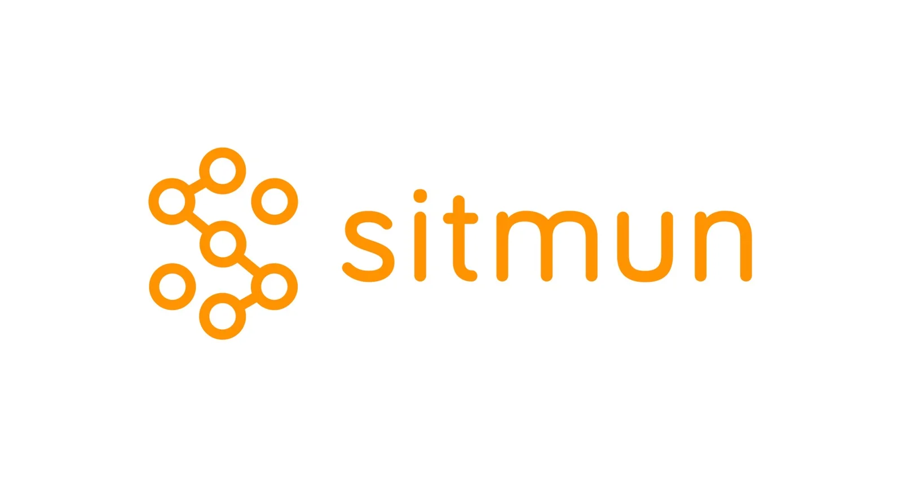

# SITMUN

La [Red SITMUN](https://sitmun.org), una red europea, tiene como objetivo, entre otros, el desarrollo y mantenimiento de la plataforma [SITMUN](https://github.com/sitmun).
Es una plataforma de código abierto, con licencia [EUPL v1.2](https://eur-lex.europa.eu/eli/dec_impl/2017/863/oj), que permite a las organizaciones supramunicipales participantes ofrecer a los municipios que coordinan las aplicaciones de gestión territorial que estos municipios necesitan para su día a día.
El despliegue, mantenimiento y actualización de estas aplicaciones está centralizado por la organización supramunicipal, de manera que los recursos de los municipios pueden focalizarse en prestar servicios a sus ciudadanos.

**SITMUN 3** es la generación actual de la plataforma, y su versión publicada es la [1.3.0](https://github.com/sitmun/sitmun/releases/tag/v1.3.0).

Esta web tiene como objetivo poner la documentación técnica de la plataforma **SITMUN 3** a disposición de quienes participen en su desarrollo, en su implantación o en el desarrollo de aplicaciones que la utilicen.

## Secciones de esta web

Por dónde empezar, según lo que se necesite:

- **[¿Qué es SITMUN?](que-es-sitmun/plataforma/index.md)**: qué es la plataforma **SITMUN 3**, qué funcionalidades ofrece,
  su [arquitectura](que-es-sitmun/plataforma/arquitectura/index.md), su [hoja de ruta](que-es-sitmun/plataforma/hoja-de-ruta/index.md),
  su [licencia](que-es-sitmun/plataforma/licencia.md) y los [órganos de gobierno de la Red SITMUN](que-es-sitmun/red-sitmun/contacto.md).
- **[Guías y manuales de usuario](usuario/instalacion/requisitos.md)**: cómo instalar **SITMUN 3** por primera vez
  y cómo configurar aplicaciones, capas y mapas de fondo desde el administrador.
- **[Manual de desarrollador](desarrollador/contribuir.md)**: cómo se organiza el desarrollo y cómo contribuir al proyecto.

!!! warning "Proyecto en desarrollo"

    SITMUN es un proyecto en continuo desarrollo y la documentación se actualiza para ir reflejando los cambios más
    importantes. Pueden existir algunas discrepancias entre la documentación y las últimas versiones del software.
    Las discrepancias que se detecten se pueden notificar en <https://github.com/sitmun/sitmun.github.io/issues/new>.
