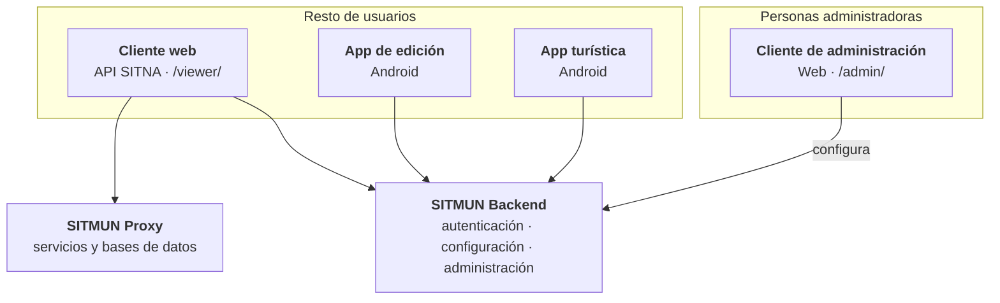

# Clientes de SITMUN 3

SITMUN 3 no tiene un único cliente. Ofrece **cuatro clientes** distintos, cada uno pensado para un público y una tarea:

- **El cliente de administración** es la herramienta principal de las personas que administran SITMUN en su entidad.
- **El resto de usuarios** trabajan con uno de los tres clientes restantes, según lo que necesiten: el **cliente web** para consultar mapas desde el navegador, la **app móvil de edición** para trabajo de campo y la **app turística** para difundir datos turísticos.

Los cuatro se configuran desde el cliente de administración y se conectan al mismo backend.

## Los cuatro clientes de un vistazo

El administrador define en el backend qué aplicaciones, capas, herramientas y usuarios existen. Cada cliente obtiene de ahí su configuración, y las peticiones a servicios y bases de datos protegidos pasan por el proxy.

## Qué cliente es para quién

| Cliente | Para quién | Para qué sirve | Plataforma | Dirección |
| --- | --- | --- | --- | --- |
| [Cliente de administración](administrador.md) | Administradores de SITMUN de cada entidad | Gestionar múltiples aplicaciones, accesos a datos y usuarios | Web | `/admin/` |
| [Cliente web (API SITNA)](visor-web.md) | Usuarios de SITMUN, con o sin identificación | Consultar y trabajar con mapas desde el navegador | Web | `/viewer/` |
| [App móvil de edición](app-edicion.md) | Personal de campo | Editar cartografía online y offline; multiusuario y multiproyecto | Android | — |
| [App turística](app-turistica.md) | Ciudadanía y visitantes | Consultar datos turísticos | Android | — |

## Qué se instala y qué se compila

| Cliente | Carpeta en [sitmun/sitmun](https://github.com/sitmun/sitmun) | Se publica con la instalación |
| --- | --- | --- |
| Cliente de administración | `sitmun-admin` | Sí |
| Cliente web | `sitmun-viewer` | Sí |
| App móvil de edición | `sitmun-mobile/sitmun-edition` | No: se compila desde su carpeta |
| App turística | `sitmun-mobile/sitmun-touristic` | No: se compila desde su carpeta |

Los dos clientes web se publican con la instalación (ver [Instalación](../../../usuario/instalacion/instalacion.md)). Las dos apps móviles se compilan desde su carpeta del repositorio (ver el README de cada una) y se conectan al backend de una instalación.

## Cómo se decide qué ve cada usuario

Qué aplicaciones aparecen en cada cliente depende del **tipo de aplicación** configurado en el administrador:

| Tipo de aplicación | Código | Cliente que la muestra |
| --- | --- | --- |
| Aplicación interna o externa | — | Cliente web |
| Edition application | `ED` | App móvil de edición |
| Aplicación turística | `T` | App turística |

Además, el acceso depende del usuario, su rol y el territorio, como en el resto de la plataforma. Ver [Arquitectura](../arquitectura/index.md).

## Páginas de esta sección

- [Cliente de administración](administrador.md)
- [Cliente web (API SITNA)](visor-web.md)
- [App móvil de edición](app-edicion.md)
- [App turística](app-turistica.md)
