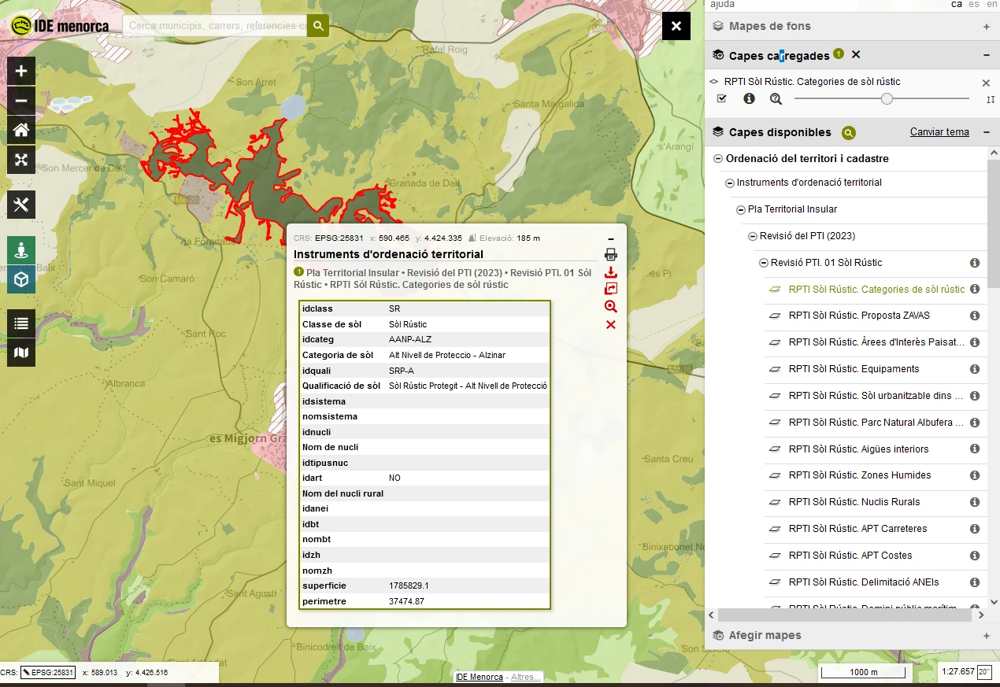
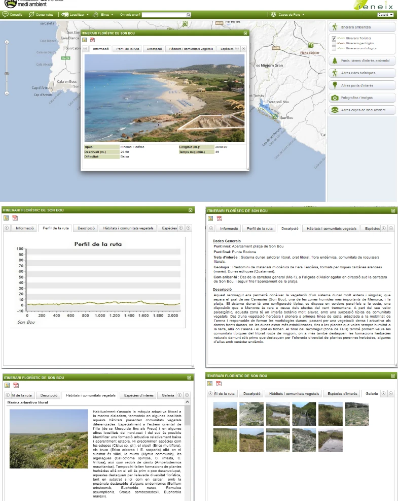
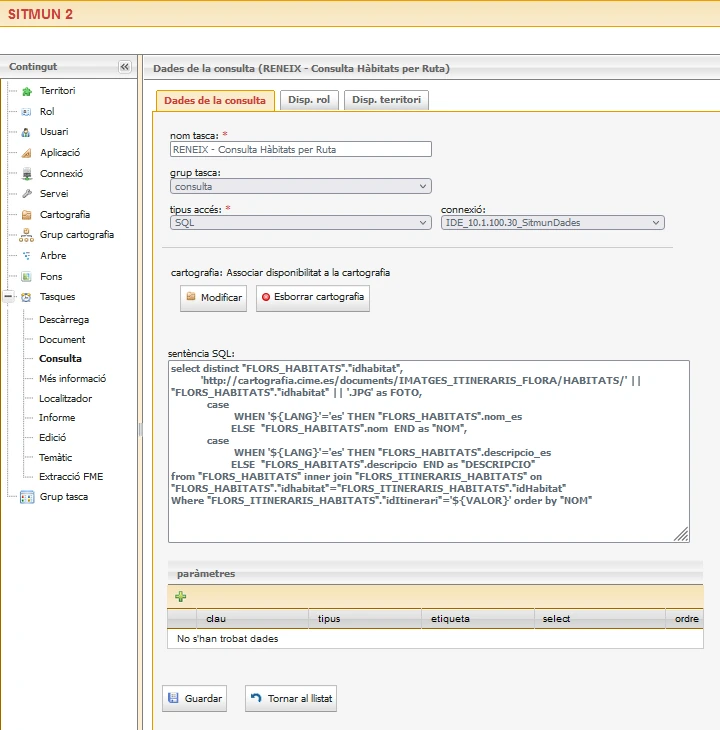
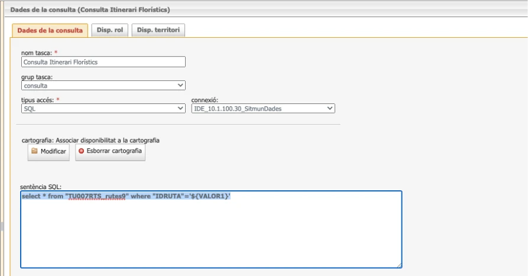
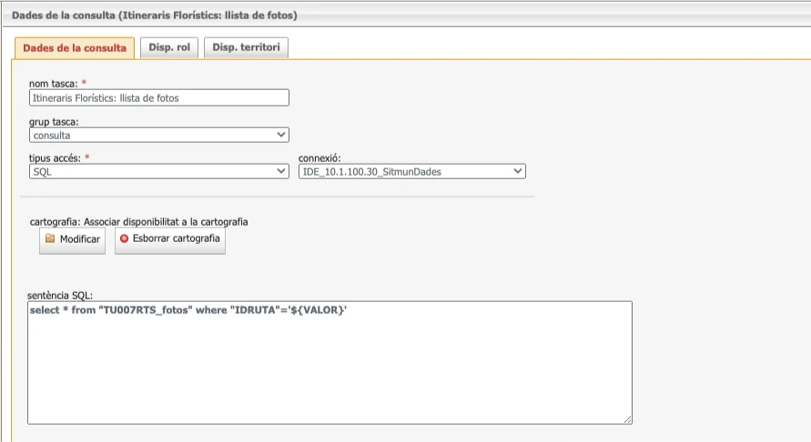
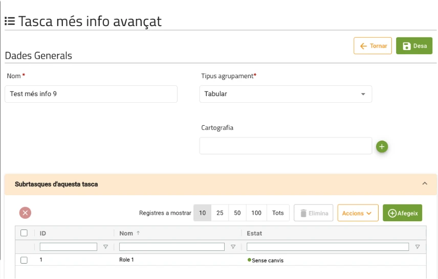
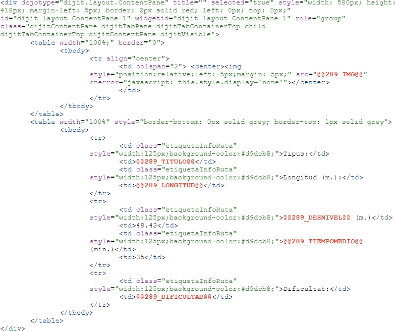

# Más info avanzado

!!! success "Estado (noviembre 2026): implementado"
    Disponible como tarea de **más información avanzada** en el administrador y en el visor. Ver [Tarea de más información avanzada](../../../../usuario/manual/administrador/tareas/mas-informacion-avanzada.md).
    El formato de cada resultado se define con [plantillas](../../../../usuario/manual/administrador/tareas/plantillas.md) (`{{campo}}`, `data-sitmun-each`) en lugar de los marcadores `@@CODIGOTAREA_NOMBRECAMPO@@` de esta propuesta.
    Las tablas de estado de más abajo reflejan la situación cuando se redactó la propuesta.

!!! info "Aspectos generales"

    **Estimación horas de desarrollo:** 200 horas

    **Entidad solicitante:** Comisión técnica SITMUN

    **Prioridad:** ALTA

    **Persona o entidad de referéncia o contacto:** Consell Insular de Menorca

## Objetivo

Esta funcionalidad busca dotar a SITMUN 3 de la capacidad de configurar, desde el administrador SITMUN 3,
el contenido de la ventana que devuelve el visor SITMUN 3 al realizar una consulta sobre el mapa para una capa determinada.

El contenido de la ventana debe poder integrar la respuesta de una o varias consultas definidas como tareas al propio administrador

## Contexto y casos de uso

El actual cliente SITMUN 3, al hacer clic en el área de mapa sobre un objeto de una capa determinada, presenta el resultado de la petición GetFeatureInfo sobre al servicio WMS correspondiente.

Con la funcionalidad 'Más info avanzado' se busca enriquecer esta ventana de respuesta con datos que provengan de otras peticiones a otros servicios o conexiones a base de datos.

Como ejemplo se puede observar el funcionamiento de SITMUN 2 en el caso del [visualizador de medio natural del Consell Insular de Menorca](https://ide.cime.es/sitmun/ambiental.jsp). En la ventana siguiente podemos observar el detalle de la ventana con distintas pestañas, cada una de ellas se corresponde con el resultado de una tarea de tipo consulta configurada en el administrador SITMUN 2.

Actual ventana de ejemplo de configuración de una tarea tipo consulta en SITMUn 2.

## Requerimientos funcionales

Se prevé la siguiente lógica funcional:

1. En el administrador SITMUN 3 se definirán primero las distintas tareas (que pueden ser de distintos tipos consultas a bases de datos, consultas a servicios, …) que formaran parte de la ventana de más info avanzado.

    Por ejemplo, en el caso del visor medioambiental anterior, se establecen varias consultas:

    - Una primera tarea que consiste en consulta que devuelve toda la información relativa a una ruta turística:
  
      

    - Una segunda consulta que devuelve todas las fotografías de una ruta en concreto:
  
      

2. Una vez definidas estas tareas, que llamaremos tareas hijas, se configurarà en el administrador SITMUN la tarea padre **más info avanzado** En la ventana de configuración de dicha tarea se podrá:

    - Establecer la relación con las distintas tareas hijas que forman parte del más info avanzado. Una tarea hija, a su vez, debe poder formar parte de varias tareas padre.
    - Establecer el tipo de más info avanzado, para establecer cómo se presentarán en la ventana las distintas tareas hijo (en tabs, en scroll…)

      

    - Establecer para cada tarea hija el código HTML con la configuración o formato de renderizado (para poder definir la tabla, o cómo se muestran las imágenes, o una galeria de fotos, etc.). A este código se añadirán marcas especiales con el nombre de los campos de la subconsulta que serán sustituidas en el cliente (API SITNA) por el valor de los mismos.
    Por ejemplo, a la tarea hija código 289 (primera imagen del visor de medio ambiente) le corresponde este layout, dónde los valores `@@CODIGOTAREA_NOMBRECAMPO@@` deben de ser sustituidos por el valor del campo correspondiente a la consulta 289.

        

    - Definir qué capa o capas tienen asociada esta funcionalidad.
    - Definir qué territorios y roles de usuario tienen asociada esta funcionalidad.

3. Configurada correctamente la tarea, la API de Configuración y Autorización_ deberá incorporar los valores necesarios para permitir al cliente SITMUN 3 - SITNA (1) detectar qué capas tienen un *más info avanzado* definido (para el rol y territorio que esté logeado). Así mismo, la API deberá retornar la información necesaria y suficiente para que el cliente (API SITNA u otros) puedan renderizar la información consultada de forma adecuada.

4. El Cliente SITMUN - API SITNA deberá configurar correctamente la ventana de info cuando se realice un clic sobre el mapa a un elemento de dicha capa, en caso de que la capa tenga asociada una tarea de esta índole.

    El cliente permitirá gestionar el comportamiento en caso de que el usuario haga clic a dos o más objetos sobre el mapa pertenecientes a la misma capa y/o a distintas capas, algunas de las cuales pueden tener una funcionalidad *más info avanzado* definida y otras no (con lo que presenta la ventana por defecto de respuesta GetFeatureInfo).

Se identifican los siguientes requerimientos funcionales a desarrollar para cada uno de los componentes de la arquitectura de SITMUN:

### Cliente Administrador

+-------------------------------------------------------------------------------------------------+---------------------------------------------+---------------------+
| Funcionalidad                                                                                   | [Commit messages](https://gitmoji.dev/)     | Issues relacionadas |
+=================================================================================================+=============================================+=====================+
| Posibilidad de configurar tareas SITMUN de consultas a base de datos                            | Existente no testeada                       |                     |
+-------------------------------------------------------------------------------------------------+---------------------------------------------+---------------------+
| Posibilidad de configurar tareas SITMUN de consulta a servicios web                             | Existente no testeada                       |                     |
+-------------------------------------------------------------------------------------------------+---------------------------------------------+---------------------+
| Creación de tipo de tareas padre que permitan seleccionar tareas hijo con una vinculación N a M | Nueva                                       |                     |
+-------------------------------------------------------------------------------------------------+---------------------------------------------+---------------------+
| Asignación de parámetros específicos a tareas padre Tab scroll                                  | Nueva                                       |                     |
+-------------------------------------------------------------------------------------------------+---------------------------------------------+---------------------+
| Asignación de una respuesta avanzada a una capa existente                                       | Nueva                                       |                     |
+-------------------------------------------------------------------------------------------------+---------------------------------------------+---------------------+

### Cliente visualizador (API SITNA)

+-------------------------------------------------------------------------------------------------+-------------------------+---------------------+
| Funcionalidad                                                                                   | Estado                  | Issues relacionadas |
+=================================================================================================+=========================+=====================+
| Parsear json de la API de Configuración y representar los datos                                   | Existente no testeada   |                     |
+-------------------------------------------------------------------------------------------------+-------------------------+---------------------+
| Gestionar y renderizar la configuración de la respuesta avanzada para una capa concreta         | Nueva                   |                     |
+-------------------------------------------------------------------------------------------------+-------------------------+---------------------+

### API de Autenticación {#roadmap-mas-info-api-de-autenticacion}

No se prevén modificaciones dea este componente durante el desarrollo de esta funcionalidad.

### API de Administración {#roadmap-mas-info-api-de-administracion}

+-------------------------------------------------------------------------------------------------+-------------------------+---------------------+
| Funcionalidad                                                                                   | Estado                  | Issues relacionadas |
+=================================================================================================+=========================+=====================+
| Posibilidad de configurar tareas SITMUN de consultas a base de datos                            | Existente no testeada   |                     |
+-------------------------------------------------------------------------------------------------+-------------------------+---------------------+
| Posibilidad de configurar tareas SITMUN de consulta a servicios web                             | Existente no testeada   |                     |
+-------------------------------------------------------------------------------------------------+-------------------------+---------------------+

### API de Configuración y Autorización {#roadmap-mas-info-api-de-configuracion-y-autorizacion}

No se prevén modificaciones dea este componente durante el desarrollo de esta funcionalidad.

### API de Proxy {#roadmap-mas-info-api-de-proxy}

No se prevén modificaciones dea este componente durante el desarrollo de esta funcionalidad.

### Esquema de base de datos

No se prevén modificaciones dea este componente durante el desarrollo de esta funcionalidad.
