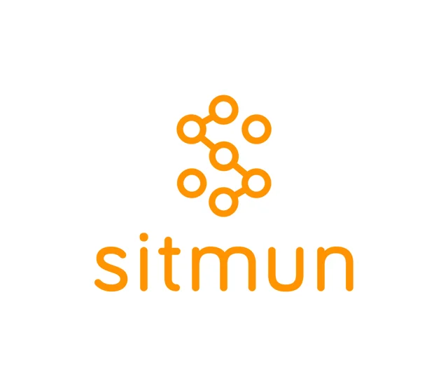
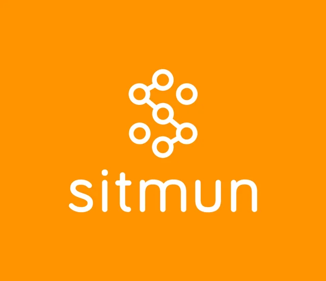
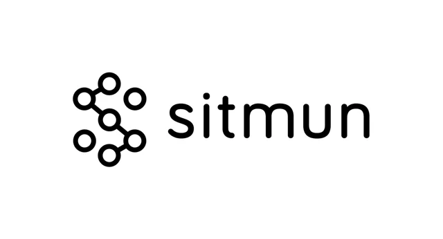
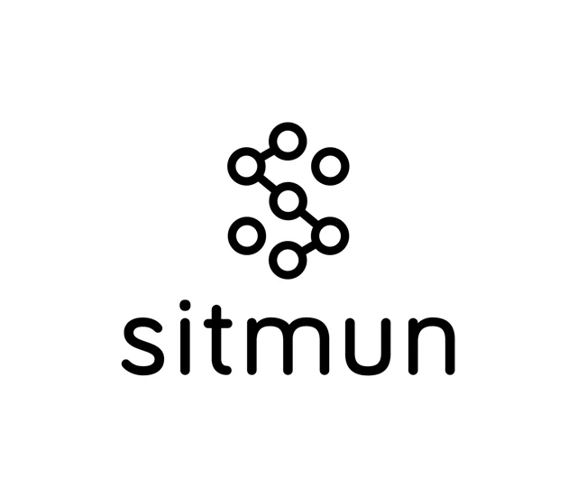
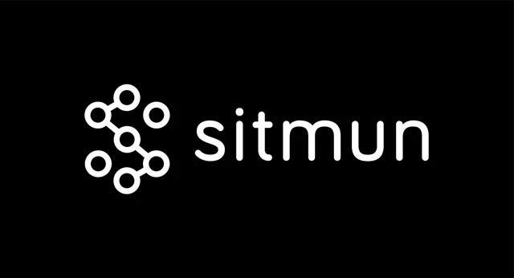
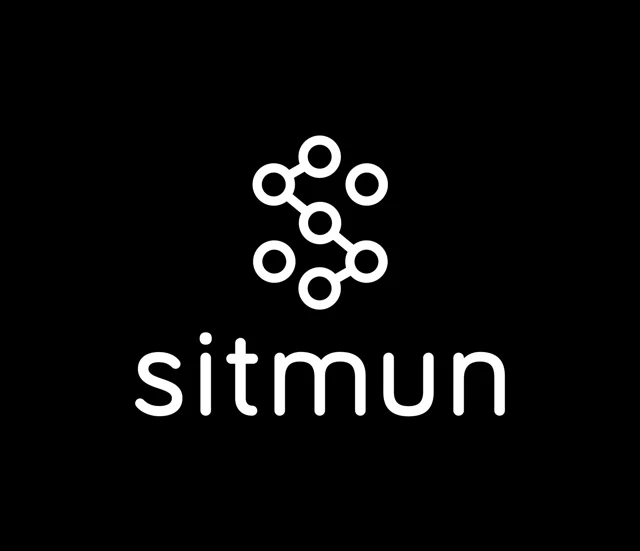
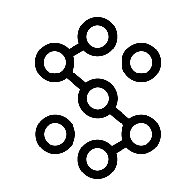
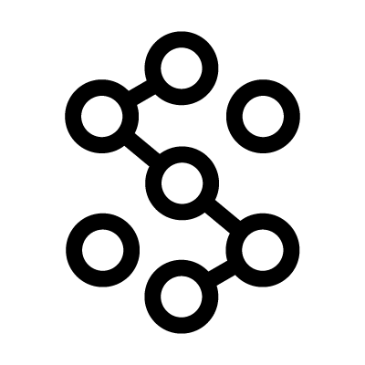

# Identidad corporativa

La identidad corporativa de SITMUN se define en el
[manual de identidad corporativa](identidad/manual-identidad-corporativa.pdf) (PDF, 7 MB, en catalán).
En esta página están el logotipo y el isotipo en sus distintas versiones, listos para descargar.

## Color y tipografías

- **Color corporativo**: naranja PANTONE 1375 C, CMYK 0, 51, 100, 0, RGB 255, 147, 0 (`#FF9300`).
- **Tipografías**: Bariol, la del logotipo, y Source Sans Pro, tipografía abierta y de libre acceso, para los textos.

Las normas de uso (área de protección, tamaños mínimos, fondos y usos incorrectos) están en el manual.

## Logotipo

Versiones en JPG a alta resolución (8713 × 4705 píxeles la horizontal y 6834 × 5884 la vertical).
Cada imagen enlaza con el archivo original.

| Versión | Horizontal | Vertical |
| --- | --- | --- |
| Principal | [{ width="300" .marca }](identidad/logotipo/01.principal-horit-normal.jpg) | [{ width="220" .marca }](identidad/logotipo/01.principal-vert-normal.jpg) |
| Principal en negativo | [{ width="300" .marca }](identidad/logotipo/02.principal-horit-negatiu.jpg) | [{ width="220" .marca }](identidad/logotipo/02.principal-vert-negatiu.jpg) |
| Negro | [{ width="300" .marca }](identidad/logotipo/03.negre-horit.jpg) | [{ width="220" .marca }](identidad/logotipo/03.negre-vert.jpg) |
| Negro en negativo | [{ width="300" .marca }](identidad/logotipo/04.negre-horit-negatiu.jpg) | [{ width="220" .marca }](identidad/logotipo/04.negre-vert-negatiu.jpg) |

## Isotipo

Versiones en PNG en tres tamaños. Las versiones transparentes no tienen fondo.

| Versión | Vista | PNG (píxeles) |
| --- | --- | --- |
| Principal | { width="64" .marca } | [28](identidad/isotipo/01.principal-normal-28x28.png) · [400](identidad/isotipo/01.principal-normal-400x400.png) · [800](identidad/isotipo/01.principal-normal-800x800.png) |
| Principal transparente | { width="64" .marca } | [28](identidad/isotipo/02.principal-transparent-28x28.png) · [400](identidad/isotipo/02.principal-transparent-400x400.png) · [800](identidad/isotipo/02.principal-transparent-800x800.png) |
| Principal en negativo | { width="64" .marca } | [28](identidad/isotipo/03.principal-negatiu-28x28.png) · [400](identidad/isotipo/03.principal-negatiu-400x400.png) · [800](identidad/isotipo/03.principal-negatiu-800x800.png) |
| Principal en círculo | { width="64" .marca } | [28](identidad/isotipo/04.principal-cercle-28x28.png) · [400](identidad/isotipo/04.principal-cercle-400x400.png) · [800](identidad/isotipo/04.principal-cercle-800x800.png) |
| Negro | { width="64" .marca } | [28](identidad/isotipo/05.negre-28x28.png) · [400](identidad/isotipo/05.negre-400x400.png) · [800](identidad/isotipo/05.negre-800x800.png) |
| Negro transparente | { width="64" .marca } | [28](identidad/isotipo/06.negre-transparent-28x28.png) · [400](identidad/isotipo/06.negre-transparent-400x400.png) · [800](identidad/isotipo/06.negre-transparent-800x800.png) |
| Negro en negativo | { width="64" .marca } | [28](identidad/isotipo/07.negre-negatiu-28x28.png) · [400](identidad/isotipo/07.negre-negatiu-400x400.png) · [800](identidad/isotipo/07.negre-negatiu-800x800.png) |
| Negro en círculo | { width="64" .marca } | [28](identidad/isotipo/08.negre-cercle-28x28.png) · [400](identidad/isotipo/08.negre-cercle-400x400.png) · [800](identidad/isotipo/08.negre-cercle-800x800.png) |
