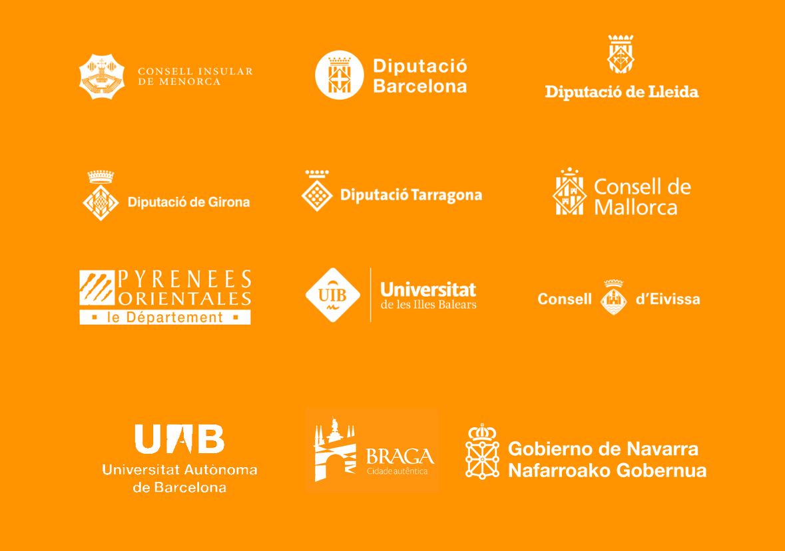

# La red SITMUN

La red SITMUN es un espacio de colaboración y trabajo conjunto entre entidades del sector público local y universidades, que comparten conocimientos, experiencias y recursos en el ámbito de los sistemas de información geográfica (SIG) y la gestión de los datos geográficos.

En el marco de esta red nace el proyecto de desarrollo de la plataforma SITMUN, concebida como una herramienta tecnológica compartida para dar respuesta a las necesidades de las administraciones locales en materia de creación, gestión, consulta, análisis y difusión de datos geográficos. Su desarrollo se basa en la colaboración y el conocimiento compartido entre las entidades participantes, con el objetivo de ofrecer una solución adaptada a la realidad y a los retos de la gestión territorial del ámbito local.

🔗 Más información: [sitmun.org](https://sitmun.org)
