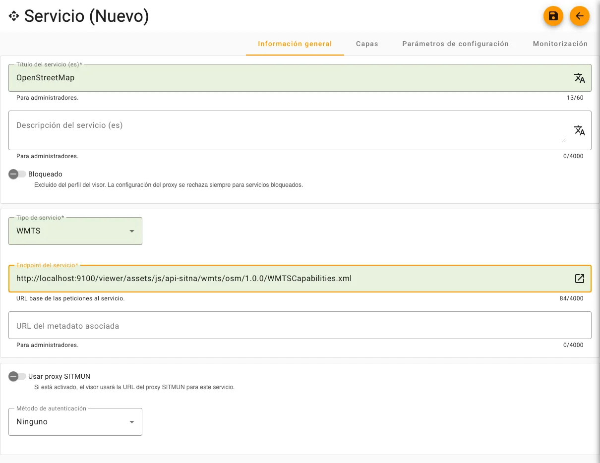
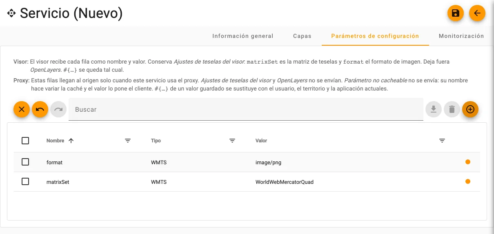
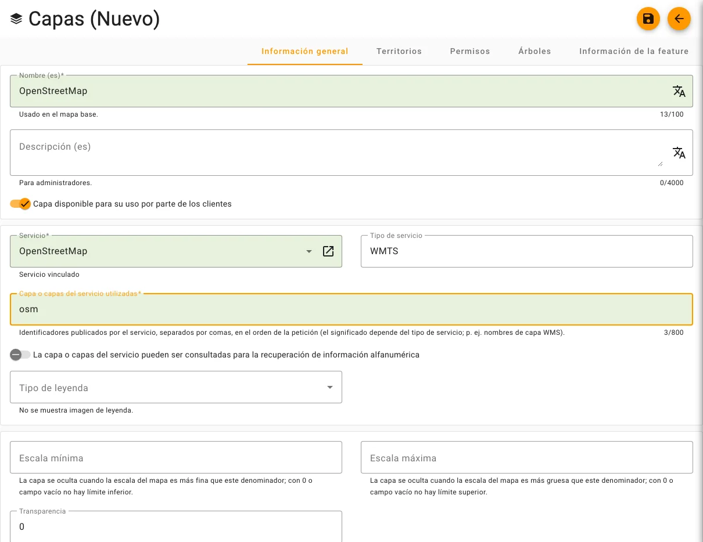
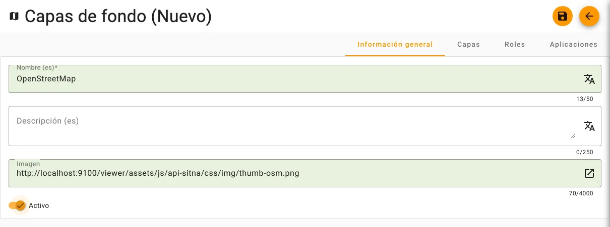
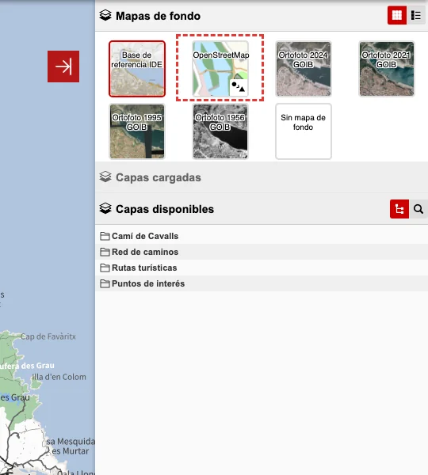
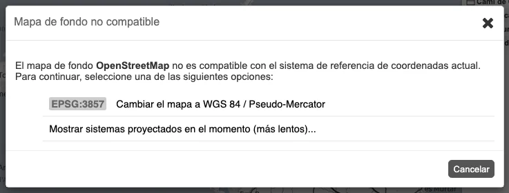

# Añadir OpenStreetMap como mapa de fondo

Esta guía explica cómo ofrecer el mapa de [OpenStreetMap](https://www.openstreetmap.org) (OSM) como mapa de fondo en una aplicación de SITMUN. Todo se hace desde el administrador. No hace falta instalar nada ni cambiar código.

Al terminar, los usuarios del visor verán **OpenStreetMap** en la lista de mapas de fondo de la aplicación.

!!! info "Cambio de sistema de referencia"
    Los mapas de OpenStreetMap solo existen en el sistema de referencia **EPSG:3857** (Web Mercator). Si la aplicación usa otro (por ejemplo, EPSG:25831), al elegir OpenStreetMap el visor muestra el aviso *Mapa de fondo no compatible* y propone cambiar el sistema de referencia del mapa. El usuario elige **EPSG:3857** y el mapa se muestra. El mapa sigue en EPSG:3857 al volver a otro mapa de fondo, si ese mapa de fondo admite EPSG:3857.

??? info "Cómo funciona (detalle técnico)"
    SITMUN admite servicios WMS, WMTS y WFS. OpenStreetMap publica su mapa en otro formato (teselas XYZ), que SITMUN no admite directamente.

    El visor de SITMUN incluye un archivo que describe el mapa de OpenStreetMap como si fuera un servicio WMTS. Basta con dar de alta un servicio WMTS que apunte a ese archivo. Las teselas del mapa se descargan de los servidores de OpenStreetMap.

## Antes de empezar

!!! tip "Practica esta guía sin instalar nada"
    Abre en GitHub Codespaces la instalación de demostración de SITMUN 1.3.0 preparada para esta guía: sin su mapa de fondo «OpenStreetMap», como en las capturas, que se hicieron en la aplicación «Camí de Cavalls». Necesitas una cuenta de GitHub; el arranque tarda unos minutos y el codespace consume horas de tu cuota de Codespaces mientras está encendido.

    [Abrir en GitHub Codespaces](https://codespaces.new/sitmun/sitmun.github.io?quickstart=1&devcontainer_path=.devcontainer%2Fosm%2Fdevcontainer.json){ .md-button .md-button--primary }

!!! note "En la instalación de demostración"
    La instalación de demostración ya trae un mapa de fondo «OpenStreetMap» en sus aplicaciones. Si sigues esta guía en una
    instalación propia de demostración, quita antes ese mapa de fondo de la aplicación (menú **Aplicación**, pestaña
    **Mapas de fondo**) para no ver dos con el mismo nombre. El botón anterior ya lo hace.

Necesitas:

- Acceso al administrador de SITMUN con un usuario administrador.
- La dirección web del visor de tu instalación. Por ejemplo, `https://ejemplo.org/sitmun/viewer`.
- Saber en qué aplicaciones quieres el mapa, para qué territorios y para qué roles.

Comprueba que el archivo de OpenStreetMap está disponible. Abre en el navegador esta dirección, sustituyendo el principio por la dirección de tu visor:

```text
https://ejemplo.org/sitmun/viewer/assets/js/api-sitna/wmts/osm/1.0.0/WMTSCapabilities.xml
```

Debe mostrarse un documento XML que empieza por `<Capabilities`. Esta dirección es el **Endpoint del servicio** que usarás en el paso 1.

!!! example "Instalación local con Docker"
    En una instalación local la dirección es
    `http://localhost:9000/viewer/assets/js/api-sitna/wmts/osm/1.0.0/WMTSCapabilities.xml`.

## Paso 1. Crear el servicio

1. En el menú, abre **Servicio** y crea uno nuevo.
2. Rellena los datos principales:

    | Campo | Valor |
    | --- | --- |
    | **Título del servicio** | `OpenStreetMap` (solo lo ven los administradores) |
    | **Tipo de servicio** | `WMTS` |
    | **Endpoint del servicio** | La dirección del archivo que has comprobado antes |
    | **Usar proxy SITMUN** | Desactivado |
    | **Método de autenticación** | Ninguno |

    { loading=lazy }

3. En **Parámetros de configuración**, añade estos dos parámetros con el botón de añadir. En los dos, el **Tipo** es *WMTS*:

    | Nombre | Tipo | Valor |
    | --- | --- | --- |
    | `matrixSet` | WMTS | `WorldWebMercatorQuad` |
    | `format` | WMTS | `image/png` |

    { loading=lazy }

4. Guarda el servicio.

!!! warning "Escribe los nombres exactamente así"
    `matrixSet` distingue mayúsculas y minúsculas, igual que el nombre de la capa `osm` del paso 2. Si falta o está mal escrito,
    no se abre el mapa de ninguna de las aplicaciones que tengan este mapa de fondo: el visor muestra «Creando mapa...» y, a los 30 segundos, «Error al inicializar el mapa»
    ([sitmun/sitmun#380](https://github.com/sitmun/sitmun/issues/380)). Comprueba el mapa en el visor justo después de configurarlo.

## Paso 2. Crear la capa

1. En el menú, abre **Capas** y crea una nueva.
2. Rellena los datos:

    | Campo | Valor |
    | --- | --- |
    | **Nombre** | `OpenStreetMap` |
    | **Capa disponible para su uso por parte de los clientes** | Activado |
    | **Servicio** (*Selecciona un servicio*) | El servicio creado en el paso 1 |
    | **Capa o capas del servicio utilizadas** | `osm` |

    { loading=lazy }

3. En la pestaña **Territorios**, añade los territorios donde debe estar disponible el mapa.
4. Guarda la capa.

!!! tip "El nombre de la capa es el que ven los usuarios"
    En la lista de mapas de fondo del visor aparece el **nombre de la capa**, no el del mapa de fondo. Elige un nombre claro para los usuarios, por ejemplo `OpenStreetMap`.

## Paso 3. Crear el mapa de fondo

1. En el menú, abre **Capas de fondo** y crea una nueva.
2. Rellena los datos:

    | Campo | Valor |
    | --- | --- |
    | **Nombre** | `OpenStreetMap` |
    | **Descripción** | Opcional |
    | **Imagen** | Miniatura que verán los usuarios. El visor incluye una: `<dirección del visor>/assets/js/api-sitna/css/img/thumb-osm.png` |
    | **Activo** | Activado |

    { loading=lazy }

3. En la pestaña **Capas**, añade la capa creada en el paso 2.
4. En la pestaña **Roles**, añade los roles que deben ver el mapa. Si la aplicación es pública, incluye también el rol que tenga asignado el usuario `public` (ver [Paso 1](primer-proyecto/paso-1-territorio-rol-usuario.md)).
5. En la pestaña **Aplicaciones**, añade las aplicaciones donde debe aparecer el mapa.
6. Guarda.

El orden de los mapas de fondo de cada aplicación se cambia en la propia aplicación: menú **Aplicación**, pestaña **Mapas de fondo**.

!!! warning "OpenStreetMap no puede ser el primer mapa de fondo"
    El visor abre el mapa con el primer mapa de fondo. Si la aplicación no usa EPSG:3857 y OpenStreetMap queda el primero, aparece
    «Error al inicializar el mapa». Al añadirlo desde la pestaña **Aplicaciones** recibe el orden 0, el mismo que el primer mapa de fondo, así que
    revisa el orden (en esa pestaña o en **Aplicación** → **Mapas de fondo**) y deja primero un mapa de fondo de la aplicación.

## Paso 4. Comprobarlo en el visor

1. Abre la aplicación en el visor. Si ya estaba abierta, recárgala.
2. Abre el panel de capas y despliega **Mapas de fondo**. Debe aparecer **OpenStreetMap** con su miniatura.

    { loading=lazy }

3. Haz clic en **OpenStreetMap**. Si la aplicación no usa EPSG:3857, aparece el aviso *Mapa de fondo no compatible*: elige **EPSG:3857**.

    { loading=lazy }

4. Acerca el mapa hasta nivel de calle para comprobar que se ve con detalle.
5. Vuelve a un mapa de fondo de la aplicación. Si ese mapa de fondo admite EPSG:3857, el mapa se queda en EPSG:3857; si no, el visor vuelve a mostrar el aviso para cambiar de sistema de referencia.

## Si no se ve

| Qué pasa | Qué revisar |
| --- | --- |
| OpenStreetMap no aparece en la lista de mapas de fondo | El mapa de fondo está **Activo** y tiene la aplicación (paso 3). La capa está marcada como disponible y tiene el **territorio** (paso 2). El mapa de fondo tiene el **rol** del usuario (paso 3). |
| El mapa no se abre: «Creando mapa...» y, a los 30 segundos, «Error al inicializar el mapa» | El parámetro `matrixSet` del servicio (paso 1). El campo **Capa o capas del servicio utilizadas** de la capa es `osm`, en minúsculas (paso 2). OpenStreetMap no es el primer mapa de fondo de la aplicación (paso 3). |
| Aparece con otro nombre | El nombre que se muestra es el de la **capa** (paso 2). |
| Aparece sin miniatura | La dirección del campo **Imagen** del mapa de fondo (paso 3). |
| El **Endpoint del servicio** no abre el archivo XML | La dirección del visor. Prueba primero la dirección del visor sola. |

## Condiciones de uso de OpenStreetMap

Las teselas se descargan de los servidores de la Fundación OpenStreetMap. Su uso está sujeto a la [política de uso de teselas](https://operations.osmfoundation.org/policies/tiles/):

- El mapa debe citar a OpenStreetMap: *© colaboradores de OpenStreetMap*.
- El servicio es gratuito y no tiene garantía de disponibilidad.
- No se permiten descargas masivas de teselas. No uses este mapa de fondo con herramientas de mapas sin conexión.
