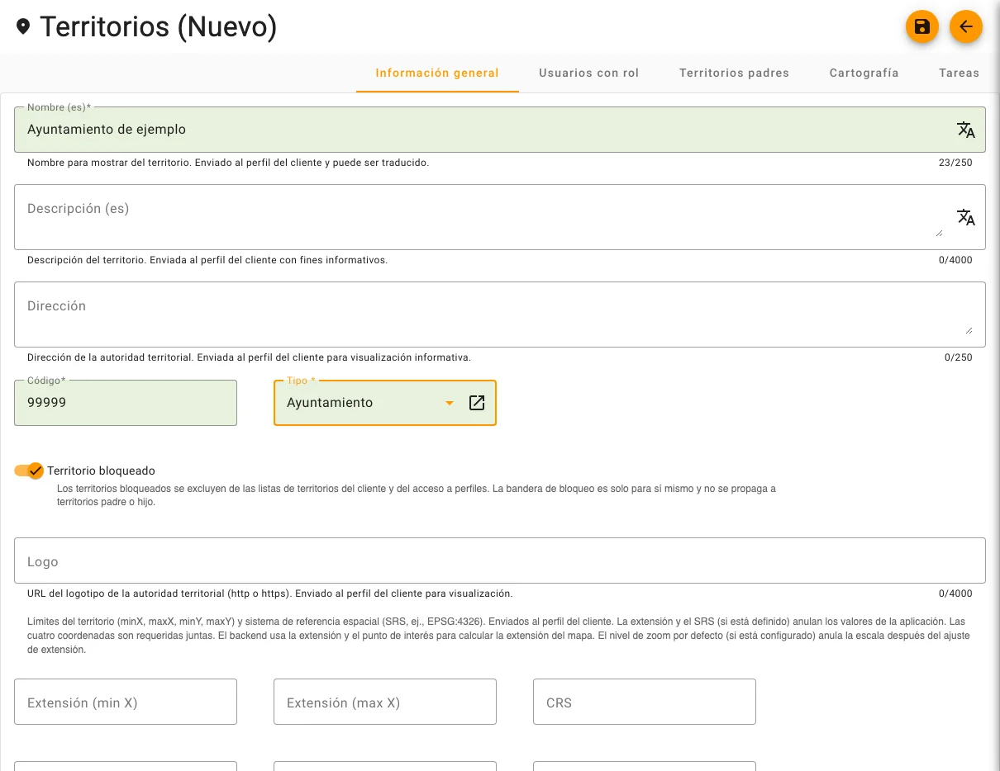
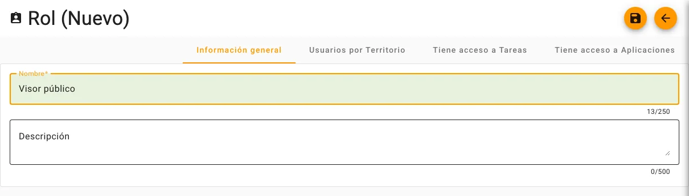
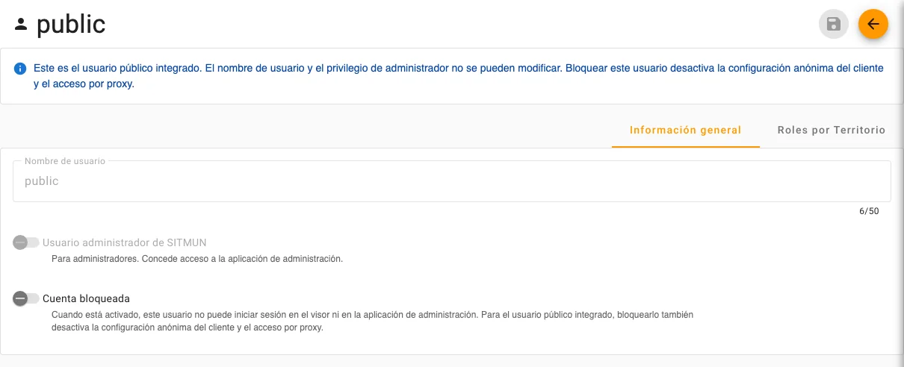

# Paso 1: territorio, rol y usuario público

Este paso va primero porque casi todo lo demás (capas, mapas de fondo, árboles, tareas) se enlaza a un rol y a un territorio. El usuario `public` ya existe: solo tienes que crear el territorio y el rol y asignárselos.

**1.1 Territorio** (menú **Territorios** → **Nuevo**)

- **Nombre**, **Código** y **Tipo** son obligatorios. Los tipos (Ayuntamiento, Diputación, Comarca…) ya existen; si falta alguno, lo creas en **Sistema** → **Tipos de territorio**.
- Desactiva **Territorio bloqueado**. Un territorio nuevo aparece bloqueado por defecto. En SITMUN 1.3.0 la opción todavía no tiene efecto ([sitmun/sitmun#376](https://github.com/sitmun/sitmun/issues/376)), pero desactivarla deja el territorio bien configurado.
- Rellena la **Extensión** (min X, max X, min Y, max Y; las cuatro juntas), el **CRS** (por ejemplo `EPSG:25831`) y, si quieres, el **Punto central** y el **Nivel de Zoom por defecto**. Sin extensión, el visor no abre el mapa. El CRS del territorio manda sobre el de la aplicación.

{ loading=lazy }

**1.2 Rol** (menú **Rol** → **Nuevo**)

- Solo hace falta el **Nombre**. Elígelo pensando en quién lo usará, por ejemplo «Rol público Ciutadella».

{ loading=lazy }

**1.3 Usuario público** (menú **Usuario**)

- Abre el usuario `public` (ya existe, no tienes que crearlo), ve a la pestaña **Roles por Territorio**, pulsa **Añadir** y elige el rol del paso 1.2 y tu territorio.
- La columna **Rol territorial** permite que el rol valga también para los territorios hijos (por ejemplo, los municipios de una isla). Si la activas, la aplicación decide dónde vale ([paso 7](paso-7-aplicacion.md)): **Garantizar acceso al territorio de la asignación** para tu territorio y **Garantizar acceso a territorios hijo** para sus territorios hijos. Si la aplicación no tiene ninguna de las dos, no aparece. Déjala desactivada si no lo necesitas. Además, añade cada territorio hijo a la pestaña **Territorios** de las capas (también las de los mapas de fondo) y de las tareas; si no, la aplicación aparece en el territorio hijo pero su mapa no se abre («No hay capas definidas como base»).

{ loading=lazy }

Cada fila de **Roles por Territorio** es una llave: dice «esta persona, en este territorio, tiene este rol».
