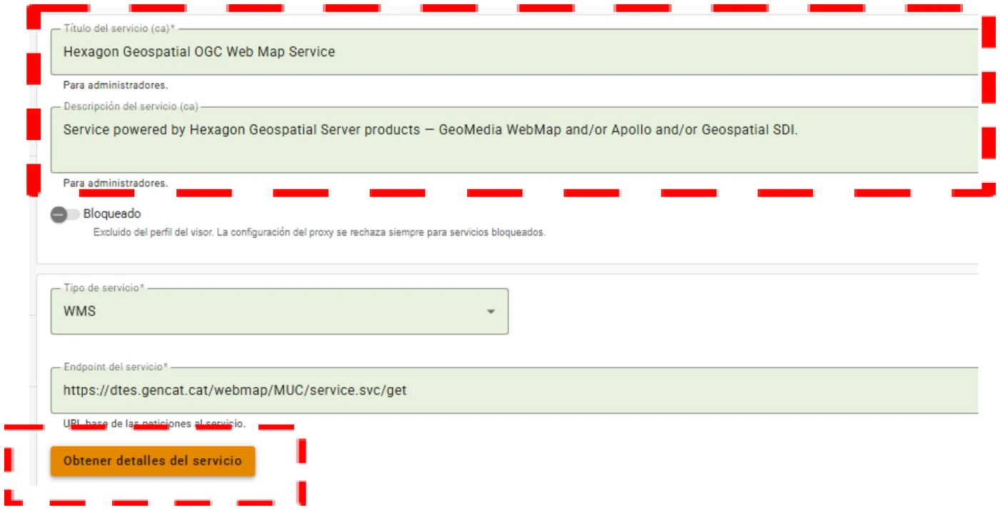

# Paso 2: dar de alta los servicios

Un servicio es la dirección de un servidor de mapas. Crea uno por cada servidor: uno para las capas de trabajo y otro para el mapa de fondo, si vienen de sitios distintos.

(menú **Servicio** → **Nuevo**)

1. **Título del servicio**: un nombre que reconozcas. El usuario del visor no lo ve.
2. **Tipo de servicio**: WMS, WMTS o WFS.
3. **Endpoint del servicio**: la URL base, sin parámetros (sin `?SERVICE=WMS&REQUEST=...`). Algunos servidores necesitan una barra `/` al final.
4. Si es WMS o WFS, pulsa **Obtener detalles del servicio**. El administrador pide al servidor su descripción (GetCapabilities) y rellena datos como la descripción y los metadatos. Si falla, la URL no es correcta o el servidor no responde. El administrador avisa antes con el mensaje «Peligro»: al aceptar, el **Título del servicio**, la descripción y los **CRS soportados** se sustituyen por los del servidor. Cambia el título después si lo prefieres. El servicio todavía no está guardado: falta pulsar **Guarda** (punto 6).
5. **Método de autenticación**: deja **Ninguno** si el servicio es público. Si pide usuario y contraseña, elige **Autenticación HTTP básica** y rellénalos. La opción **Usar proxy SITMUN** se activa sola, porque el visor tiene que pasar por SITMUN Proxy Middleware, el servidor intermediario de SITMUN, para no exponer la contraseña.
6. Pulsa **Guarda**.

{ loading=lazy }

**Si el mapa de fondo es WMTS**, ve a la pestaña **Parámetros de configuración** y añade `matrixSet` y, si quieres fijar el formato de imagen, `format` (por ejemplo `image/png`). Un servicio WMTS no tiene el botón **Obtener detalles del servicio**, así que tienes que buscar los valores en su descripción. Para verla, abre en el navegador la URL del servicio con `?SERVICE=WMTS&REQUEST=GetCapabilities`. En `matrixSet` pon uno de sus `TileMatrixSet` que use el sistema de referencia de la aplicación (por ejemplo `EPSG:25831` o `EPSG:3857`). Anota también el `ows:Identifier` de cada capa: es su nombre técnico, que necesitarás en el [paso 3](paso-3-capas.md) (opción B). Sin `matrixSet` no se abre el mapa de la aplicación ([sitmun/sitmun#380](https://github.com/sitmun/sitmun/issues/380)).

La pestaña **Monitorización** tiene un botón **Probar acceso** para comprobar que el servidor responde.
