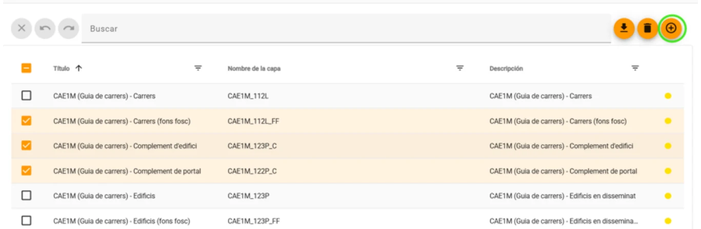

# Paso 3: crear las capas

Hay dos maneras de crear capas. La primera es la más rápida cuando el servicio es WMS.

**Opción A: desde el servicio (WMS)**

1. Abre el servicio del [paso 2](paso-2-servicios.md) y ve a la pestaña **Capas**.
2. Pulsa **Actualizar capas del servicio** (en un servicio que aún no has guardado, **Obtener capas del servicio**). El administrador avisa antes con el mensaje «Peligro», el mismo del [paso 2](paso-2-servicios.md); acéptalo. Aparece la lista de capas que ofrece el servidor, cada una con un punto de color que indica su estado.
3. Selecciona las que quieras, pulsa **Registrar** (su punto pasa a naranja, «Pendiente registrar») y después **Guarda**. Se crea una capa de SITMUN por cada una, ya disponible para los clientes. La consulta de información (GetFeatureInfo) queda desactivada: si quieres que una capa se pueda consultar, ábrela en el menú **Capas** y activa la opción de consulta («La capa o capas del servicio pueden ser consultadas…»).

    { loading=lazy }

!!! warning "SITMUN 1.3.0: «Pendiente crear» en un servicio nuevo"
    En un servicio que aún no has guardado, las capas obtenidas aparecen por error como «Pendiente crear»
    en lugar de «Capa no registrada» ([sitmun/sitmun#371](https://github.com/sitmun/sitmun/issues/371)).
    Al guardar solo se crean las que registras con **Registrar**.

!!! warning "SITMUN 1.3.0: capas WMS con varios estilos"
    Si una capa del servidor ofrece más de un estilo, al guardar aparece un error por cada estilo de más
    («Múltiples Errores» si hay más de uno; [sitmun/sitmun#384](https://github.com/sitmun/sitmun/issues/384)). Las capas se crean igualmente,
    pero cada una guarda un solo estilo y los demás se pierden. La capa se puede usar con ese estilo.

**Opción B: a mano** (menú **Capas** → **Nuevo**)

- **Nombre**: el que verá el usuario si la capa no está en un árbol (por ejemplo, en el selector de mapas de fondo).
- **Servicio**: el del [paso 2](paso-2-servicios.md).
- **Capa o capas del servicio utilizadas**: el nombre técnico de la capa en el servidor. Si pones más de una, separadas por comas, se dibujan juntas como una sola capa.
- Opcional: **Escala mínima** y **Escala máxima**, **Transparencia** (0 = opaca), si se puede consultar (GetFeatureInfo) y el **Orden** de dibujo.

**Dos comprobaciones obligatorias para cada capa:**

- [ ] La opción **Capa disponible para su uso por parte de los clientes** está activada. En una capa creada a mano aparece desactivada, y entonces el visor no la recibe.
- [ ] En la pestaña **Territorios** está el territorio del [paso 1](paso-1-territorio-rol-usuario.md). Sin esto la capa no se muestra en ese territorio.

Esto vale también para las capas que usarás como mapa de fondo en el [paso 4](paso-4-grupos-y-fondos.md).
