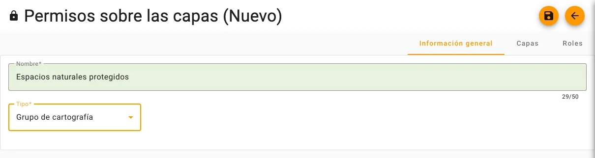
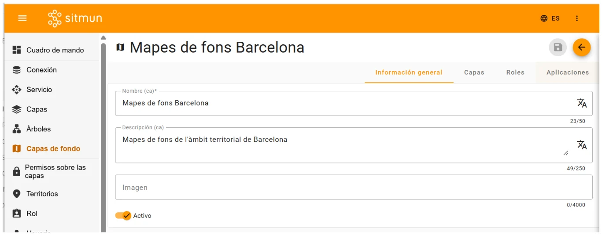

# Paso 4: grupos de permisos y mapas de fondo

Un grupo de permisos es la manera de dar capas a un rol. Sin grupo, ningún rol tiene acceso a las capas del [paso 3](paso-3-capas.md).

**4.1 Grupo de permisos para las capas de trabajo** (menú **Permisos sobre las capas** → **Nuevo**)

1. **Nombre**, y **Tipo** = **Grupo de cartografía**.
2. Pestaña **Capas**: añade las capas de trabajo.
3. Pestaña **Roles**: añade el rol del [paso 1](paso-1-territorio-rol-usuario.md).
4. **Guarda**.

{ loading=lazy }

Otros tipos de grupo: **Mapa de situación** (el mapa pequeño de referencia en la esquina, que se elige en la aplicación) e **Informe**.

**4.2 Mapa de fondo** (menú **Capas de fondo** → **Nuevo**)

1. **Nombre** y, si quieres, una **Imagen** de miniatura (una URL).
2. Activa **Activo**. Un mapa de fondo nuevo aparece inactivo y el visor no lo muestra.
3. Pestaña **Capas**: añade la capa o capas que forman el mapa de fondo.
4. Pestaña **Roles**: añade el rol del [paso 1](paso-1-territorio-rol-usuario.md).
5. **Guarda**. El administrador crea automáticamente un grupo de tipo **Mapa de fondo** con el mismo nombre; no hace falta crearlo a mano.

{ loading=lazy }

!!! tip "El nombre que ve el usuario es el de la capa"
    En el selector de mapas de fondo del visor aparece el **nombre de la capa** del [paso 3](paso-3-capas.md), no el del mapa de fondo.
    Pon a esa capa un nombre claro para los usuarios.

Recuerda: las capas que forman el mapa de fondo también tienen que tener el territorio en su pestaña **Territorios** ([paso 3](paso-3-capas.md)). Crea tantos mapas de fondo como quieras ofrecer (por ejemplo, ortofoto y topográfico).

!!! example "Extra: OpenStreetMap como mapa de fondo"
    Si quieres ofrecer el mapa de OpenStreetMap, sigue la guía [Añadir OpenStreetMap como mapa de fondo](../mapa-fondo-openstreetmap.md).
