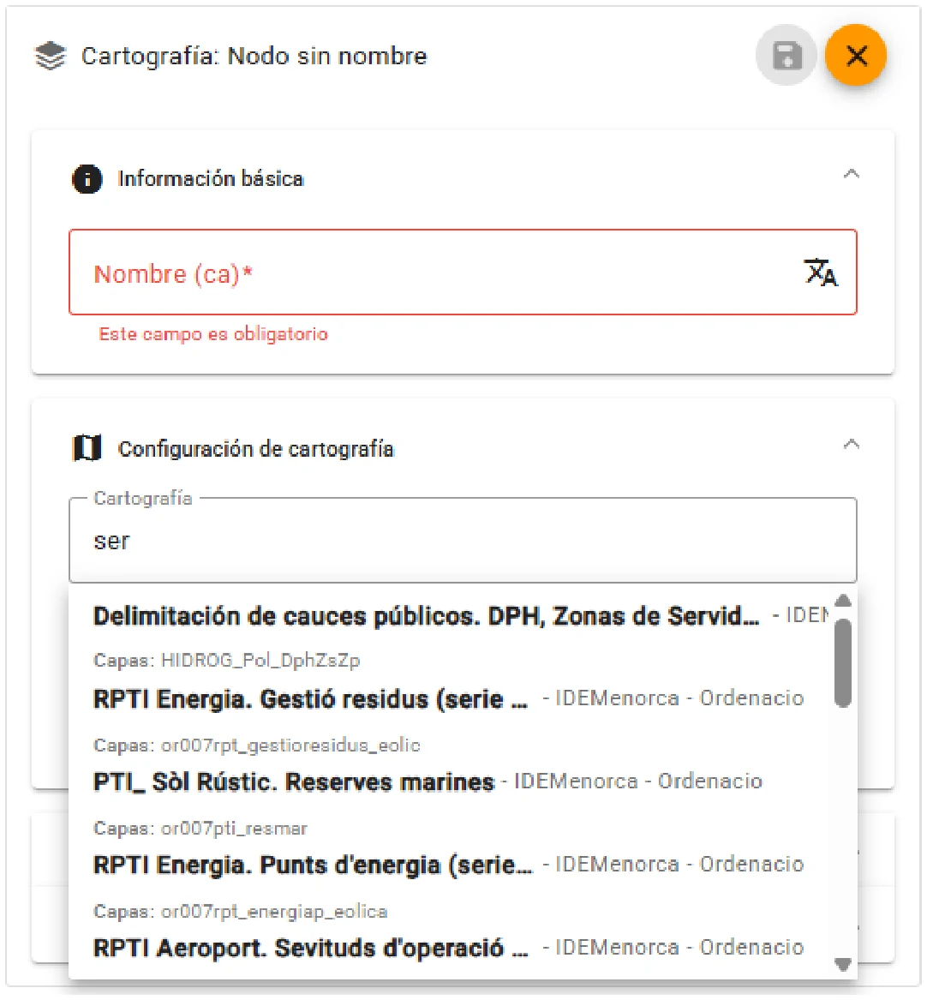

# Paso 5: construir el árbol de capas

El árbol es lo que el usuario ve en el panel de capas: carpetas que contienen capas. Una capa solo aparece en el árbol si el usuario ya tiene acceso a ella por el [paso 4](paso-4-grupos-y-fondos.md).

(menú **Árboles** → **Nuevo**)

1. **Nombre** y **Tipo** = **Cartografía**.
2. Pestaña **Estructura del árbol**:
    - Añade una carpeta de primer nivel con el botón de carpeta de la barra. En el primer nivel solo puede haber carpetas. Si el árbol tiene una sola carpeta de primer nivel, el visor no la muestra: enseña directamente su contenido. Para que el usuario vea las carpetas, crea al menos dos de primer nivel.
    - Se abre el panel del nodo. Escribe el **Nombre** (es lo que leerá el usuario, hasta 80 caracteres) y pulsa el icono de guardar del panel. Sin ese clic, el nodo no se añade al árbol.
    - Para añadir algo dentro de una carpeta, pasa el ratón por su fila: aparecen los botones **Carpeta** y **Cartografía**. Una capa no puede tener hijos.
    - En cada nodo de capa, elige en **Cartografía** la capa del [paso 3](paso-3-capas.md) y vuelve a pulsar el icono de guardar del panel.
3. Opciones de cada nodo: **Visible**, **Cargar por defecto** (la capa aparece encendida al abrir el mapa), **Consultable (GetFeatureInfo)** (clic en el mapa para ver su información; solo se puede activar si la capa del [paso 3](paso-3-capas.md) tiene activada la consulta) y, en carpetas, **Modo selección única** (solo una capa encendida a la vez).
4. Pestaña **Roles**: añade el rol del [paso 1](paso-1-territorio-rol-usuario.md). Sin rol, el árbol no llega a nadie.
5. **Guarda** el árbol con el botón de arriba a la derecha. El icono del panel solo aplica el nodo a la estructura; los cambios no se guardan en el servidor hasta aquí.

{ loading=lazy }

**Atajo:** el botón **Cargar desde servicio** de la estructura crea las carpetas y las capas a partir de la organización del servicio WMS. En la versión 1.3.0 los nodos de capa que crea no quedan enlazados a las capas de SITMUN: después de guardar, elige la capa en **Cartografía** en cada uno.

El árbol se enlaza a la aplicación en el [paso 7](paso-7-aplicacion.md).
