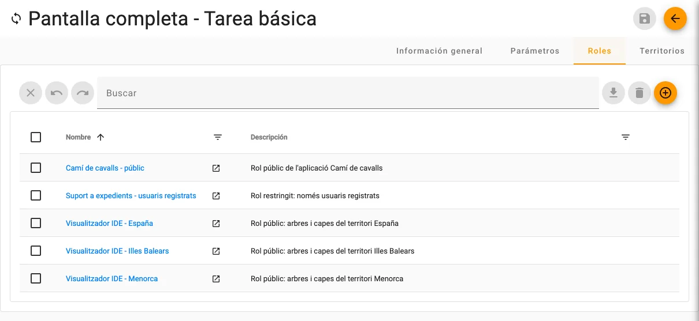

# Paso 6: configurar las herramientas (tareas)

Cada herramienta del visor es una **tarea básica** enlazada a un control del visor. La instalación ya trae una tarea para cada control, dentro del grupo **Básico**. Normalmente no hace falta crear ninguna: solo tienes que darlas al rol y al territorio.

(menú **Tarea** → **Tarea básica** → abre cada tarea que quieras)

1. Pestaña **Roles**: añade el rol del [paso 1](paso-1-territorio-rol-usuario.md).
2. Pestaña **Territorios**: añade el territorio del [paso 1](paso-1-territorio-rol-usuario.md).
3. **Guarda**.

{ loading=lazy }

Si falta el rol o el territorio, la herramienta no aparece en el visor.

**Herramientas mínimas para un primer proyecto:**

| Tarea (control) | Para qué sirve |
| --- | --- |
| Catálogo de capas (`sitna.layerCatalog`) | El árbol de capas («Capas disponibles»). **Sin esta tarea no se ve el árbol.** |
| Selector de mapa base (`sitna.basemapSelector`) | Selector de mapas de fondo. |
| Gestor de capas de trabajo (`sitna.workLayerManager`) | Lista de las capas encendidas. |
| Información de entidad (`sitna.featureInfo`) | Información de un punto al hacer clic en él. |
| Mapa de situación (`sitna.overviewMap`) | Mapa pequeño que muestra la zona visible dentro de un área mayor. Si el primer mapa de fondo es WMTS, sale en blanco: mira el aviso del [paso 7](paso-7-aplicacion.md). |
| Barra de navegación (`sitna.navBar`) | Botones de zoom. Sin ella, el mapa no tiene controles de zoom. |

La lista de tareas básicas del administrador muestra el nombre de la tarea, no el código del control: busca por el nombre.

Otras tareas habituales: «Buscar» (`sitna.search`) e «Imprimir mapa» (`sitna.printMap`). Los demás tipos de tarea del menú (consulta, localizador, edición…) son para herramientas más avanzadas y quedan fuera de esta guía.
