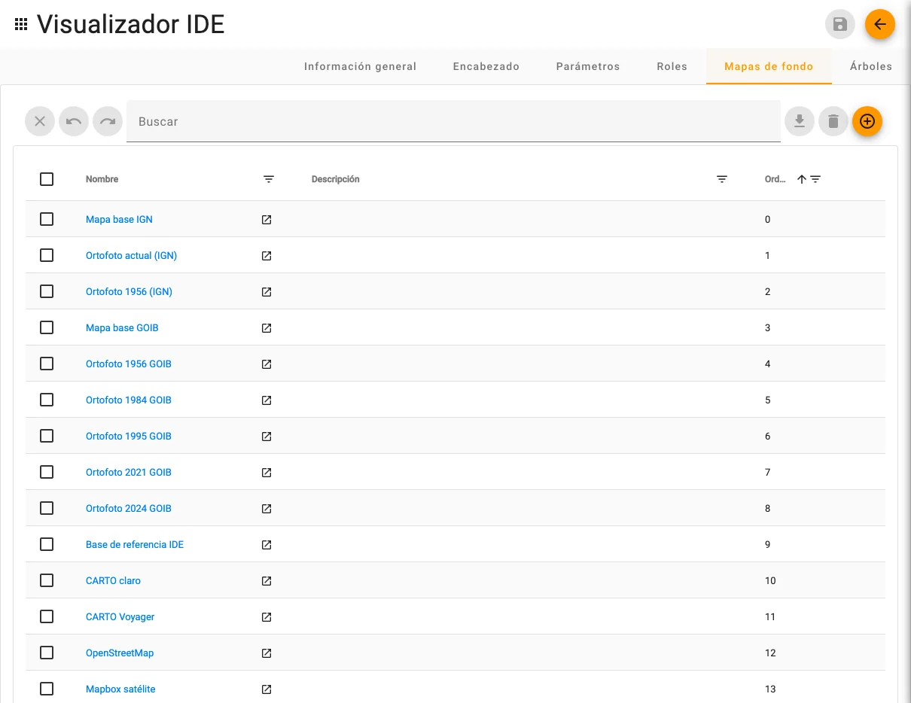

# Paso 7: crear la aplicación y juntarlo todo

La aplicación es el proyecto: dice qué mapas de fondo, qué árboles y qué roles forman el visor.

(menú **Aplicación** → **Nuevo**)

**Información general**

- **Nombre** (obligatorio) y **Descripción**.
- **Tipo** = **Aplicación interna** (el visor de SITMUN). **Aplicación externa** solo guarda un enlace a otra web.
- **Título**: el texto de la cabecera del visor.
- **Estilo de mapa utilizado**: déjalo en blanco o pon `sitmun-base`.
- **CRS por defecto de la aplicación**: por ejemplo `EPSG:25831`. Si el territorio tiene CRS propio, manda el del territorio.
- **Mapa de situación**: opcional, un grupo de tipo **Mapa de situación** ([paso 4](paso-4-grupos-y-fondos.md)). Si no eliges ninguno, se usa el primer mapa de fondo.
- **Aplicación privada**: déjala desactivada; si la activas, el usuario `public` no la ve.

{ loading=lazy }

**Pestañas**

1. **Roles**: añade el rol del [paso 1](paso-1-territorio-rol-usuario.md). Es el enlace más importante: sin rol, nadie entra en la aplicación.
2. **Mapas de fondo**: añade los mapas de fondo del [paso 4](paso-4-grupos-y-fondos.md) y ordénalos. El primero es el que aparece al abrir el mapa.
3. **Árboles**: añade el árbol del [paso 5](paso-5-arbol.md).
4. **Encabezado** (opcional): qué botones aparecen arriba (logotipo, cambio de territorio, idioma, salir…).
5. **Guarda**.

{ loading=lazy }

No hay pestaña de territorios: el territorio llega a través del usuario ([paso 1](paso-1-territorio-rol-usuario.md)).

Las opciones **Garantizar acceso al territorio de la asignación** y **Garantizar acceso a territorios hijo** solo importan si has activado **Rol territorial** en el usuario. En ese caso, activa **Garantizar acceso al territorio de la asignación**: sin ella la aplicación no aparece. Para que la aplicación también se abra en los territorios hijos, activa además **Garantizar acceso a territorios hijo**. En la versión 1.3.0, **Garantizar acceso a territorios hijo** por sí sola no basta (ver [sitmun/sitmun#379](https://github.com/sitmun/sitmun/issues/379)). Además, añade cada territorio hijo a la pestaña **Territorios** de las capas (también las de los mapas de fondo) y de las tareas; si no, la aplicación aparece en el territorio hijo pero su mapa no se abre («No hay capas definidas como base»).
