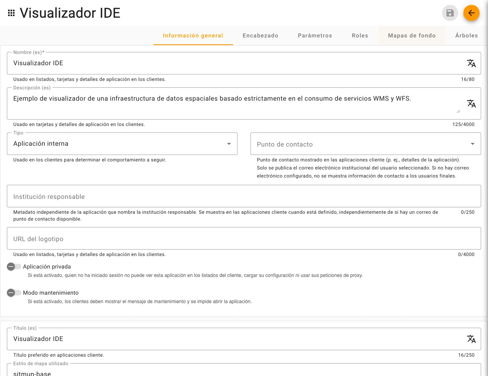

# Paso 7: crear la aplicación

La aplicación es el proyecto: dice qué mapas de fondo, qué árboles y qué roles forman el visor.

(menú **Aplicación** → **Nuevo**)

**Información general**

- **Nombre** (obligatorio) y **Descripción**.
- **Tipo** = **Aplicación interna** (el visor de SITMUN). **Aplicación externa** solo guarda un enlace a otra web.
- **Título**: el nombre que ve el usuario en la lista de aplicaciones del visor. El mapa no lo muestra.
- **Estilo de mapa utilizado**: déjalo en blanco o pon `sitmun-base`.
- **CRS por defecto de la aplicación**: por ejemplo `EPSG:25831`. Si el territorio tiene CRS propio, manda el del territorio.
- **Mapa de situación**: opcional, un grupo de tipo **Mapa de situación** ([paso 4](paso-4-grupos-y-fondos.md)). El mapa de situación usa la primera capa de ese grupo. Si no eliges ninguno, usa la primera capa del primer mapa de fondo.
- **Aplicación privada**: déjala desactivada; si la activas, el usuario `public` no la ve.

!!! bug "Error conocido de SITMUN 1.3.0: mapa de situación en blanco con WMTS (sitmun/sitmun#388)"
    El mapa de situación usa la primera capa del grupo elegido en **Mapa de situación** y, si no eliges ninguno, la primera capa del primer mapa de fondo. Si esa capa es WMTS, el mapa de situación sale en blanco en la versión 1.3.0 ([sitmun/sitmun#388](https://github.com/sitmun/sitmun/issues/388)).
    Para evitarlo, crea en **Permisos sobre las capas** un grupo de tipo **Mapa de situación** con una sola capa WMS y elígelo aquí, en **Mapa de situación**.

{ loading=lazy }

**Pestañas**

1. **Roles**: añade el rol del [paso 1](paso-1-territorio-rol-usuario.md). Es el enlace más importante: sin rol, nadie entra en la aplicación.
2. **Mapas de fondo**: añade los mapas de fondo del [paso 4](paso-4-grupos-y-fondos.md) y ordénalos. El primero es el que aparece al abrir el mapa.
3. **Árboles**: añade el árbol del [paso 5](paso-5-arbol.md).
4. **Encabezado** (opcional): qué botones aparecen arriba (logotipo, cambio de territorio, idioma, salir…).
5. **Guarda**.

{ loading=lazy }

No hay pestaña de territorios: el territorio llega a través del usuario ([paso 1](paso-1-territorio-rol-usuario.md)).

Las opciones **Garantizar acceso al territorio de la asignación** y **Garantizar acceso a territorios hijo** solo importan si has activado **Rol territorial** en el usuario. En ese caso, **Garantizar acceso al territorio de la asignación** abre la aplicación en el territorio asignado y **Garantizar acceso a territorios hijo** la abre en sus territorios hijos. Activa las que necesites: sin ninguna, la aplicación no aparece. Además, añade cada territorio hijo a la pestaña **Territorios** de las capas (también las de los mapas de fondo) y de las tareas; si no, la aplicación aparece en el territorio hijo pero su mapa no se abre («No hay capas definidas como base»).
