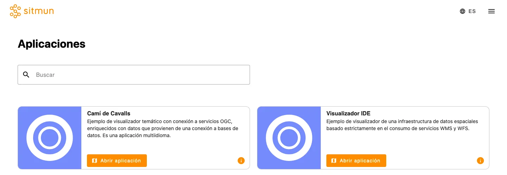
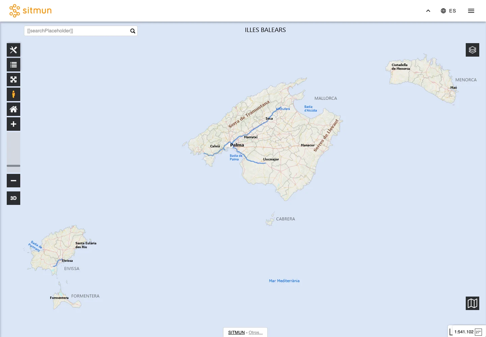

# Paso 8: comprobar el resultado en el visor

El administrador no tiene ningún botón para abrir el visor. Ábrelo aparte, en otra pestaña del navegador.

- **Lista de aplicaciones**: `http://<servidor>/viewer/#/public/dashboard`. La aplicación nueva tiene que aparecer en la lista.
- **Directo al mapa**: `.../viewer/#/public/map/<id aplicación>/<id territorio>`. Las listas del administrador no muestran los identificadores (id): búscalos en la dirección del formulario de cada elemento, por ejemplo `#/application/2/applicationForm` para la aplicación 2.

**Si la aplicación es privada** (opción **Aplicación privada** activada en el [paso 7](paso-7-aplicacion.md)), solo la ven los usuarios con contraseña que tienen alguno de los roles de la aplicación:

- Inicia sesión en `http://<servidor>/viewer/#/auth/login` con ese usuario. Después llegas a `.../viewer/#/user/dashboard`.
- La aplicación aparece en la pestaña **Aplicaciones restringidas**.
- El rol de ese usuario tiene que estar en los mismos sitios en los que pusiste el rol del usuario `public`: los mapas de fondo y grupos de permisos ([paso 4](paso-4-grupos-y-fondos.md)), el árbol ([paso 5](paso-5-arbol.md)) y las tareas ([paso 6](paso-6-herramientas.md)). Si falta en los mapas de fondo, el mapa muestra «No hay capas definidas como base».

Las imágenes publicadas, los perfiles de producción y el *showcase* usan direcciones con `#/`.
Solo una instalación de desarrollo (perfiles `development-*.env`) las usa sin `#/`, por ejemplo `/viewer/public/dashboard`.

{ loading=lazy }

**Lista de comprobación**

- [ ] La aplicación aparece en la lista del visor.
- [ ] El mapa se abre centrado en el territorio.
- [ ] Se ve el primer mapa de fondo, y el selector de mapas de fondo muestra el resto.
- [ ] El panel de capas muestra el árbol con las capas (y las carpetas, si hay más de una de primer nivel).
- [ ] Las capas marcadas con **Cargar por defecto** aparecen encendidas.
- [ ] Al hacer clic en el mapa sobre una capa consultable aparece su información.
- [ ] Están las herramientas del [paso 6](paso-6-herramientas.md).

{ loading=lazy }

Después de cambiar algo en el administrador, vuelve a cargar el visor. Si no ves el cambio, prueba en una ventana privada: el navegador puede tener guardada la configuración antigua.
