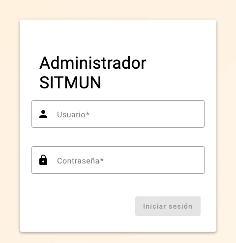
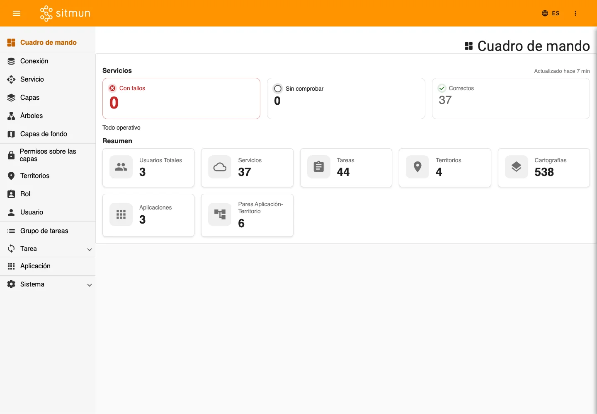

# Primera entrada al administrador

El administrador se abre en `http://<servidor>/admin/` (en una instalación local, `http://localhost:9000/admin/`).

1. Elige el **Idioma** en la pantalla de inicio.
2. Escribe **Usuario** y **Contraseña** y pulsa **Iniciar sesión**. En una instalación de producción nueva, la primera visita pide crear la contraseña del usuario `admin` y elegir el idioma por defecto (ver [Instalación][instalacion-sitmun]). En una base de datos de desarrollo el usuario es `admin` y la contraseña `admin`.
3. Solo pueden entrar los usuarios con la opción **Usuario administrador de SITMUN** activada.

{ loading=lazy }

**El menú lateral** está agrupado en el orden de trabajo de esta guía:

| Grupo | Entradas |
| --- | --- |
| 1 | Cuadro de mando |
| 2 | Conexión, Servicio, Capas, Árboles, Capas de fondo |
| 3 | Permisos sobre las capas, Territorios, Rol, Usuario |
| 4 | Grupo de tareas, Tarea (con 9 tipos de tarea) |
| 5 | Aplicación |
| 6 | Sistema (solo para el usuario `admin`): Controles de interfaz de tarea, Idiomas, Traducciones de literales, Tipos de territorio, Tipos de tareas, Valores de listas de códigos, Parámetros de configuración |

{ loading=lazy }

**Cómo funcionan las pantallas.** Cada entrada del menú abre una **lista**. El botón **Nuevo** abre un formulario vacío; al hacer clic en una fila se abre su formulario.

- La primera pestaña del formulario siempre es **Información general**. Las demás pestañas enlazan ese elemento con otros (capas, roles, territorios…).
- En las pestañas de relación usa los botones **Añadir** y **Eliminar**.
- No se guarda nada hasta que pulsas **Guarda**. Esto incluye los cambios de todas las pestañas.
- **Duplicar** crea una copia, útil para partir de un elemento que ya funciona.

!!! tip "Los botones son iconos"
    Los botones **Nuevo**, **Añadir**, **Eliminar**, **Duplicar**, **Registrar** y **Guarda** son iconos sin texto.
    Su nombre aparece al pasar el ratón por encima.

**A partir de aquí empiezas a crear el visor público.** Los pasos 1 a 8 lo montan sobre el usuario `public` (ya existe por defecto), un rol nuevo y una aplicación no privada.
