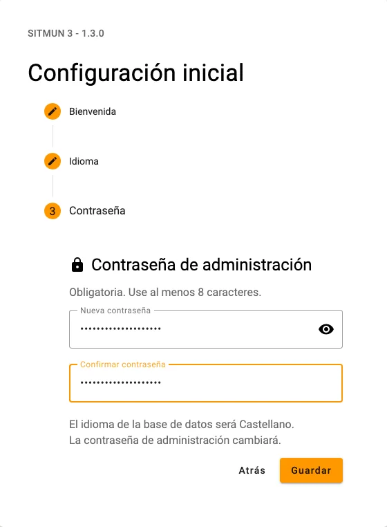

# Instalación

Todo el código de **SITMUN 3** está en un único repositorio: [sitmun/sitmun](https://github.com/sitmun/sitmun).
Cada componente (administrador, visor, backend, proxy, MBTiles y aplicaciones móviles) es una carpeta de ese repositorio.
Los repositorios antiguos por componente (`sitmun-application-stack`, `sitmun-backend-core`, `sitmun-admin-app`, etc.) solo llegan a la versión 1.2.9.

=== "Docker"

    **Elegir cómo instalar**

    | Uso | Rama o etiqueta | Perfil (`profiles/*.env`) | Datos |
    | --- | --- | --- | --- |
    | Probar SITMUN (*showcase*) | `v1.3.0` | `showcase.env` | Tres aplicaciones de demostración |
    | Producción con PostgreSQL | `v1.3.0` | `postgres.env` | Sin datos de ejemplo |
    | Producción con Oracle | `v1.3.0` | `oracle.env` | Sin datos de ejemplo |
    | Desarrollo con PostgreSQL | `dev` | `development-postgres.env` | Datos de ejemplo |
    | Desarrollo con Oracle | `dev` | `development-oracle.env` | Datos de ejemplo |

    **Pasos de instalación (producción)**

    1. Clona la versión publicada y entra en el directorio:

        ```bash
        git clone --branch v1.3.0 https://github.com/sitmun/sitmun.git
        cd sitmun
        ```

    2. Copia el perfil a `.env` y genera los secretos:

        - Linux/macOS:

            ```bash
            cp profiles/postgres.env .env
            ./setup.sh
            ```

        - Windows:

            ```powershell
            Copy-Item profiles\postgres.env .env
            .\setup.ps1
            ```

        Para Oracle, copia `profiles/oracle.env` en lugar de `profiles/postgres.env`.

        `setup.sh` y `setup.ps1` añaden a `.env` los tres secretos que faltan:
        `SITMUN_USER_SECRET`, `MIDDLEWARE_SECRET` y `SITMUN_MBTILES_JOB_HANDLE_SECRET`.
        Docker Compose no arranca si falta alguno.

    3. Arranca la plataforma con las imágenes publicadas:

        ```bash
        docker compose up -d --pull always --no-build
        ```

    4. Espera a que el backend responda con `"status":"UP"` (la primera vez tarda un par de minutos, mientras crea la base de datos):

        ```bash
        curl http://localhost:9001/api/dashboard/health
        ```

        En PowerShell usa `curl.exe` en lugar de `curl`.

    5. Abre el administrador en <http://localhost:9000/admin/> y el visor en <http://localhost:9000/viewer/>.
       La documentación de la API (Swagger UI) está en <http://localhost:9001/swagger-ui/index.html>.

    **Primer acceso al administrador**

    En una base de datos de producción (y en el *showcase*) el usuario `admin` no tiene contraseña.
    La primera visita a `/admin/` pide crear su contraseña y elegir el idioma por defecto.
    Cualquiera que llegue al puerto 9000 puede hacer esa primera visita, así que hazla enseguida,
    o define `SITMUN_BOOTSTRAP_ADMIN_PASSWORD` (y, si quieres, `SITMUN_BOOTSTRAP_LANGUAGE`) en `.env` antes de arrancar.
    Quita esas variables de `.env` cuando `GET /api/dashboard/health` responda `UP`.

    { loading=lazy }

    { loading=lazy }

    En una base de datos de desarrollo el usuario es `admin` y la contraseña `admin`.

    **Probar SITMUN (showcase)**

    Sin instalar nada: abre el *showcase* en GitHub Codespaces. El codespace descarga las imágenes publicadas de SITMUN 1.3.0
    y lo arranca con los datos de ejemplo; tarda unos minutos y consume horas de tu cuota de Codespaces mientras está encendido.

    [Abrir en GitHub Codespaces](https://codespaces.new/sitmun/sitmun.github.io?quickstart=1&devcontainer_path=.devcontainer%2Fshowcase%2Fdevcontainer.json){ .md-button .md-button--primary }

    Cuando termina, la pestaña «Puertos» del codespace muestra la dirección del puerto 9000: `/admin/` es el administrador
    (en la primera visita se elige la contraseña de `admin`) y `/viewer/` el visor.

    En tu equipo:

    - Linux/macOS:

        ```bash
        git clone --branch v1.3.0 https://github.com/sitmun/sitmun.git
        cd sitmun
        cp profiles/showcase.env .env
        ./setup.sh
        docker compose -p sitmun-showcase up -d --pull always --no-build
        ```

    - Windows:

        ```powershell
        git clone --branch v1.3.0 https://github.com/sitmun/sitmun.git
        cd sitmun
        Copy-Item profiles\showcase.env .env
        .\setup.ps1
        docker compose -p sitmun-showcase up -d --pull always --no-build
        ```

    En el visor, el usuario `demo` con contraseña `demo` ve las tres aplicaciones de demostración.

    **Entorno de desarrollo**

    ```bash
    git clone --branch dev https://github.com/sitmun/sitmun.git
    cd sitmun
    ./setup.sh
    docker compose up -d
    ```

    En Windows, usa `.\setup.ps1` en lugar de `./setup.sh`.
    Sin `.env`, `setup.sh` (o `setup.ps1`) copia `profiles/development-postgres.env`.
    `docker compose up -d` sin `--no-build` compila las imágenes a partir del código del repositorio.

    **Servicios**

    Los servicios están definidos en el archivo `compose.yaml`:

    - `front`: servidor web *nginx* en el puerto 9000. Publica el visor (`/viewer/`) y el administrador (`/admin/`) y enruta `/backend/` al `backend` y `/middleware/` al `proxy`.
    - `backend`: API de autenticación, autorización, configuración y administración (puerto 9001).
    - `proxy`: API de proxy-middleware, que se comunica con el `backend` (puerto 9002).
    - `postgres`: base de datos PostgreSQL 16 en el volumen `pgdata` (puerto 9003, perfil `postgres`).
    - `oracle`: base de datos Oracle 23 Free (puerto 9004, perfil `oracle`).
    - `example`: base de datos PostgreSQL de ejemplo (puerto 9005, perfil `demo`).
    - `mbtiles`: servicio de exportación de teselas para la aplicación móvil de edición (perfil `mbtiles`, sin puerto publicado).

    ```mermaid
    block-beta
    columns 5

    space:2
    front["<b>front</b><br>nginx<br>localhost:9000"]
    space:2

    space:5

    postgres[("<b>postgres</b><br>PostgreSQL 16<br>SITMUN database")]
    space:1
    backend["<b>backend</b><br>Spring Boot<br>SITMUN backend"]
    space:1
    proxy["<b>proxy</b><br>Spring Boot<br>SITMUN proxy-middleware"]

    front -- "/middleware" --> proxy
    front -- "/backend" --> backend
    proxy -- "/api/config/proxy" --> backend
    backend -- "jdbc" --> postgres
    ```

    **Configuración**

    Las variables de entorno se definen en el archivo `.env`. Variables clave:

    - `COMPOSE_PROFILES`: `postgres` u `oracle`. Añade `,demo` para la base de datos de ejemplo y `,mbtiles` para MBTiles.
    - `DATABASE_TYPE`, `DATABASE_URL`, `DATABASE`, `DATABASE_USERNAME`, `DATABASE_PASSWORD`.
    - `PUBLIC_URL_SCHEME`, `PUBLIC_HOSTNAME`, `PUBLIC_PORT`: dirección pública de la instalación.
    - `PUBLIC_BASE_PATH`: ruta pública (`/` por defecto). La imagen publicada del front solo funciona en `/`: para publicar
      SITMUN bajo una ruta (por ejemplo `/sitmun3/`) hay que construir `front` desde el repositorio con `PUBLIC_BASE_PATH`
      y `LOCAL_BASE_PATH`, como explica DEPLOYMENT.md (*Path prefix*).
    - `SPRING_PROFILES_ACTIVE`: perfiles del backend. Añade `mail` (por ejemplo `prod,postgres,mail`) para que funcione
      la recuperación de contraseña del visor; sin él, «¿Contraseña olvidada?» acaba en error. El servidor de correo se configura
      con las propiedades `spring.mail.*` y `sitmun.recover-password.mail.from` en un archivo `application-mail.yml` dentro de
      la carpeta de configuración del perfil (por ejemplo `profiles/postgres/`). Los usuarios necesitan un correo electrónico.
    - `SITMUN_USER_SECRET`, `MIDDLEWARE_SECRET`, `SITMUN_MBTILES_JOB_HANDLE_SECRET`: secretos obligatorios (los genera `setup.sh`).
    - `FORCE_USE_OF_PROXY`: fuerza el uso del proxy (`false` por defecto).

    La lista completa, la conexión a una base de datos externa, las copias de seguridad y la publicación bajo una ruta
    están en [DEPLOYMENT.md](https://github.com/sitmun/sitmun/blob/main/DEPLOYMENT.md).
    La actualización desde 1.2.8 o 1.2.9 está en
    [docs/upgrade](https://github.com/sitmun/sitmun/tree/main/docs/upgrade).

    **Parar y desinstalar**

    Para parar SITMUN conservando los datos:

    ```bash
    docker compose down
    ```

    Para eliminarlo todo, **incluida la base de datos** (no se puede deshacer; haz antes una
    [copia de seguridad](solucion-problemas.md#backup-de-base-de-datos) si la necesitas):

    ```bash
    docker compose down -v
    ```

    Añade `-p sitmun-showcase` después de `docker compose` si instalaste el *showcase*.

=== "Fuente"

    Todos los componentes se compilan desde la raíz del repositorio [sitmun/sitmun](https://github.com/sitmun/sitmun).
    Cada componente tiene su propio README con todos los detalles.

    Los comandos de esta sección son para una consola *bash* (Linux, macOS, o en Windows Git Bash o WSL). En la consola de
    Windows (`cmd`) no funcionan `export`, `envsubst`, `$(...)` ni `openssl`; para compilar el visor con
    `cmd` usa `pnpm run build:win` en lugar de `pnpm run build`.
    Las pruebas de la versión 1.3.0 se ejecutan con PostgreSQL 12 y 16 y con Oracle 11g y 21c.

    ```bash
    git clone --branch v1.3.0 https://github.com/sitmun/sitmun.git
    cd sitmun
    ```

    === "Backend"

        1. Compila con Gradle desde la raíz del repositorio:

            ```bash
            ./gradlew :sitmun-backend:build -x test
            ```

            El JAR ejecutable se genera en `sitmun-backend/build/libs/sitmun-backend-<versión>.jar`
            (no uses el JAR `-plain`). Con `-Ppackaging=war` se genera un WAR.

        2. Ejecútalo desde la raíz del repositorio. El JAR no incluye la configuración de cada base de datos:
           está en `profiles/postgres/` (o `profiles/oracle/`) y se carga con `--spring.config.additional-location`.
           La conexión, el *changelog* de Liquibase y los dos secretos se pasan como variables de entorno
           (son los mismos valores que usa `profiles/postgres.env` con Docker):

            ```bash
            export SPRING_DATASOURCE_URL=jdbc:postgresql://localhost:5432/sitmun3
            export SPRING_DATASOURCE_USERNAME=sitmun3
            export SPRING_DATASOURCE_PASSWORD=<contraseña>
            export SPRING_LIQUIBASE_CHANGE_LOG=file:profiles/postgres/liquibase/master.xml
            export SPRING_LIQUIBASE_CONTEXTS=
            export SPRING_JPA_HIBERNATE_DDL_AUTO=validate
            export SITMUN_USER_SECRET=$(openssl rand -hex 32)
            export SITMUN_PROXY_MIDDLEWARE_SECRET=$(openssl rand -hex 32)
            export SITMUN_PROXY_MIDDLEWARE_URL=http://localhost:8082
            java -jar sitmun-backend/build/libs/sitmun-backend-1.3.0.jar \
              --spring.profiles.active=prod,postgres \
              --spring.config.additional-location=file:profiles/postgres/
            ```

            - `SITMUN_PROXY_MIDDLEWARE_URL` es la dirección **pública** del proxy, la que usarán los navegadores
              para las capas y tareas que pasan por el proxy (por ejemplo `https://ejemplo.org/middleware`
              si un servidor web lo publica en esa ruta). El ejemplo apunta al proxy del paso siguiente,
              arrancado en el puerto 8082.
            - Guarda los dos secretos: `SITMUN_PROXY_MIDDLEWARE_SECRET` debe ser el mismo que use el **proxy**
              (`SITMUN_BACKEND_CONFIG_SECRET`), y si cambia `SITMUN_USER_SECRET` se invalidan las sesiones.
            - Para Oracle usa el perfil `prod,oracle` (u `oracle-11` para Oracle 11g), la carpeta `profiles/oracle/`,
              su `liquibase/master.xml` y una URL `jdbc:oracle:thin:@//<servidor>:1521/<servicio>`.
            - Cuando arranque, `http://localhost:8080/api/dashboard/health` responde `UP`.
              En una base de datos nueva, la primera visita al administrador pide crear la contraseña de `admin`.

        La configuración (base de datos, secretos, LDAP, OIDC…) se detalla en
        [sitmun-backend/README.md](https://github.com/sitmun/sitmun/blob/main/sitmun-backend/README.md).

        Los sistemas operativos en los que se puede desplegar el **backend** son:

        - Linux: como servicio *systemd* o mediante un script de arranque.
        - Windows: como servicio Windows usando la herramienta *WinSW* o mediante un script de arranque.

    === "Proxy"

        1. Compila con Gradle desde la raíz del repositorio:

            ```bash
            ./gradlew :sitmun-proxy:build -x test
            ```

            El JAR ejecutable se genera en `sitmun-proxy/build/libs/sitmun-proxy-<versión>.jar`.

        2. Ejecútalo desde la raíz del repositorio:

            ```bash
            export SITMUN_BACKEND_CONFIG_URL=http://localhost:8080/api/config/proxy
            export SITMUN_BACKEND_CONFIG_SECRET=<el valor de SITMUN_PROXY_MIDDLEWARE_SECRET del backend>
            java -jar sitmun-proxy/build/libs/sitmun-proxy-1.3.0.jar --spring.profiles.active=prod --server.port=8082
            ```

            - `SITMUN_BACKEND_CONFIG_URL` es la URL de la **[API de Configuración y Autorización][api-de-configuracion-y-autorizacion]**
              del backend. Si el **proxy** y el **backend** están en máquinas distintas, usa el nombre o la dirección IP interna del **backend**.
            - `SITMUN_BACKEND_CONFIG_SECRET` debe ser idéntico al secreto del backend y tener al menos 32 caracteres.

            El backend y el proxy usan por defecto el puerto 8080. Si están en la misma máquina, arranca el proxy
            en otro puerto (aquí 8082, el mismo que `SITMUN_PROXY_MIDDLEWARE_URL` del backend).
            Cuando arranque, `http://localhost:8082/actuator/health` responde `UP`.

        La imagen Docker se construye desde la raíz con `docker/proxy/Dockerfile`.
        Más detalles en [sitmun-proxy/README.md](https://github.com/sitmun/sitmun/blob/main/sitmun-proxy/README.md).

    === "Visor de mapas"

        1. Instala las dependencias desde la raíz del repositorio (necesitas Node.js y pnpm, ver [Requisitos](requisitos.md)):

            ```bash
            pnpm ci
            ```

        2. Compila. `PUBLIC_BASE_PATH` es la ruta pública bajo la que se publica SITMUN (`/` si el visor queda en `/viewer/`).
           El visor la necesita para cargar sus módulos y registrar su *service worker* desde `/viewer/`,
           igual que hace la imagen Docker:

            ```bash
            cd sitmun-viewer
            export PUBLIC_BASE_PATH=/ APP_VERSION=1.3.0 FRONT_ENV=production BUILD_TIMESTAMP=
            envsubst '$PUBLIC_BASE_PATH' < ../docker/front/viewer/index.html.template > src/index.html
            envsubst '$BUILD_TIMESTAMP,$APP_VERSION,$FRONT_ENV,$PUBLIC_BASE_PATH' \
              < ../docker/front/viewer/environment.prod.ts.template > src/environments/environment.prod.ts
            pnpm run build --configuration=production --base-href=${PUBLIC_BASE_PATH}viewer/
            ```

            `envsubst` forma parte de GNU gettext. Sin `PUBLIC_BASE_PATH` el visor compila, pero
            se queda en blanco: busca sus módulos en la raíz del servidor en lugar de en `/viewer/`.
            El segundo `envsubst` genera la configuración que usa la imagen Docker: la dirección del backend
            (`${PUBLIC_BASE_PATH}backend`) y las mismas opciones, por ejemplo sin el acceso con DNIe.

            Los archivos se generan en `sitmun-viewer/dist/viewer-app`.
            Esta compilación usa direcciones con `#`, por ejemplo `/viewer/#/public/dashboard`.

        Copia el contenido de esa carpeta a `/viewer/` en tu servidor web (ver más abajo, *Publicar en un servidor web*).

        Más detalles en [sitmun-viewer/README.md](https://github.com/sitmun/sitmun/blob/main/sitmun-viewer/README.md).

    === "Administrador"

        1. Instala las dependencias desde la raíz del repositorio:

            ```bash
            pnpm ci
            ```

        2. Compila. Igual que en el visor, el segundo comando genera la configuración que usa la imagen Docker:

            ```bash
            cd sitmun-admin
            export PUBLIC_BASE_PATH=/ APP_VERSION=1.3.0 FRONT_ENV=production BUILD_TIMESTAMP=
            envsubst '$BUILD_TIMESTAMP,$APP_VERSION,$FRONT_ENV,$PUBLIC_BASE_PATH' \
              < ../docker/front/admin/environment.prod.ts.template > src/environments/environment.prod.ts
            pnpm run build --configuration=production --base-href=${PUBLIC_BASE_PATH}admin/
            ```

            Los archivos se generan en `sitmun-admin/dist/admin-app`.

        Copia el contenido de esa carpeta a `/admin/` en tu servidor web (ver *Publicar en un servidor web*).
        Más detalles en [sitmun-admin/README.md](https://github.com/sitmun/sitmun/blob/main/sitmun-admin/README.md).

    **Publicar en un servidor web**

    El visor y el administrador llaman a la API en `/backend` del mismo servidor, y el visor usa el proxy
    en la dirección `SITMUN_PROXY_MIDDLEWARE_URL` del backend. El servidor web (nginx, Apache, IIS…) debe:

    - servir `dist/viewer-app` en `/viewer/` y `dist/admin-app` en `/admin/`, devolviendo el `index.html` de cada uno
      cuando el archivo pedido no existe;
    - reenviar `/backend/` al backend (`http://localhost:8080/`) y, si publicas el proxy en `/middleware/`, reenviar
      esa ruta al proxy (`http://localhost:8082/`), quitando el prefijo en ambos casos.

    La configuración que usa la imagen Docker es un ejemplo completo:
    [docker/front/config/default.conf.template](https://github.com/sitmun/sitmun/blob/main/docker/front/config/default.conf.template).

---

Con SITMUN instalado, crea tu primer visor con la guía [Primer proyecto](../guias/primer-proyecto/index.md). Si algo no arranca, consulta [Solución de problemas](solucion-problemas.md).
