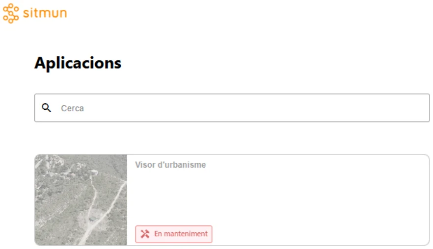
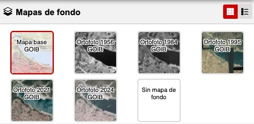

# Aplicación

La aplicación es el elemento principal para configurar el visor de SITMUN. Todos los elementos anteriores (capas, árboles, tareas, etc.) quedarán integrados en una aplicación. Cuando el usuario accede a SITMUN, visualiza un panel con todas las aplicaciones disponibles, ya sean las públicas o aquellas para las que tiene permisos con su rol.

Para configurar una aplicación se rellenan los datos de información general, encabezado, parámetros, roles, mapas de fondo y árboles.

## Información general

En este apartado se facilitan los datos generales de la aplicación, como el nombre y la descripción.

El **tipo de aplicación** se selecciona de una lista. Existen aplicaciones específicas para determinados propósitos, como la **Aplicación turística** o la «Edition application» (`ED`) que usa la aplicación móvil de edición (ver [Clientes](../../../que-es-sitmun/plataforma/clientes.md#aplicaciones-moviles)), pero para configurar un visor estándar se selecciona el tipo **Aplicación interna**. La aplicación externa sirve para enlazar con otra aplicación definida en otro sistema de visor de mapas.

También se debe indicar un **punto de contacto**, que será alguno de los usuarios de SITMUN (se recomienda que el punto de contacto sea un usuario corporativo y no una persona física).

También se puede especificar la **institución responsable**, así como la URL de la imagen que se utilizará como logotipo. En la versión actual no es posible añadir una imagen directamente a través de la aplicación de administración de SITMUN: esta imagen se deberá subir externamente, mediante FTP o un sistema similar, a un servidor web desde el que se pueda acceder a ella por su URL.

Finalmente, existe la posibilidad de indicar que una aplicación es **privada** (solo accesible cuando se accede con un usuario registrado) y también la posibilidad de poner la aplicación en **modo de mantenimiento**, que impedirá que los usuarios puedan acceder a ella. En ese caso, los usuarios verán la siguiente pantalla:

{ loading=lazy }

Cabe señalar que, en función del tipo de aplicación seleccionado, se requerirá información adicional. En el caso de la aplicación interna, se deberá facilitar el **título** de la aplicación (nombre con el que el usuario la va a identificar).

También se puede personalizar el estilo de la aplicación indicándolo en el campo **Estilo de mapa utilizado**. Si se deja en blanco, la aplicación utilizará los estilos CSS definidos en la carpeta por defecto (carpeta `sitmun-base`, ubicada en la ruta `sitmun-viewer/src/assets/map-styles/` del repositorio), pero se puede crear otra carpeta con los mismos estilos CSS y personalizarlos para cumplir con los estilos corporativos de cada institución. En ese caso, se deberá facilitar el nombre del nuevo directorio donde se encuentran estos estilos.

También se puede especificar un CRS concreto con el que trabajará la aplicación.

También se permite seleccionar el **mapa de situación** que se desea utilizar en esta aplicación. La lista de mapas de situación se obtiene de todos aquellos grupos que se han etiquetado como mapas de situación en el apartado [Permisos sobre las capas](permisos-capas.md).

Por último, se puede definir cuál va a ser el comportamiento de la aplicación con los territorios hijos del territorio de referencia de dicha aplicación.

## Encabezado

En el apartado **Encabezado** se definen aspectos relacionados con la visualización de la aplicación.

Se ofrecen diversas opciones de activación y desactivación para personalizar dicho aspecto:

- **Mostrar el logotipo de Sitmun**
- **Mostrar el botón del menú de inicio**
- **Mostrar el botón de cambio de territorio**
- **Mostrar el botón de cambio de idioma**
- **Mostrar el botón de perfil**: da acceso a la página **Mi perfil** del visor, donde el usuario registrado puede cambiar su
  contraseña, su correo electrónico principal y sus datos en cada territorio.
- **Mostrar el botón de desconexión**

En la misma pestaña se pueden añadir logotipos, por ejemplo el de la institución. Cada logotipo es una fila con **Nombre**, **Url** (la dirección de la imagen), **Posición** (**Izquierda** o **Derecha** del encabezado) y **Mostrar**.

## Parámetros

Como la mayoría de los elementos de SITMUN, las aplicaciones permiten crear parámetros para añadir más personalización.

## Roles

A la aplicación se le asignan los roles que tendrán acceso a ella. Cabe mencionar que, si no se asigna ningún rol, la aplicación no será accesible: sin asignación de roles, ningún usuario (ni siquiera el usuario público) podrá visualizar la aplicación. Una instalación nueva no trae ningún rol: para una aplicación pública, se crea un rol, se asigna al usuario `public` en su territorio (pestaña **Roles por territorio** del usuario) y se añade a la aplicación, como explica el [Paso 1 de la guía](../../guias/primer-proyecto/paso-1-territorio-rol-usuario.md).

## Mapas de fondo

Se pueden añadir tantos mapas de fondo como se desee, ya que el usuario podrá seleccionar en el visor el que más le interese.

Los mapas de fondo pueden ser cualquiera de los que se hayan definido como tales en el apartado [Capas de fondo](capas-de-fondo.md).

{ loading=lazy }

*Ejemplo del selector de mapas de fondo en el visor.*
