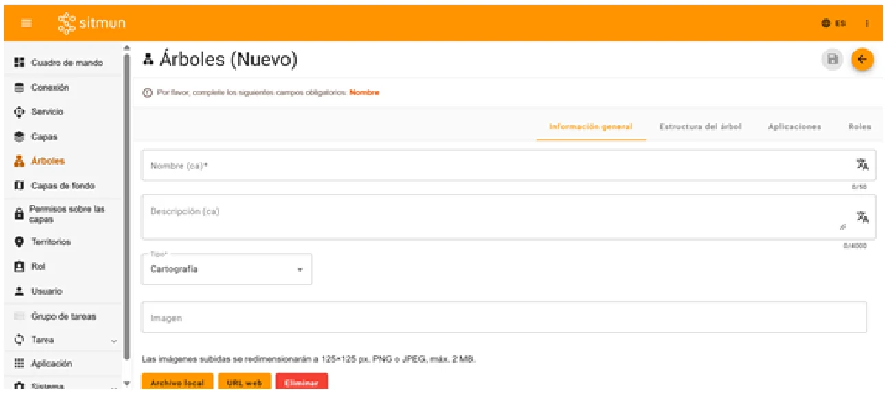
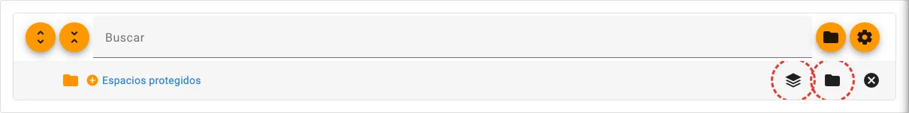

# Árboles

El árbol es el elemento que permite configurar y organizar el contenido que estará disponible en una aplicación web, sean capas de información u otros accesos.

Existen tres tipos de árboles:

- Cartografía
- Aplicación turística
- Árbol de edición

Al crear un árbol nuevo hay que indicar el tipo deseado en la primera pestaña, **Información general**.

{ loading=lazy }

## Árbol de cartografía

Un árbol de este tipo sirve para crear contenido de datos geográficos para una aplicación de tipo visor cartográfico.

### Estructura del árbol { #estructura-del-arbol }

El diseño del contenido se define en la segunda pestaña, **Estructura del árbol**. En ella se pueden generar múltiples carpetas y subcarpetas, que pueden contener diferentes capas de contenido cartográfico.

Para empezar es necesario crear una carpeta, ya que toda la información tiene que estar siempre incluida en una de ellas.

{ loading=lazy }

Para que cada nuevo elemento se cargue en la estructura, se debe guardar previamente la carpeta.

{ loading=lazy }

Dentro de las carpetas se pueden crear otras subcarpetas o directamente capas de información cartográfica.

El botón **Cargar desde servicio** crea los nodos a partir de un servicio WMS, pero solo para las capas de ese servicio que ya están registradas como capas de SITMUN; las demás se omiten sin aviso, aunque las carpetas se crean igualmente, vacías si hace falta. En la versión 1.3.0 los nodos creados no quedan enlazados a su capa: después de guardar, se elige la capa en **Cartografía** en cada uno.

{ loading=lazy }

Al crear una capa de información, lo más importante es indicar la capa, de entre las ya incluidas en la plataforma. La caja de texto para indicar la capa de cartografía ofrece un desplegable con opciones.

{ loading=lazy }

El campo **Nombre** del nodo es obligatorio y es el texto que el visor muestra en el árbol (o su traducción al idioma del visor), en lugar del nombre de la capa. Elegir la capa en **Cartografía** no lo rellena: sin **Nombre**, el nodo no se puede guardar. Para cambiar cómo se llama una capa en el árbol del visor, se cambia el **Nombre** de su nodo.

Cada nodo tiene además estas opciones, dentro del panel plegado **Opciones de visualización**:

- **Visible**: el nodo aparece en el árbol del visor.
- **Cargar por defecto**: la capa aparece encendida al abrir el mapa.
- **Modo selección única** (en carpetas): solo una capa de la carpeta puede estar encendida a la vez.

El árbol también puede tener una **Imagen** que lo representa: se sube un archivo o se indica su dirección (URL).

### Acceso

Para que este árbol esté disponible en una aplicación, se puede asignar directamente desde la pestaña **Aplicaciones** (si la aplicación ha sido creada previamente) o bien se puede enlazar en el momento de crear la [aplicación](aplicacion.md).

Paralelamente, para dar acceso según usuarios y territorios, se requiere indicar el rol o roles a los que se desea dar permisos de acceso a esta estructura de árbol, desde la pestaña **Roles**.

Finalmente es imprescindible guardar los cambios de la configuración del árbol, desde el botón que aparece en la parte superior derecha de la pantalla.

## Aplicación turística

!!! info "En preparación"
    Este apartado todavía no está documentado.

## Árbol de edición

!!! info "En preparación"
    Este apartado todavía no está documentado.
