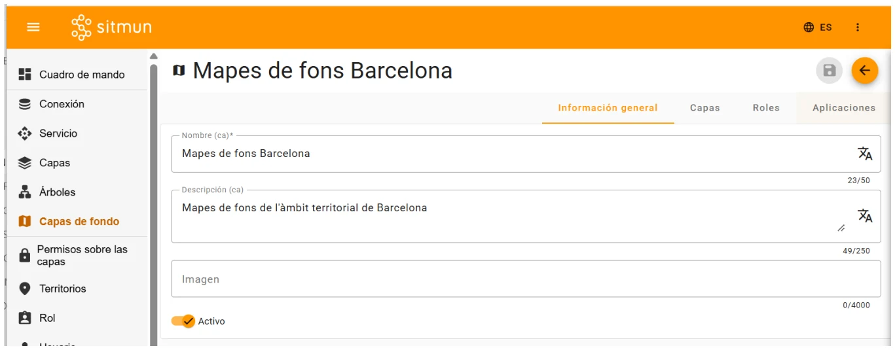

# Capas de fondo

Las capas de fondo sirven para configurar los mapas base de las aplicaciones.

Se pueden configurar varias capas de información y asignarles roles y aplicaciones.

Existe la posibilidad de activar o desactivar su disponibilidad en las aplicaciones asociadas.

{ loading=lazy }

Es muy importante activar la opción **Activo** para que esté disponible en las aplicaciones deseadas.

En la pestaña **Capas** se debe indicar la capa o las capas que se desee que formen este mapa de fondo.

!!! example "Ejemplo: OpenStreetMap como mapa de fondo"
    La guía [Añadir OpenStreetMap como mapa de fondo](../../guias/mapa-fondo-openstreetmap.md) explica paso a paso cómo configurar un mapa de fondo concreto.
