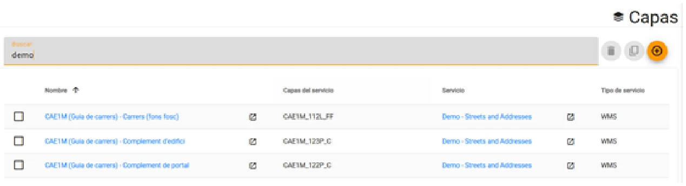
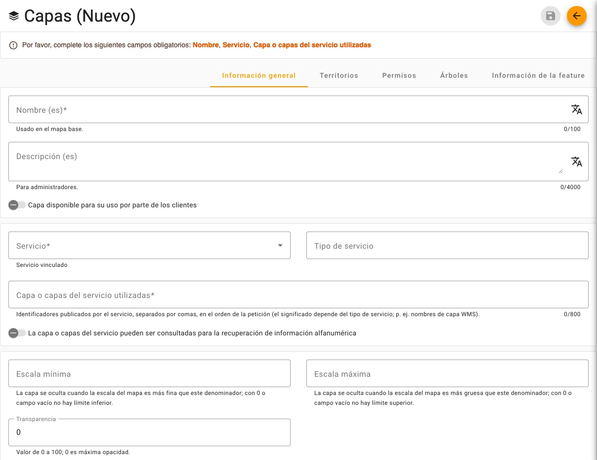

# Capas

Las capas provienen de los servicios que se hayan definido previamente.

Cuando las capas se han cargado automáticamente desde la configuración del [servicio](servicios.md#capas), ya aparecen disponibles en la lista de capas, desde donde se pueden editar.

{ loading=lazy }

Se puede crear una capa nueva manualmente. Eso ofrece la posibilidad de configurarla como se desee o de unir varias capas en una sola.

{ loading=lazy }

Es indispensable indicar como parámetros mínimos:

- **Nombre de la capa**: nombre identificativo del elemento.
- **Servicio**: servicio del que proviene.
- **Capa/s**: nombre de una o varias capas separadas por comas. Es importante tener en cuenta que el nombre o código de la capa debe estar escrito exactamente igual que como viene en el servicio.

Complementariamente, se pueden detallar otros parámetros para definir su comportamiento:

- **Escala mínima y máxima** de visualización.
- **Transparencia**.
- Acceso a los **metadatos**.
- **Orden** de carga predeterminado.
- **Capa disponible para su uso por parte de los clientes**: activarla para que esté abierta al acceso. Si se deja desactivada, la capa estará en estado oculto.

## Acceso

Dar acceso a las capas requiere atribuirles permisos (roles) y asignarles los territorios en los que las capas se encuentran disponibles.

Los permisos de las capas van asociados a los grupos de capas que se generan en [Permisos sobre las capas](permisos-capas.md).
