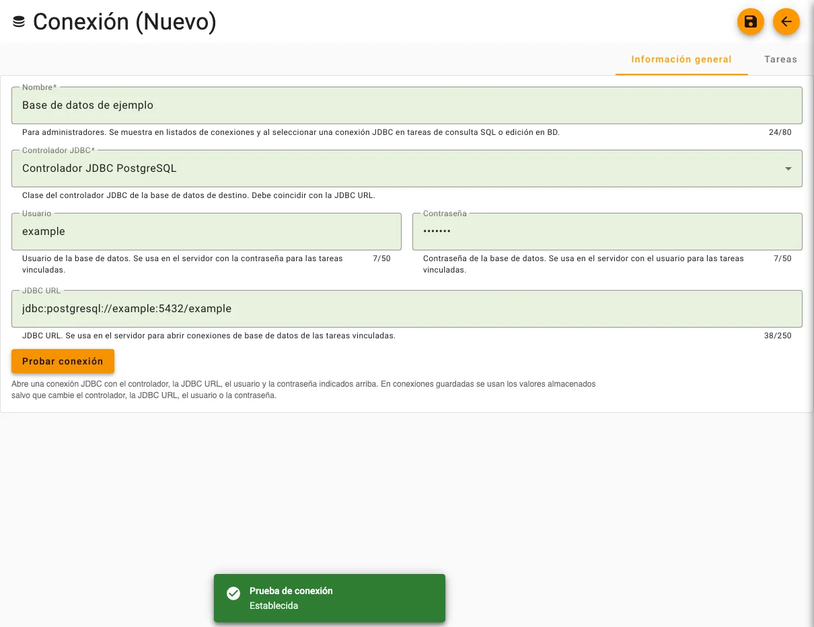
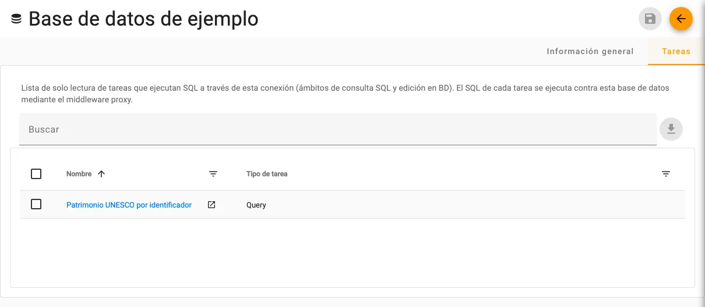

# Conexiones

En SITMUN, además de poder consultar información cartográfica, también se pueden realizar consultas a bases de datos para obtener información alfanumérica.

Para poder gestionar la información de bases de datos externas, existe la posibilidad de configurar conexiones a dichas bases de datos, que se utilizarán posteriormente, por ejemplo, para crear una [tarea de consulta](tareas/consulta.md) a base de datos.

Para crear una nueva conexión se rellenan los campos indicados en el formulario que se muestra en la captura de pantalla:

- **Nombre**: puede ser cualquier nombre que permita identificar la conexión a posteriori.
- **Controlador JDBC**: se selecciona el que corresponda de la lista desplegable (H2, Oracle, Microsoft o PostgreSQL).
- **Usuario y contraseña**: serán las credenciales de conexión a la base de datos.
- **JDBC URL**: será la cadena de conexión a la base de datos. Debe tener el siguiente formato (ejemplo de conexión a Oracle):

    ```text
    jdbc:oracle:thin:@HOST:PORT:DBNAME
    ```

    Donde `HOST` es la URL del host donde se encuentra la base de datos, `PORT` el puerto de escucha de la base de datos y `DBNAME` el nombre de la instancia de base de datos a la que se conecta.

Una vez rellenados los datos se puede probar la conexión, con el fin de comprobar que los datos introducidos son correctos y que se puede establecer conexión con la base de datos.

{ loading=lazy }

Con la pestaña **Tareas** del menú superior se ve una lista (solo de lectura) con todas las tareas en las que se utiliza una conexión concreta a base de datos. Esto puede ser útil, por ejemplo, si una conexión cambia, para saber a qué tareas puede afectar.

{ loading=lazy }
