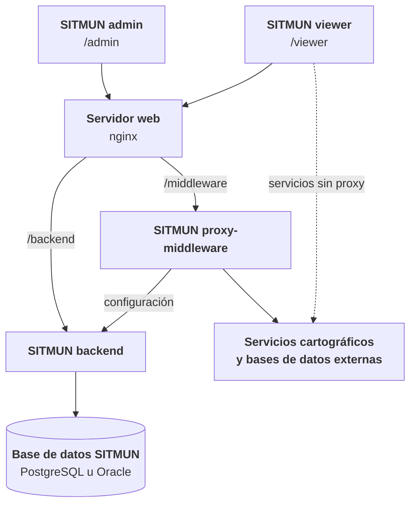
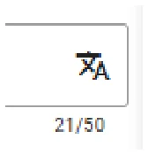
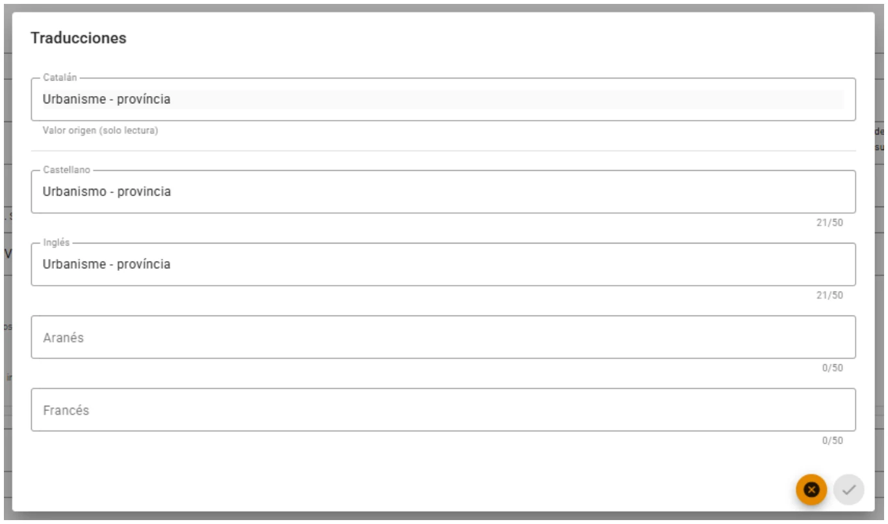
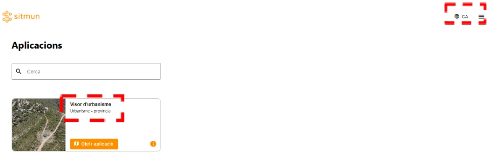
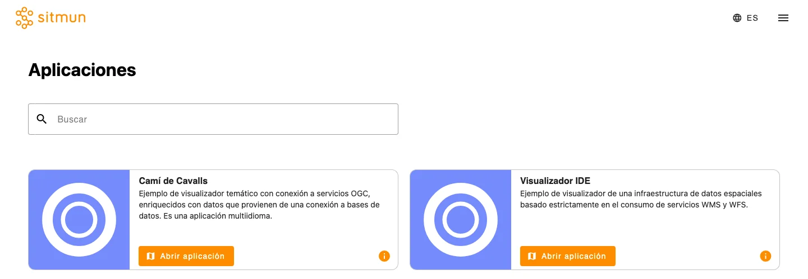

# Manual del administrador

Este manual es una guía para los usuarios administradores de SITMUN, en su versión 3.

SITMUN 3 nace de una profunda actualización técnica y conceptual de la versión SITMUN 2 con el fin de poner al día sus estándares tecnológicos y, también, para incrementar y mejorar sus funcionalidades, tanto para el administrador como para el usuario.

SITMUN 3 ya está disponible bajo una versión de código libre, concretamente bajo la **licencia EUPL v1.2**. Esto facilita que el proyecto pueda ser utilizado por otras administraciones locales y, también, que dichas administraciones puedan contribuir activamente al avance del proyecto SITMUN.

El código fuente del proyecto se puede encontrar en el [repositorio de GitHub de SITMUN](https://github.com/sitmun/).

## Arquitectura básica de SITMUN 3

Sin entrar en detalles técnicos que no son objeto de este manual, sí que es conveniente describir los principales elementos que configuran SITMUN 3:

- **SITMUN Viewer (visor).** Es la aplicación que verán los usuarios de SITMUN y donde se pueden consultar los datos cartográficos y ejecutar las funcionalidades de SITMUN.
- **SITMUN admin.** Es la aplicación de administración que utilizarán los usuarios administradores para configurar el visor y añadir y mantener los datos cartográficos de SITMUN.
- **SITMUN backend.** Es la parte de la aplicación que se encarga de la lógica de la aplicación y de gestionar las consultas a la base de datos. Esta parte de la aplicación se ejecuta en el servidor donde se aloje la instalación de SITMUN y no es visible ni para el usuario público ni para el administrador. La gestiona el responsable de sistemas de SITMUN.
- **SITMUN proxy-middleware.** Es una parte de la aplicación que tiene como fin gestionar peticiones al backend que requieren una capa extra de seguridad, como por ejemplo las conexiones a servicios cartográficos con autenticación.
- **Base de datos SITMUN.** Es la base de datos donde SITMUN guarda toda la información referente a servicios, capas, usuarios, roles, tareas, aplicaciones, etc. El proyecto contiene modelos de base de datos en Oracle y PostgreSQL, pero también permite utilizar bases de datos externas a la propia aplicación.

*Esquema de despliegue. El servidor web publica el administrador y el visor, y reenvía sus peticiones al backend y al proxy.*

El objetivo de este manual es explicar la parte de SITMUN admin, y va dirigido a los usuarios administradores de SITMUN.

## Multiidioma

Una característica general de SITMUN es que es multiidioma, permitiendo gestionar el proyecto en 6 idiomas: inglés, francés, español, catalán, occitano (aranés) y portugués. Los cinco primeros son los idiomas oficiales de las administraciones impulsoras del proyecto SITMUN.

Hay que diferenciar dos aspectos de la gestión del multiidioma en SITMUN:

- Los **textos de contenido**, es decir, todo texto añadido por el usuario administrador o el usuario público.
- Los **textos de aplicación**, es decir, todo texto incorporado a la aplicación y que tiene por objetivo informar de algo al usuario.

Para gestionar los **textos de contenido**, en cualquier formulario de la aplicación de administración que admita texto aparece el siguiente símbolo:

{ loading=lazy }

Al pulsar sobre este símbolo se despliega otro formulario que permite añadir los textos equivalentes al texto que se ha creado en los diferentes idiomas definidos.

{ loading=lazy }

Cuando el usuario público seleccione un idioma en concreto en el visor, se buscará el texto equivalente en el idioma seleccionado para mostrarlo traducido, tal y como se muestra en las capturas de pantalla para el catalán y el español.

{ loading=lazy }

{ loading=lazy }

En el caso de que un texto no figure traducido en el idioma seleccionado, se proporcionará el texto en el idioma por defecto, que se elige en el primer arranque de la instalación y se puede cambiar en [Sistema → Idiomas](sistema.md#idiomas).

Los **textos de aplicación**, por norma general, se deben modificar en el código. Algunos de ellos se pueden traducir desde la aplicación de administración, en el apartado [Traducciones de literales](sistema.md#traducciones-de-literales).
