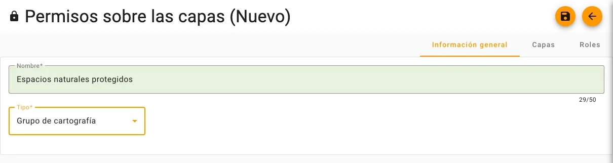
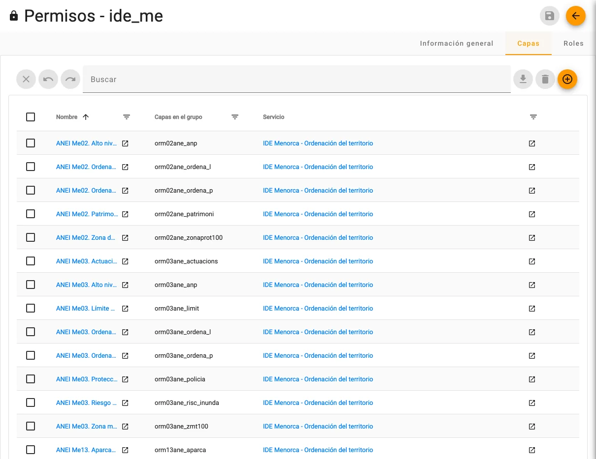

# Permisos sobre las capas

Se generan grupos de capas para darles permisos conjuntamente y asignarles los roles.

Primero se debe crear el grupo, donde se debe indicar el nombre y el tipo de grupo de permisos:

- **Nombre\***: puede ser cualquier nombre que nos permita reconocer el grupo de capas y permisos.
- **Tipo\***: puede ser Cartografía, Informe o Mapa de situación, según el uso que se le quiera dar al grupo de capas.

{ loading=lazy }

En la pestaña **Capas** se pueden cargar todas las capas ya configuradas en la plataforma.

{ loading=lazy }

Una vez creado el grupo de permisos de capas, ya existe en la plataforma, por lo que se podrá añadir directamente desde la definición de la capa.

{ loading=lazy }

Desde el botón **+** de la derecha aparece un listado de los permisos sobre las capas disponibles. Se debe seleccionar el grupo y añadirlo a la lista con el símbolo **+**.

{ width="393" loading=lazy }

Aparece el símbolo naranja a la derecha, como pendiente de guardar.
