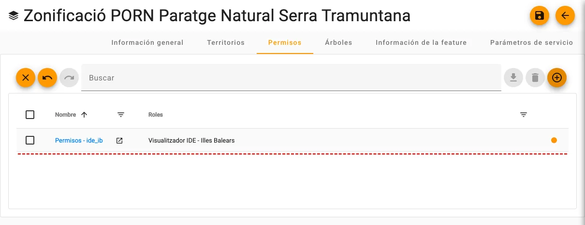
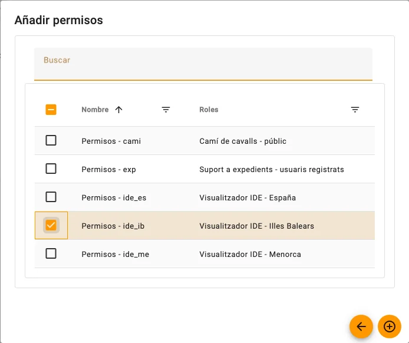

# Permisos sobre las capas { #admin-permisos-capas }

En el menú **Permisos sobre las capas** se crean grupos de permisos: conjuntos de capas a los que se asignan roles.

Primero se crea el grupo, con su nombre y su tipo:

- **Nombre\***: puede ser cualquier nombre que permita reconocer el grupo de permisos.
- **Tipo\***: puede ser «Grupo de cartografía», «Informe» o «Mapa de situación», según el uso que se le quiera dar al grupo de permisos. Existe un cuarto tipo, «Mapa de fondo», que se crea automáticamente con cada mapa de fondo (menú [Capas de fondo](capas-de-fondo.md)); no hace falta crearlo a mano.

{ loading=lazy }

En la pestaña **Capas** se pueden cargar todas las capas ya configuradas en la plataforma.

{ loading=lazy }

Una vez creado el grupo de permisos, ya existe en la plataforma, por lo que se podrá añadir directamente desde la definición de la capa.

{ loading=lazy }

Desde el botón **+** de la derecha aparece un listado de los permisos sobre las capas disponibles. Se debe seleccionar el grupo y añadirlo a la lista con el símbolo **+**.

{ loading=lazy }

La fila nueva aparece con un punto naranja (al pasar el ratón, «Pendiente crear») hasta que se guarda la capa.
