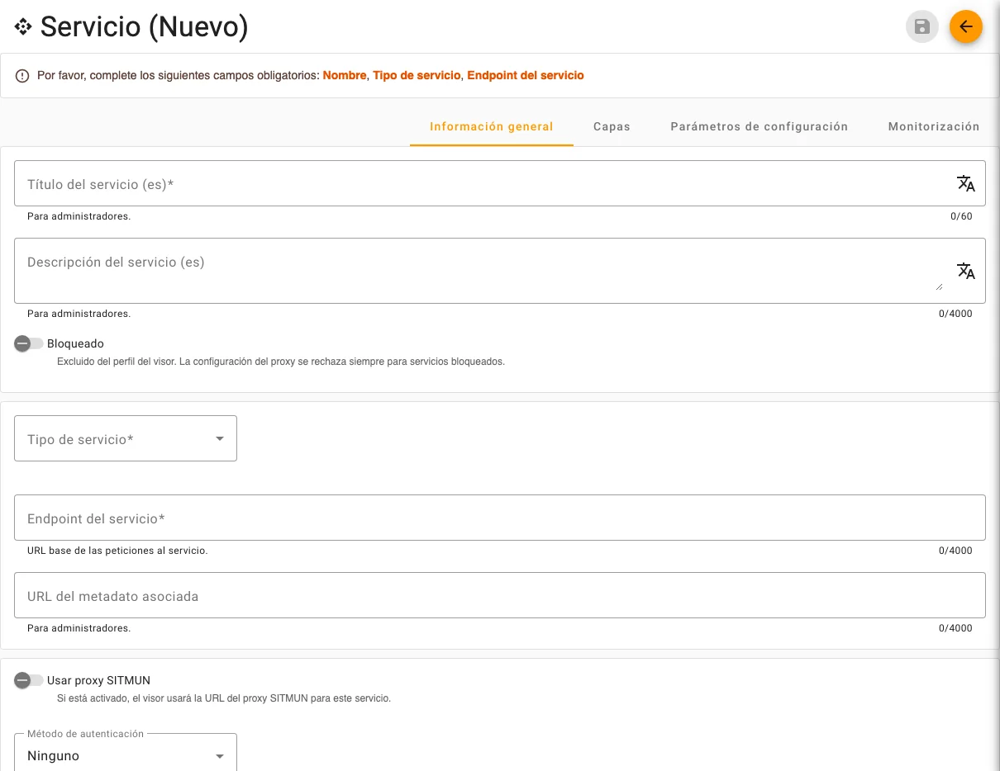
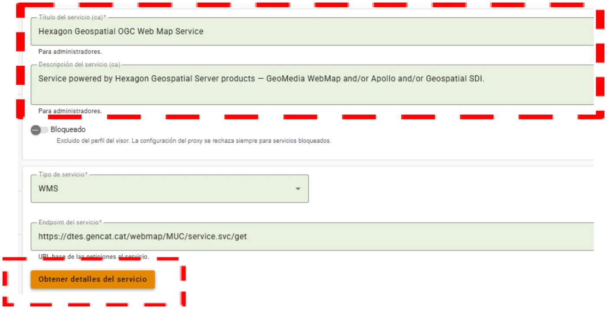
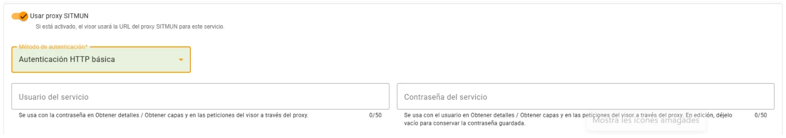
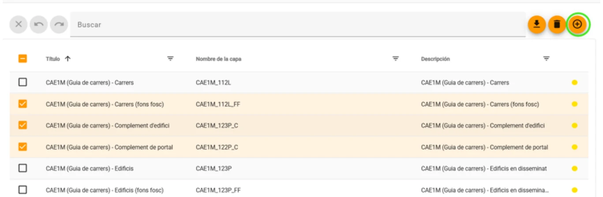
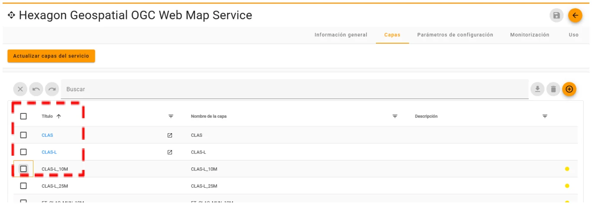
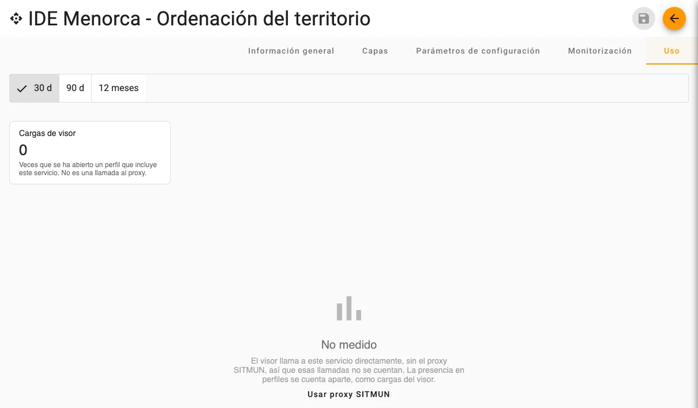

# Servicios

La funcionalidad principal de SITMUN es la visualización de cartografía mediante capas. Dicha cartografía se obtiene mediante la conexión a servicios que ofrecen datos cartográficos.

En este apartado se pueden configurar los servicios cartográficos que proporcionan la información que se puede visualizar en el visor de SITMUN.

Para añadir un nuevo servicio cartográfico se usa el formulario siguiente, indicando los datos específicos del servicio, tal y como se muestra en la captura de pantalla.

## Información general

Los primeros datos que se deben proporcionar son los datos vinculados a la información general.

{ loading=lazy }

- **Título del servicio\*** y **Descripción del servicio**: pueden ser cualquier texto que permita reconocer el servicio añadido. Se recomienda disponer de algún criterio de taxonomía para poder nombrar todos los elementos de SITMUN y luego facilitar su identificación.
- **Bloqueado**: si está activado, bloquea un servicio y todas sus capas, que ya no son visibles en el visor SITMUN.
- **Tipo de servicio\***: es posible añadir servicios de tipo Web Map Service (WMS), Web Feature Service (WFS) o Web Map Tile Service (WMTS).
- **Endpoint del servicio\***: será la URL de conexión del servicio cartográfico.
- **URL del metadato asociada**: se puede añadir, de manera opcional, un enlace a los metadatos correspondientes a dicho servicio.

Los campos marcados con un asterisco son obligatorios para poder crear un servicio.

Un aspecto que puede resultar de interés es que, en el momento de añadir la dirección de un servicio WMS, aparece el botón **Obtener detalles del servicio**. El botón también aparece en los servicios WFS, pero en la versión 1.3.0 solo funciona con WMS ([sitmun/sitmun#382](https://github.com/sitmun/sitmun/issues/382)). Este botón permite consultar la información del propio servicio y autocompletar la información del formulario de creación del servicio; por ejemplo, puede añadir la propia descripción del servicio en el apartado de descripción.

Además, tiene la virtud de poder probar la comunicación con el servicio y comprobar que ha sido posible realizar la conexión a dicho servicio.

{ loading=lazy }

*Tras pulsar el botón **Obtener detalles del servicio**, se autocompletan los campos de título y descripción con los datos proporcionados por el servicio.*

### Servicios de acceso restringido

Hay que tener en cuenta que algunos servicios cartográficos pueden requerir la autenticación previa mediante usuario y contraseña. Esto depende de cómo esté configurado el propio servicio.

En SITMUN es posible realizar la conexión a servicios que requieren autenticación mediante la parte inferior del apartado **Información general**.

Para un servicio con autenticación, en el desplegable **Método de autenticación** se elige **Autenticación HTTP básica** (usuario y contraseña). La opción **Usar proxy SITMUN** se activa entonces sola y no se puede desactivar mientras haya autenticación: las conexiones con autenticación pasan por SITMUN Proxy Middleware para proteger los datos.

Al seleccionar la opción de autenticación se deben facilitar el usuario y la contraseña de conexión al servicio.

!!! warning "SITMUN 1.3.0: error 401 en el proxy con algunos usuarios"
    Un usuario con fecha de último cambio de contraseña registrada recibe un error 401 en todas las capas y tareas que el visor pide a través de SITMUN Proxy Middleware (servicios con **Usar proxy SITMUN**, consultas SQL y de API web, localizadores). Es el caso del usuario `admin` cuya contraseña se creó en el primer acceso (o con `SITMUN_BOOTSTRAP_ADMIN_PASSWORD`) y de cualquier usuario que la haya restablecido con la recuperación de contraseña; cambiar la contraseña desde el formulario de usuarios no registra esa fecha.
    No hay solución en la configuración. No se ven afectados el usuario público ni las capas que el visor carga directamente. Más detalles en [la API de Proxy](../../../que-es-sitmun/plataforma/arquitectura/api.md#problema-token-proxy-1-3-0) y en [sitmun/sitmun#387](https://github.com/sitmun/sitmun/issues/387).

{ loading=lazy }

## Capas

Una vez configurado el servicio se pueden gestionar las capas que dicho servicio proporciona.

La pestaña **Capas** aparecerá vacía en el momento de crear el servicio. Las capas se pueden configurar automáticamente o también existe la opción de definirlas manualmente, lo que ofrece otras posibilidades de configuración. Esta segunda opción se detalla en el apartado [Capas](capas.md).

La carga automática solo funciona en los servicios WMS. En un servicio WFS la pestaña se llama **Tipos de entidad** y tiene el botón **Obtener tipos de entidad del servicio**, pero en la versión 1.3.0 no funciona: el backend solo admite WMS y responde con un error aunque la URL sea correcta ([sitmun/sitmun#382](https://github.com/sitmun/sitmun/issues/382)). En los servicios WFS y WMTS las capas se crean a mano en el menú [Capas](capas.md).

El botón **Actualizar capas del servicio** carga las capas automáticamente (en un servicio que todavía no está guardado, se llama **Obtener capas del servicio**). Tras aceptar el aviso «Peligro», aparece la lista de todas las capas que proporciona el servicio:

{ loading=lazy }

En este punto aún no hay ninguna capa añadida a SITMUN, solo el listado de las que ofrece el servicio. La última columna muestra el estado de cada capa con un punto de color; al pasar el ratón sobre él aparece su nombre. Las capas que ofrece el servicio aparecen con un punto amarillo, «Capa no registrada».

Del listado se eligen las capas que se quieren incorporar a SITMUN y se pulsa **Registrar** (símbolo **+**). Su punto pasa a naranja, «Pendiente registrar»: están preparadas, pero todavía no forman parte de SITMUN. Las capas se crean al guardar el servicio.

!!! warning "SITMUN 1.3.0: «Pendiente crear» en un servicio nuevo"
    En un servicio que todavía no se ha guardado, las capas obtenidas aparecen por error con el punto
    naranja «Pendiente crear» en lugar del amarillo «Capa no registrada»
    ([sitmun/sitmun#371](https://github.com/sitmun/sitmun/issues/371)).
    Como en cualquier servicio, al guardar solo se crean las capas registradas con **Registrar**.

{ loading=lazy }

{ loading=lazy }

*Se seleccionan las capas deseadas, se pulsa **Registrar** y se guarda el servicio.*

Una vez guardado, al volver a la pestaña **Capas** esas capas ya aparecen como registradas. Posteriormente se deben configurar con las opciones descritas en el apartado [Capas](capas.md) de este manual, pero el primer paso es registrarlas en SITMUN.

{ loading=lazy }

Se puede quitar una capa ya registrada seleccionándola de la lista y pulsando el icono de la papelera. La capa queda marcada con un punto rojo, «Pendiente eliminar», y al guardar se materializa el cambio.

{ loading=lazy }

{ loading=lazy }

## Parámetros de configuración

La pestaña **Parámetros de configuración** añade parámetros a las peticiones que el visor hace al servicio. En un servicio WMTS es necesario el parámetro `matrixSet` (y opcionalmente `format`), ambos de tipo WMTS; sin `matrixSet` el mapa de la aplicación no se abre. Su valor es uno de los `TileMatrixSet` que anuncia el GetCapabilities del servicio (`?SERVICE=WMTS&REQUEST=GetCapabilities`), y el nombre técnico de cada capa es su `ows:Identifier`; las capas WMTS se crean a mano. La guía [Añadir OpenStreetMap como mapa de fondo](../../guias/mapa-fondo-openstreetmap.md) tiene un ejemplo completo.

## Monitorización y uso

Las pestañas **Monitorización** y **Uso** ofrecen herramientas útiles para poder realizar un seguimiento del servicio en cuestión y conocer su estado.

En concreto, la pestaña **Monitorización** permite mantener un seguimiento permanente que prueba la conexión al servicio periódicamente (cada 15 minutos por defecto; el intervalo se configura en el backend con `sitmun.service-check.interval`). Esto resulta útil, ya que se pueden detectar servicios que han dejado de funcionar sin necesidad de realizar una prueba explícita sobre el servicio.

{ loading=lazy }

La pestaña **Uso** muestra estadísticas de uso del servicio. Solo se cuentan las peticiones que pasan por el proxy y las **Cargas de visor**: si el servicio no usa el proxy, el visor lo llama directamente y esas peticiones aparecen como «No medido».

{ loading=lazy }

*Estas dos capturas son de otro servicio de la instalación de demostración, «IDE Menorca - Ordenación del territorio», que ya tiene historial de comprobaciones y de uso.*
