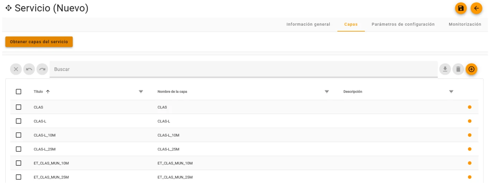
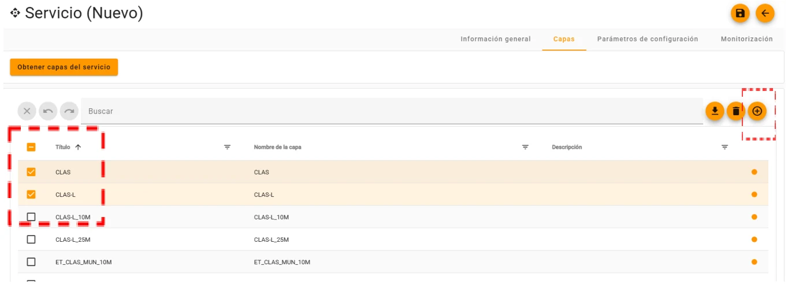
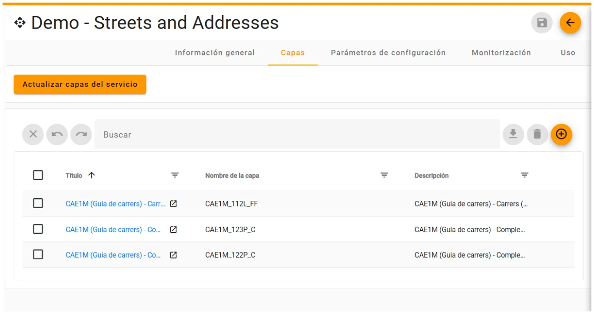
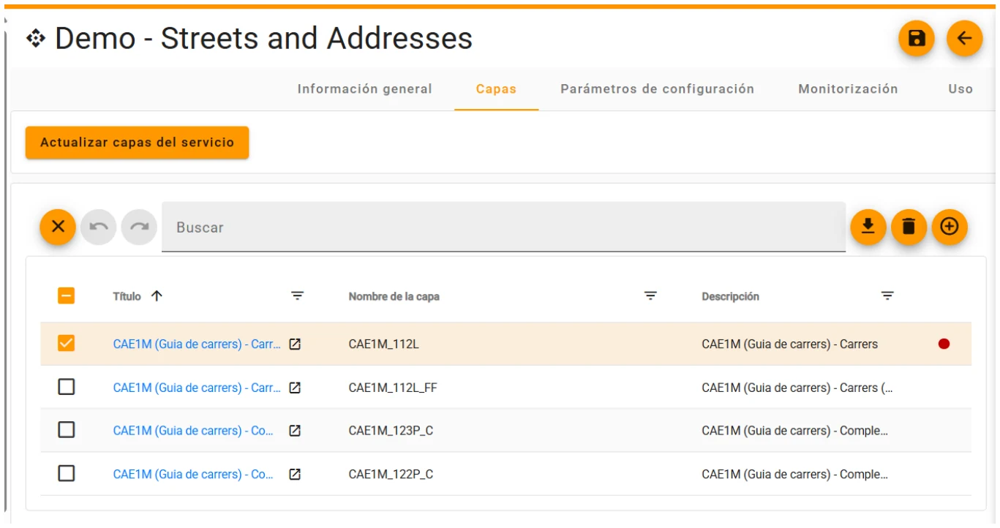
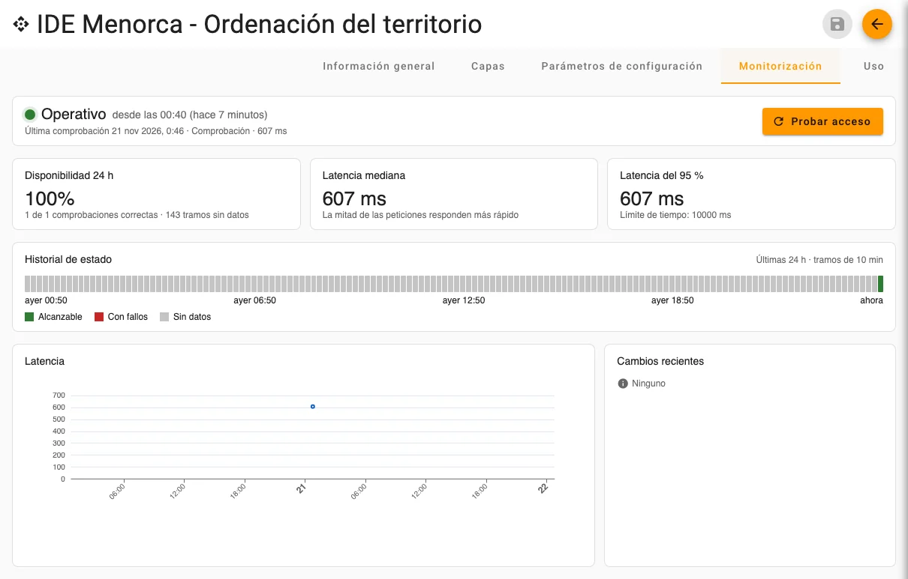

# Servicios

La funcionalidad principal de SITMUN es la visualización de cartografía mediante capas. Dicha cartografía se obtiene mediante la conexión a servicios que ofrecen datos cartográficos.

En este apartado se pueden configurar los servicios cartográficos que proporcionan la información que se puede visualizar en el visor de SITMUN.

Para añadir un nuevo servicio cartográfico lo podemos hacer mediante el formulario siguiente, indicando los datos específicos del servicio, tal y como se muestra en la captura de pantalla.

## Información general

Los primeros datos que se deben proporcionar son los datos vinculados a la información general.

{ loading=lazy }

- **Título del servicio\*** y **Descripción del servicio**: pueden ser cualquier texto que nos permita reconocer el servicio añadido. Se recomienda disponer de algún criterio de taxonomía para poder nombrar todos los elementos de SITMUN y luego facilitar su identificación.
- **Bloqueado**: si está activado, bloquea un servicio y todas sus capas, que ya no son visibles en el visor SITMUN.
- **Tipo de servicio\***: es posible añadir servicios de tipo Web Map Service (WMS), Web Feature Service (WFS) o Web Map Tile Service (WMTS).
- **Endpoint del servicio\***: será la URL de conexión del servicio cartográfico.
- **URL del metadato asociada**: se puede añadir, de manera opcional, un enlace a los metadatos correspondientes a dicho servicio.

Los campos marcados con un asterisco son obligatorios para poder crear un servicio.

Un aspecto que puede resultar de interés es que, en el momento de añadir un endpoint para un servicio WMS, aparece el botón **Obtener detalles del servicio**. Este botón permite consultar la información del propio servicio y autocompletar la información del formulario de creación del servicio; por ejemplo, puede añadir la propia descripción del servicio en el apartado de descripción.

Además, tiene la virtud de poder probar la comunicación con el servicio y comprobar que ha sido posible realizar la conexión a dicho servicio.

{ loading=lazy }

*Tras pulsar el botón **Obtener detalles del servicio**, se autocompletan los campos de título y descripción con los datos proporcionados por el servicio.*

### Servicios de acceso restringido

Hay que tener en cuenta que algunos servicios cartográficos pueden requerir la autenticación previa mediante usuario y contraseña. Esto depende de cómo esté configurado el propio servicio.

En SITMUN es posible realizar la conexión a servicios que requieren autenticación mediante la parte inferior del apartado **Información general**.

Para la conexión a servicios con autenticación debemos utilizar el desplegable **Método de autenticación** y seleccionar **Autenticación HTTP básica** (usuario y contraseña). Al hacerlo, la opción **Usar proxy SITMUN** se activa automáticamente y no se puede desactivar mientras haya autenticación, ya que las conexiones con autenticación se redireccionan mediante el proxy de SITMUN para mayor seguridad de los datos.

Al seleccionar la opción de autenticación deberemos facilitar el usuario y la contraseña de conexión al servicio.

{ loading=lazy }

## Capas

Una vez configurado el servicio podemos gestionar las capas que dicho servicio proporciona.

La pestaña **Capas** aparecerá vacía en el momento de crear el servicio. Las capas se pueden configurar automáticamente o también existe la opción de definirlas manualmente, lo que ofrece otras posibilidades de configuración. Esta segunda opción se detalla en el apartado [Capas](capas.md).

Para cargar las capas automáticamente se utiliza el botón **Actualizar capas del servicio** (en un servicio que todavía no se ha guardado se llama **Obtener capas del servicio**). Al pulsarlo se listan todas las capas que proporciona el servicio:

{ loading=lazy }

En este punto aún no tenemos ninguna capa añadida a SITMUN, solo el listado de las que ofrece el servicio. La última columna muestra el estado de cada capa con un punto de color; al pasar el ratón sobre él aparece su nombre. Las capas que ofrece el servicio aparecen con un punto amarillo, **Capa no registrada**.

Del listado podemos seleccionar las capas que deseemos incorporar a SITMUN y pulsar el botón **Registrar** (símbolo **+**). Su punto pasa a naranja, **Pendiente registrar**: están preparadas, pero todavía no se han incorporado a SITMUN. Es necesario guardar el servicio para que se creen.

!!! warning "SITMUN 1.3.0: «Pendiente crear» en un servicio nuevo"
    En un servicio que todavía no se ha guardado, las capas obtenidas aparecen por error con el punto
    naranja **Pendiente crear** en lugar del amarillo **Capa no registrada**
    ([sitmun/sitmun#371](https://github.com/sitmun/sitmun/issues/371)).
    Como en cualquier servicio, al guardar solo se crean las capas registradas con **Registrar**.

{ loading=lazy }

{ loading=lazy }

*Seleccionamos las capas deseadas, pulsamos **Registrar** y finalizamos guardando el servicio.*

Una vez guardado, si volvemos a la pestaña **Capas** veremos que esas capas ya aparecen como registradas. Posteriormente deberemos configurarlas con las opciones descritas en el apartado [Capas](capas.md) de este manual, pero el primer paso es registrarlas en SITMUN.

{ loading=lazy }

Podemos quitar una capa ya registrada seleccionándola de la lista y pulsando el icono de la papelera. La capa queda marcada con un punto rojo, **Pendiente eliminar**, y al guardar se materializa el cambio.

{ loading=lazy }

{ loading=lazy }

## Monitorización y uso

Las pestañas **Monitorización** y **Uso** ofrecen herramientas útiles para poder realizar un seguimiento del servicio en cuestión y conocer su estado.

En concreto, la pestaña **Monitorización** permite mantener un seguimiento permanente que prueba la conexión al servicio periódicamente (cada 15 minutos por defecto; el intervalo se configura en el backend con `sitmun.service-check.interval`). Esto resulta útil, ya que se pueden detectar servicios que han dejado de funcionar sin necesidad de realizar una prueba explícita sobre el servicio.

{ loading=lazy }

La pestaña **Uso** permite mantener estadísticas del uso de dicho servicio.

{ loading=lazy }
