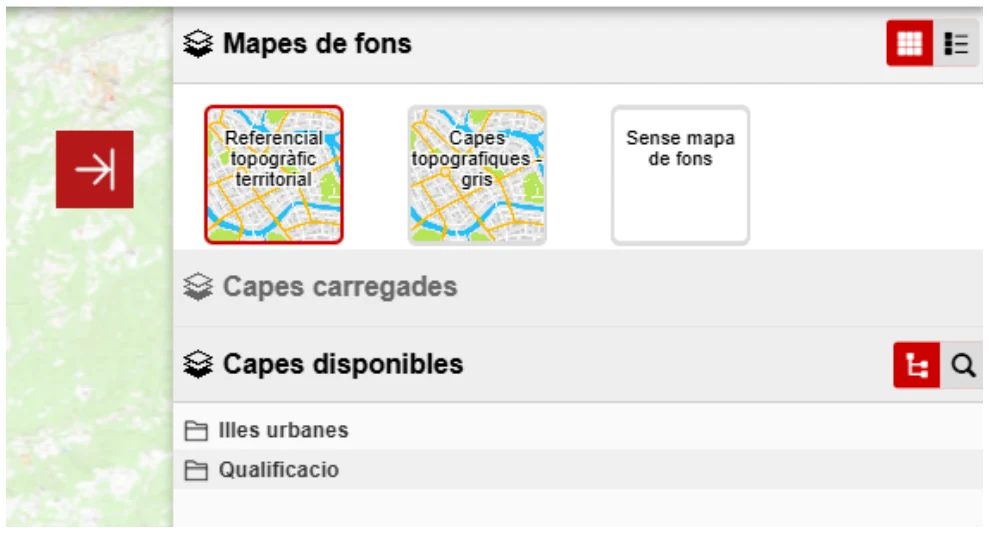
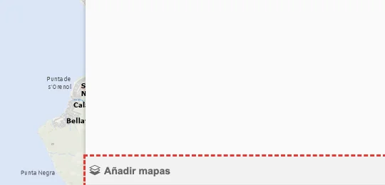
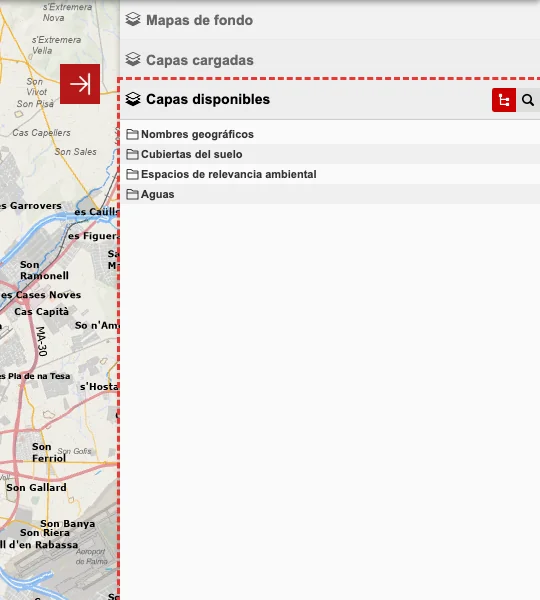
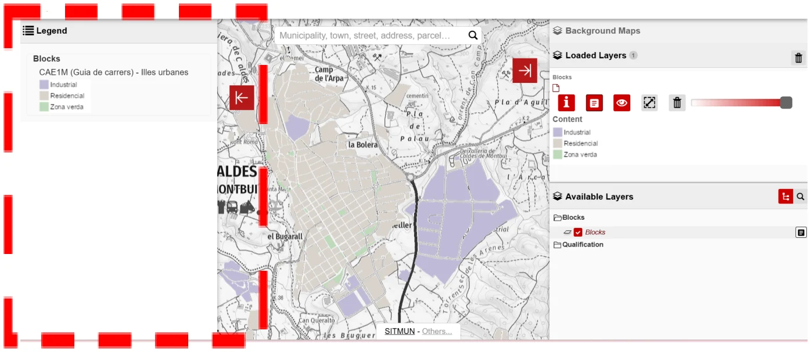
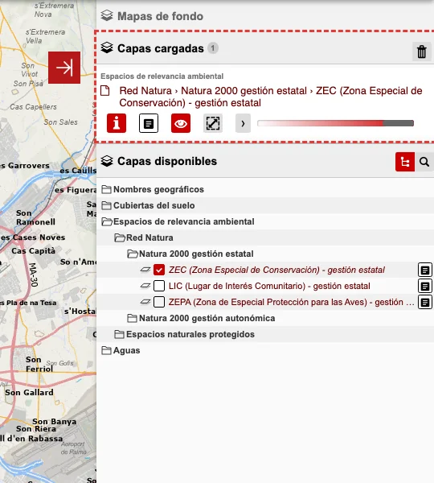

# Tareas de capas

Tareas básicas para elegir el mapa de fondo y gestionar las capas del mapa.

## Selector de mapa base (Basemap Selector) { #basemap-selector }

Permite seleccionar el mapa base que se desea utilizar entre un conjunto de mapas disponibles.

Este control únicamente permite seleccionar entre los mapas base disponibles. Si se desea configurar una capa para que actúe como mapa base, consulte el apartado [Capas de fondo](../../capas-de-fondo.md).

- Control API SITNA: `sitna.basemapSelector`

{ loading=lazy }

## Cargador de datos (Data Loader) { #data-loader }

Permite añadir capas externas a SITMUN mediante la URL de un servicio de datos geográficos proporcionado por el usuario.

- Control API SITNA: `sitna.dataLoader`

{ loading=lazy }

## Catálogo de capas (Layer Catalog) { #layer-catalog }

Permite visualizar el catálogo de capas disponibles en el [árbol de capas](../../arboles.md).

- Control API SITNA: `sitna.layerCatalog`

{ loading=lazy }

## Leyenda (Legend) { #legend }

Permite visualizar la leyenda de las capas cargadas. La leyenda que se muestra se reconfigura con las capas cargadas y visibles. Si, por ejemplo, una capa está cargada pero aún no es visible porque no está dentro del rango de escalas de visualización, la leyenda de esa capa no se mostrará.

- Control API SITNA: `sitna.legend`

{ loading=lazy }

*Captura de una versión anterior de SITMUN; en 1.3.0, véase la nota siguiente.*

!!! warning "SITMUN 1.3.0"
    En la versión 1.3.0 el panel **Leyenda** muestra «No hay datos» aunque haya capas cargadas
    ([sitmun/sitmun#375](https://github.com/sitmun/sitmun/issues/375)).

## Gestor de capas de trabajo (Work Layer Manager) { #work-layer-manager }

Permite gestionar las capas activadas: quitarlas, ocultarlas, cambiar el orden, la transparencia, etc.

- Control API SITNA: `sitna.workLayerManager`

{ loading=lazy }
