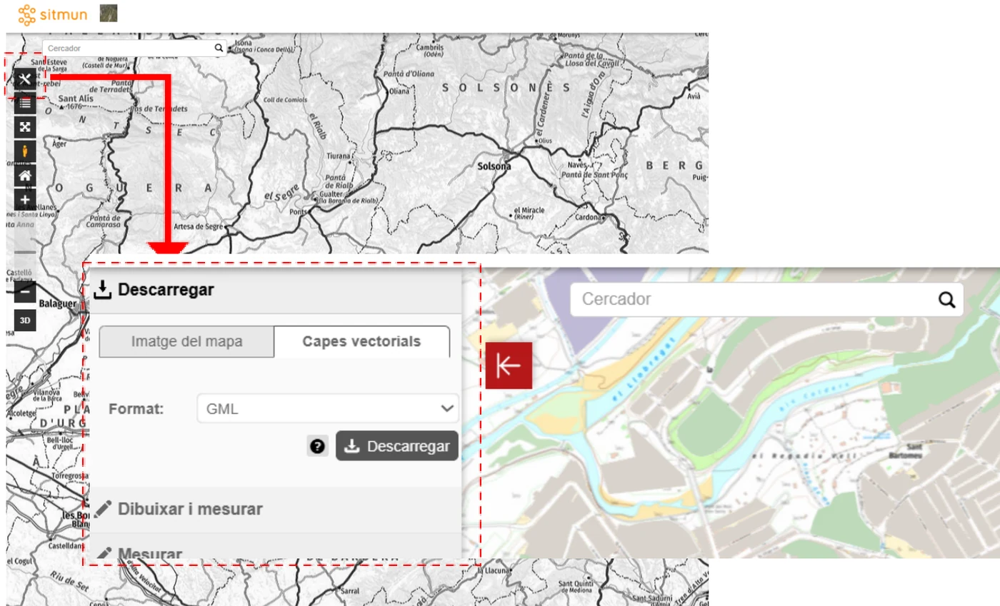
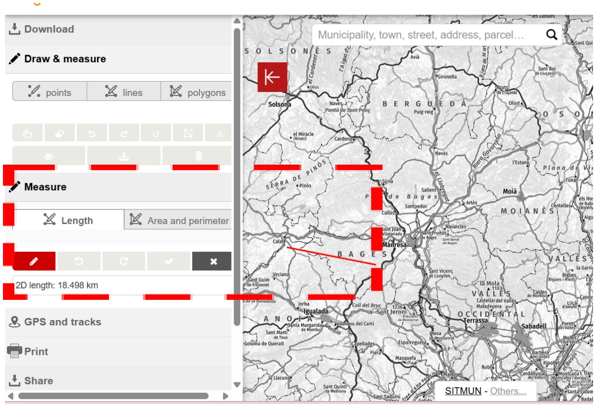
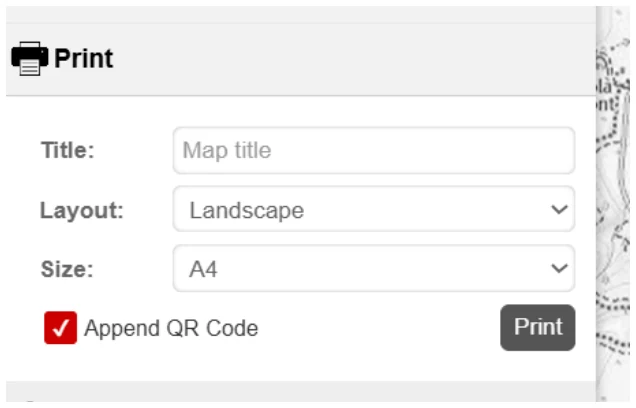
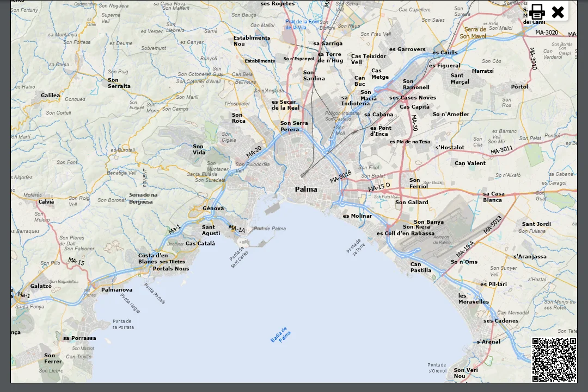
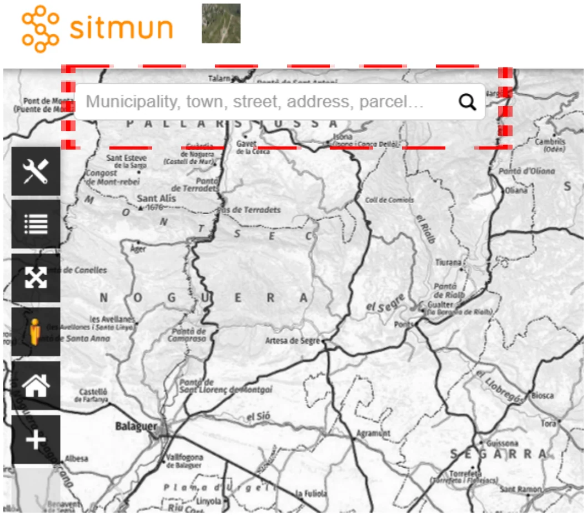
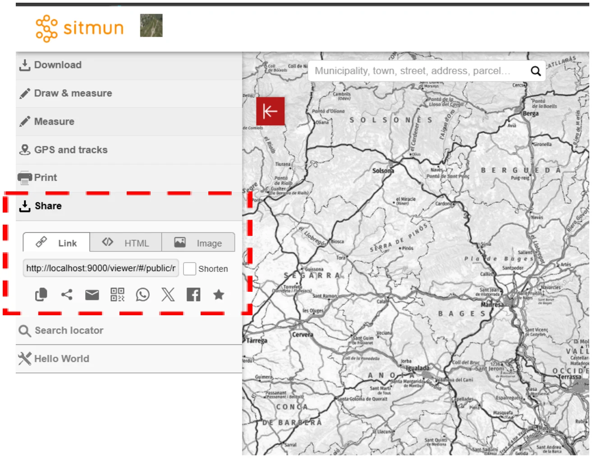

# Herramientas

Tareas básicas con herramientas de trabajo sobre el mapa: dibujar, medir, descargar, imprimir, compartir y buscar.

## Attribution

- Control API SITNA: `sitna.attribution`

!!! info "En preparación"
    Este apartado todavía no está documentado.

## Download

Permite descargar información de las capas de SITMUN. La descarga puede realizarse como una imagen del mapa que se está consultando o como una capa vectorial en el formato deseado (GML, GeoJSON, KML, SHP, GeoPackage o DXF).

Para poder descargar la capa en formato vectorial, el servicio que proporciona la capa debe estar configurado para permitir las descargas.

- Control API SITNA: `sitna.download`

{ loading=lazy }

## Draw, Measure and Modify

Permite utilizar las siguientes herramientas:

- Dibujar elementos en el mapa (puntos, líneas o polígonos) y modificarlos posteriormente.
- Medir distancias o áreas.

<!-- separa las dos listas -->

- Control API SITNA: `sitna.drawMeasureModify`

{ loading=lazy }

## Loading Indicator

!!! info "En preparación"
    Este apartado todavía no está documentado.

## Measure

Se trata de una herramienta de medición sencilla que permite medir distancias o áreas. Para tareas de medición más complejas existe la herramienta [Draw, Measure and Modify](#draw-measure-and-modify), con más opciones.

- Control API SITNA: `sitna.measure`

{ loading=lazy }

## Offline Map Maker

Permite crear, del lado del cliente, mapas que estarán disponibles sin conexión.

- Control API SITNA: `sitna.offlineMapMaker`

## Print Map

Permite configurar la impresión de un mapa. Se pueden seleccionar parámetros básicos como la orientación y el tamaño, e incrustar un código QR que permite visualizar el mapa impreso.

- Control API SITNA: `sitna.printMap`

{ loading=lazy }

Mediante este cuadro de diálogo se configura la impresión y se activa la vista siguiente, donde podemos acabar de situar el mapa deseado e imprimir cuando sea correcto.

{ loading=lazy }

## Search

Permite visualizar la función de búsqueda general en el mapa. Para que este control funcione correctamente (es decir, con un catálogo toponímico asociado al territorio), se debe configurar un servicio WFS del que obtener los datos de toponimia que alimentarán el buscador.

- Control API SITNA: `sitna.search`

{ width="464" loading=lazy }

!!! warning "SITMUN 1.3.0"
    En la versión 1.3.0 el buscador no devuelve resultados y muestra `[[searchPlaceholder]]`
    ([sitmun/sitmun#352](https://github.com/sitmun/sitmun/issues/352), corregido para la siguiente versión).

## Share

La opción Share permite compartir un determinado mapa (entendiendo mapa como un conjunto de capas seleccionado y visible a una determinada escala).

Se ofrecen múltiples formas de compartir el mapa: enlace URL, imagen, código QR, redes sociales, etc.

- Control API SITNA: `sitna.share`

{ loading=lazy }

## WFS Query

!!! info "En preparación"
    Este apartado todavía no está documentado.

## WFSEdit

!!! info "En preparación"
    Este apartado todavía no está documentado.
