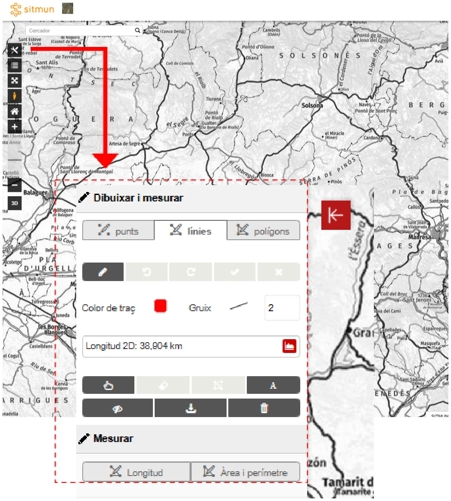

# Herramientas

Tareas básicas con herramientas de trabajo sobre el mapa: dibujar, medir, descargar, imprimir, compartir y buscar.

## Atribución (Attribution) { #attribution }

- Control API SITNA: `sitna.attribution`

!!! info "En preparación"
    Este apartado todavía no está documentado.

## Descarga (Download) { #download }

Permite descargar información de las capas de SITMUN. La descarga puede realizarse como una imagen del mapa que se está consultando o como una capa vectorial en el formato deseado (GML, GeoJSON, KML, SHP, GeoPackage o DXF).

Para poder descargar la capa en formato vectorial, el servicio que proporciona la capa debe estar configurado para permitir las descargas.

- Control API SITNA: `sitna.download`

{ loading=lazy }

## Dibujar, Medir y Modificar (Draw, Measure and Modify) { #draw-measure-and-modify }

Permite utilizar las siguientes herramientas:

- Dibujar elementos en el mapa (puntos, líneas o polígonos) y modificarlos posteriormente.
- Medir distancias o áreas.

<!-- separa las dos listas -->

- Control API SITNA: `sitna.drawMeasureModify`

{ loading=lazy }

## Indicador de carga (Loading Indicator) { #loading-indicator }

!!! info "En preparación"
    Este apartado todavía no está documentado.

## Medir (Measure) { #measure }

Se trata de una herramienta de medición sencilla que permite medir distancias o áreas. Para tareas de medición más complejas existe la herramienta [Draw, Measure and Modify](#draw-measure-and-modify), con más opciones.

- Control API SITNA: `sitna.measure`

{ loading=lazy }

## Creador de mapas sin conexión (Offline Map Maker) { #offline-map-maker }

Permite crear, del lado del cliente, mapas que estarán disponibles sin conexión.

- Control API SITNA: `sitna.offlineMapMaker`

## Imprimir mapa (Print Map) { #print-map }

Permite configurar la impresión de un mapa. Se pueden seleccionar parámetros básicos como la orientación y el tamaño, e incrustar un código QR que permite visualizar el mapa impreso.

- Control API SITNA: `sitna.printMap`

{ loading=lazy }

Mediante este cuadro de diálogo se configura la impresión y se activa la vista siguiente, donde podemos acabar de situar el mapa deseado e imprimir cuando sea correcto.

{ loading=lazy }

## Buscar (Search) { #search }

Permite visualizar la función de búsqueda general en el mapa. Para que este control funcione correctamente (es decir, con un catálogo toponímico asociado al territorio), se debe configurar un servicio WFS del que obtener los datos de toponimia que alimentarán el buscador.

- Control API SITNA: `sitna.search`

{ width="464" loading=lazy }

*Captura de una versión anterior de SITMUN; en 1.3.0, véase la nota siguiente.*

!!! warning "SITMUN 1.3.0"
    En la versión 1.3.0 el buscador no devuelve resultados y muestra `[[searchPlaceholder]]`
    ([sitmun/sitmun#352](https://github.com/sitmun/sitmun/issues/352), corregido para la siguiente versión).

## Compartir (Share) { #share }

La opción Share permite compartir un determinado mapa (entendiendo mapa como un conjunto de capas seleccionado y visible a una determinada escala).

Se ofrecen varias formas de compartir el mapa: enlace, código HTML para insertarlo en otra web, correo electrónico, código QR, redes sociales y marcadores. Para obtener una imagen del mapa, utilice la tarea **Descarga**.

- Control API SITNA: `sitna.share`

{ loading=lazy }

## Consulta WFS (WFS Query) { #wfs-query }

!!! info "En preparación"
    Este apartado todavía no está documentado.

## Edición WFS (WFSEdit) { #wfsedit }

!!! info "En preparación"
    Este apartado todavía no está documentado.
