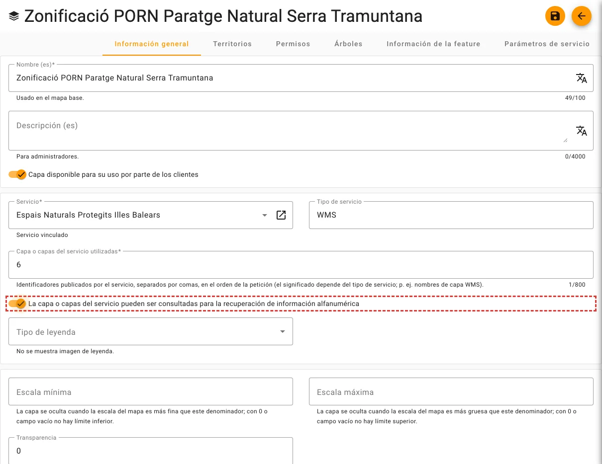
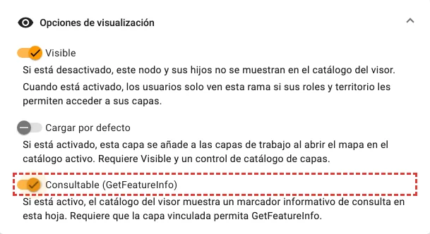
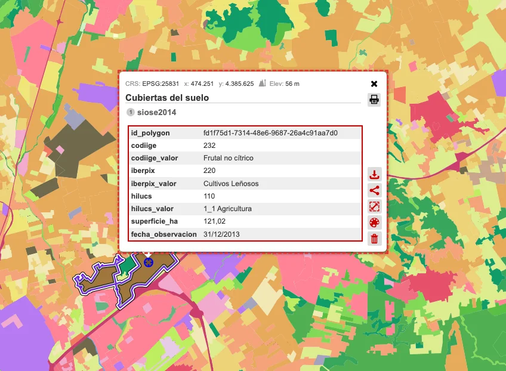

# Información

Tareas básicas para consultar la información de los elementos del mapa.

## Clic (Click) { #click }

- Control API SITNA: `sitna.click`

!!! info "En preparación"
    Este apartado todavía no está documentado.

## Coordenadas (Coordinates) { #coordinates-display }

- Control API SITNA: `sitna.coordinates`

!!! info "En preparación"
    Este apartado todavía no está documentado.

## Información de entidad (Feature Info) { #feature-info }

Permite obtener información mediante las capacidades de GetFeatureInfo (GFI) de las capas visualizadas en el mapa.

- Control API SITNA: `sitna.featureInfo`

Además de tener esta tarea básica asignada a los roles y territorios correspondientes, para poder visualizar la información GFI es necesario realizar previamente los siguientes pasos.

**Paso 1: activar la visualización de datos alfanuméricos de la capa**

En la [capa](../../capas.md) en la que se quiere mostrar información GFI se activa la opción *La capa o capas del servicio pueden ser consultadas para la recuperación de información alfanumérica*.

{ loading=lazy }

**Paso 2: activar la visualización de información en el árbol**

En el menú de [árboles](../../arboles.md) se localiza el nodo de la capa para la que se quiere mostrar la información GFI y, entre sus opciones de visualización, se activa **Consultable (GetFeatureInfo)**.

{ loading=lazy }

!!! bug "Error conocido de SITMUN 1.3.0: consulta de capas desactivada (sitmun/sitmun#377)"
    En la versión 1.3.0 el visor no aplica esta opción del nodo: la capa se consulta aunque esté desactivada
    ([sitmun/sitmun#377](https://github.com/sitmun/sitmun/issues/377)). Lo que sí impide la consulta es desactivar
    la opción de la capa del paso 1.

Una vez configuradas la capa y el árbol, al hacer clic sobre un elemento de la capa en cuestión, se visualizará la información GetFeatureInfo (GFI) del elemento o de los elementos seleccionados.

{ loading=lazy }

## Información avanzada (More Info Advanced) { #more-info-advanced }

Esta tarea permite utilizar las funcionalidades de More Info Advanced (MIA), que permiten ampliar la información mostrada de un elemento seleccionado, más allá de la proporcionada por GetFeatureInfo (GFI), incorporando, por ejemplo, información procedente de otras fuentes de datos.

Para definir un More Info Advanced (MIA), además de asignar a esta tarea los permisos correspondientes para los roles y territorios adecuados, será necesario configurar el MIA tal como se indica en el apartado [Tarea de más información avanzada](../mas-informacion-avanzada.md).

- Control API SITNA: `sitna.moreInfoAdvanced`

## Información múltiple de entidades (Multi Feature Info) { #multi-feature-info }

Permite seleccionar varias entidades a la vez, con un punto, una línea o un polígono, y obtener su información. La selección con un punto consulta las capas WMS con GetFeatureInfo; la selección con una línea o un polígono necesita que el servidor de la capa WMS la publique también como WFS.

- Control API SITNA: `sitna.multiFeatureInfo`

## Ventana emergente (Popup) { #popup }

!!! info "En preparación"
    Este apartado todavía no está documentado.
