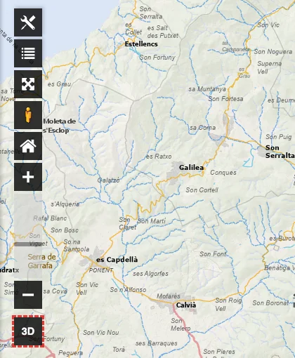
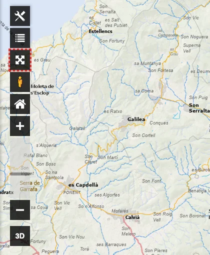
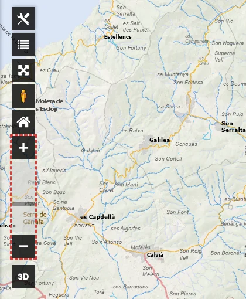

# Navegación y vista

Tareas básicas para moverse por el mapa y cambiar cómo se ve.

## 3D View

Permite cambiar de una visualización 2D a una visualización 3D, siempre que la capa de fondo disponga de la configuración necesaria para permitir la representación tridimensional de la cartografía.

- Control API SITNA: `sitna.threed`

{ width="220" loading=lazy }

## Full screen

Permite activar la visualización en pantalla completa.

- Control API SITNA: `sitna.fullScreen`

{ width="220" loading=lazy }

## Geolocation

!!! info "En preparación"
    Este apartado todavía no está documentado.

## Navigation Bar

Son los elementos que permiten realizar las operaciones de acercar y alejar, así como volver a la escala original.

- Control API SITNA: `sitna.navBar`

{ width="297" loading=lazy }

## Overview Map

Permite visualizar el mapa de situación. Se ubica en el icono inferior derecho.

- Control API SITNA: `sitna.overviewMap`

{ loading=lazy }

## Scale

Permite visualizar la escala del mapa. Se muestra en la parte inferior derecha.

- Control API SITNA: `sitna.scale`

{ width="291" loading=lazy }

## Scale Bar

Permite visualizar la escala en formato de barra. Este control no puede estar activado conjuntamente con el control Scale. Si lo está, se mostrará un mensaje informando de que son controles incompatibles entre sí y se visualizará el primero, en este caso Scale.

- Control API SITNA: `sitna.scaleBar`

{ width="189" loading=lazy }

## Scale Selector

!!! info "En preparación"
    Este apartado todavía no está documentado.

## Street View

Permite visualizar la información de Street View de un determinado punto del mapa. Se activa arrastrando el icono hasta el mapa y se vinculará con el punto de Street View más cercano.

Es necesario disponer de una clave (*key*) de Google Maps para que esta herramienta funcione correctamente; de lo contrario, las imágenes de Street View se mostrarán con un efecto de negativo fotográfico.

- Control API SITNA: `sitna.streetView`
