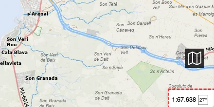

# Navegación y vista

Tareas básicas para moverse por el mapa y cambiar cómo se ve.

## Vista 3D (3D View) { #3d-view }

Permite cambiar de una visualización 2D a una visualización 3D, siempre que el mapa de fondo disponga de la configuración necesaria para permitir la representación tridimensional de la cartografía.

- Control API SITNA: `sitna.threed`

{ loading=lazy }

## Pantalla completa (Full Screen) { #full-screen }

Permite activar la visualización en pantalla completa.

- Control API SITNA: `sitna.fullScreen`

{ loading=lazy }

## Geolocalización (Geolocation) { #geolocation }

!!! info "En preparación"
    Este apartado todavía no está documentado.

## Barra de navegación (Navigation Bar) { #navigation-bar }

Son los elementos que permiten realizar las operaciones de acercar y alejar, así como volver a la escala original.

- Control API SITNA: `sitna.navBar`

{ loading=lazy }

## Mapa de situación (Overview Map) { #overview-map }

Permite visualizar el mapa de situación. Se ubica en el icono inferior derecho.

- Control API SITNA: `sitna.overviewMap`

!!! bug "Error conocido de SITMUN 1.3.0: mapa de situación en blanco con WMTS (sitmun/sitmun#388)"
    El mapa de situación usa la primera capa del grupo elegido en **Mapa de situación** y, si no hay grupo, la primera capa del primer mapa de fondo. Si esa capa es WMTS, el mapa de situación sale en blanco en la versión 1.3.0 ([sitmun/sitmun#388](https://github.com/sitmun/sitmun/issues/388)).
    Para evitarlo, se crea en [Permisos sobre las capas](../../permisos-capas.md) un grupo de tipo «Mapa de situación» con una sola capa WMS y se elige en el campo **Mapa de situación** de la [aplicación](../../aplicacion.md).

{ loading=lazy }

## Escala (Scale) { #scale }

Permite visualizar la escala del mapa. Se muestra en la parte inferior derecha.

- Control API SITNA: `sitna.scale`

{ loading=lazy }

## Barra de escala (Scale Bar) { #scale-bar }

Permite visualizar la escala en formato de barra. Se muestra en la esquina inferior derecha del mapa, en el mismo lugar que el control Scale, así que conviene no activar los dos en la misma aplicación (véase la nota siguiente).

- Control API SITNA: `sitna.scaleBar`

{ loading=lazy }

!!! bug "Error conocido de SITMUN 1.3.0: escala sobre la barra de escala (sitmun/sitmun#374)"
    Si la aplicación tiene también la tarea **Escala** (Scale), la escala tapa la barra de escala
    ([sitmun/sitmun#374](https://github.com/sitmun/sitmun/issues/374)).

## Selector de escala (Scale Selector) { #scale-selector }

!!! info "En preparación"
    Este apartado todavía no está documentado.

## Vista de calle (Street View) { #street-view }

Permite visualizar la información de Street View de un determinado punto del mapa. Se activa arrastrando el icono hasta el mapa y se vinculará con el punto de Street View más cercano.

Es necesario disponer de una clave (*key*) de Google Maps para que esta herramienta funcione correctamente; de lo contrario, las imágenes de Street View se mostrarán con un efecto de negativo fotográfico. La clave se indica en la pestaña **Parámetros** de la tarea, con un parámetro llamado `googleMapsKey` cuyo valor es la clave.

- Control API SITNA: `sitna.streetView`
