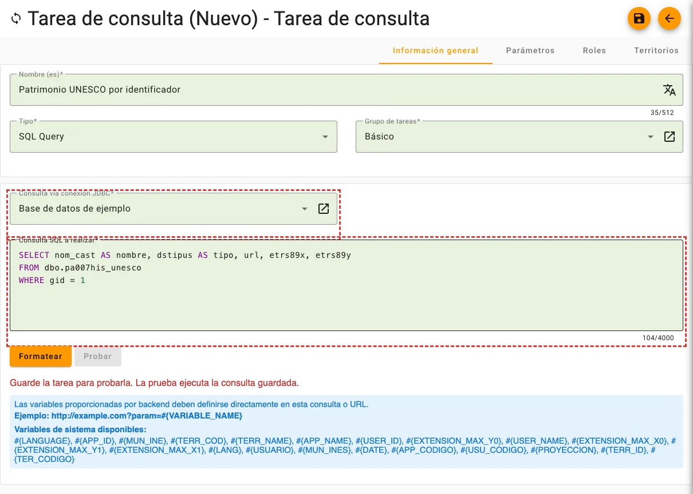
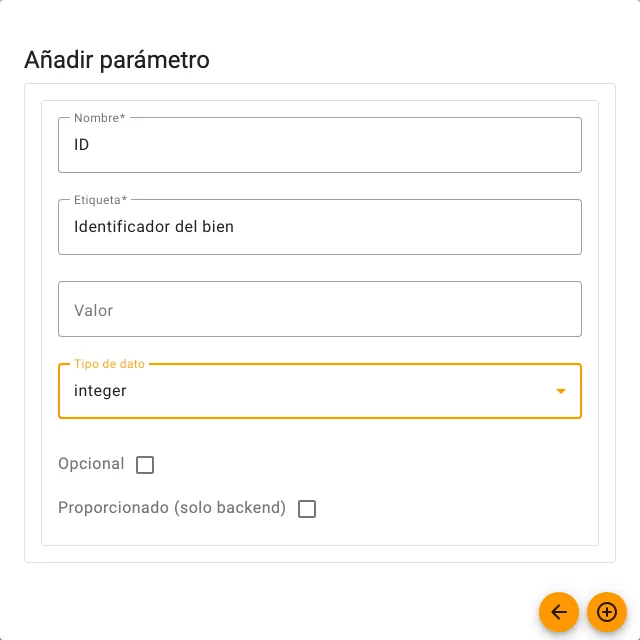

# Tareas de consulta

Las tareas de consulta están diseñadas para realizar distintos tipos de consultas sobre fuentes de datos, tales como bases de datos, cartografía, documentos, etc., y obtener información que posteriormente será utilizada en otras tareas.

Para crear o editar una consulta se dispone del siguiente formulario, con los campos que configuran una consulta:

{ loading=lazy }

- **Nombre**: nombre que identificará la tarea. No tiene ninguna otra utilidad aparte de la propia identificación del elemento.
- **Tipo**: se debe seleccionar un tipo de consulta. En función del tipo de consulta elegido, será necesario configurar la consulta de manera diferente. Más adelante se explica cómo definir cada tipo de consulta.
- **Grupo de tareas**: permite seleccionar un [grupo de tareas](../grupos-de-tareas.md) en el que clasificar la tarea que se está creando. Este grupo tiene únicamente una finalidad organizativa para ordenar las tareas creadas y no tiene ninguna implicación en su funcionamiento.

## Tipos de consulta

Existen varios tipos de tareas de consulta, y cada uno de ellos requiere configuraciones específicas. A continuación se describen los distintos tipos de consulta y la forma de definir cada uno de ellos.

### Consulta cartográfica (Cartography query)

!!! info "En preparación"
    Este apartado todavía no está documentado.

### Enlace externo (External link)

!!! info "En preparación"
    Este apartado todavía no está documentado.

### Consulta SQL (SQL query)

La consulta SQL permite realizar una consulta a una base de datos utilizando SQL y obtener los resultados.

Estos resultados serán utilizados posteriormente por otras tareas y no generan una salida directa desde esta tarea.

Para definir una consulta SQL es necesario seleccionar previamente la conexión que se utilizará para acceder a la base de datos en la que se encuentran las tablas utilizadas por la consulta SQL.

{ loading=lazy }

*Ejemplo de conexión y de consulta SQL.*

Para obtener información sobre cómo crear conexiones, consulte el apartado [Conexiones](../conexiones.md).

Para realizar una consulta SQL, se recomienda probar primero la consulta directamente en la base de datos (si se dispone de acceso a ella) para comprobar que devuelve resultados. Posteriormente, la sentencia SQL puede copiarse en la tarea de SITMUN 3.

#### Parámetros en las consultas SQL

Las consultas SQL admiten parámetros. Por ejemplo, en la consulta que se muestra en la captura de pantalla, es posible que se desee generar la consulta a partir de un identificador que no sea fijo, sino de un parámetro que se quiera pasar a la consulta.

Para crear un parámetro en una consulta, debe procederse de la siguiente manera.

En primer lugar, cree el nuevo parámetro desde la pestaña **Parámetros** del formulario y, mediante el icono **+**, añada un nuevo parámetro:

{ loading=lazy }

Al crear un nuevo parámetro aparecerá el siguiente formulario:

{ loading=lazy }

- **Nombre**: es el texto que se utilizará dentro de la consulta SQL para hacer uso de este parámetro.
- **Etiqueta**: es el nombre que se utilizará para identificar el parámetro cuando se requiera en otras configuraciones.
- **Valor**: valor por defecto, si así se desea. Es posible dejarlo en blanco si no se quiere proporcionar ningún valor por defecto.
- **Tipo**: seleccione *Query parameter*, ya que se trata de un parámetro que se insertará en una consulta (*query*).

Si el parámetro es obligatorio, marque la casilla correspondiente. En nuestro caso se marca como obligatorio, ya que la consulta no podría ejecutarse correctamente sin este parámetro.

Ahora el parámetro ya está definido, pero aún es necesario indicar cómo utilizarlo dentro de la consulta SQL. Para ello, se debe modificar la consulta SQL utilizando la siguiente sintaxis:

```text
${nombre_parametro}
```

Veámoslo con un ejemplo:

{ loading=lazy }

!!! note "Nota"
    Si el nombre del parámetro utilizado en la consulta SQL no coincide con el nombre definido en la configuración del parámetro, la opción de guardar la tarea se deshabilitará.

Además de los parámetros definidos por el usuario, también es posible utilizar en la consulta las variables de sistema, que son constantes proporcionadas por la aplicación. Para conocer qué variables de sistema están disponibles, consulte el [Anexo I: Variables de sistema](../variables-sistema.md).

La sintaxis para utilizar variables de sistema es ligeramente diferente a la de los parámetros de consulta:

```text
#{APP_ID}
```

Por último, es necesario **asignar los roles y territorios** a la consulta SQL para determinar qué usuarios tendrán visibilidad sobre ella y podrán utilizarla.

### Consulta Web API (Web API query)

!!! info "En preparación"
    Este apartado todavía no está documentado.

### Consulta Web API sin proxy (Web API query (No Proxy))

!!! info "En preparación"
    Este apartado todavía no está documentado.
