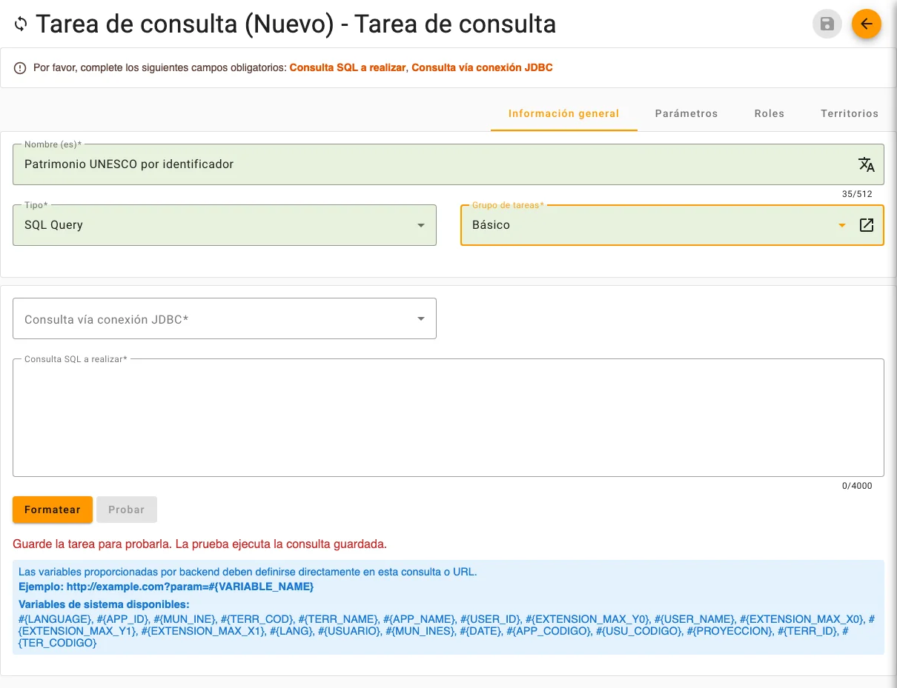
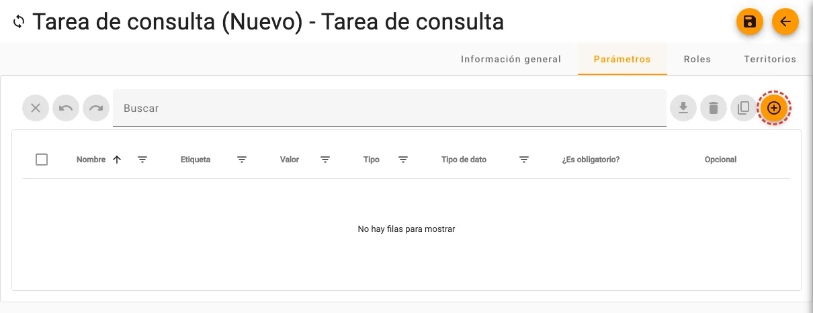
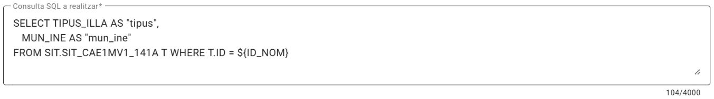

# Tareas de consulta

Las tareas de consulta están diseñadas para realizar distintos tipos de consultas sobre fuentes de datos, tales como bases de datos, cartografía, documentos, etc., y obtener información que posteriormente será utilizada en otras tareas.

Para crear o editar una consulta se dispone del siguiente formulario, con los campos que configuran una consulta:

{ loading=lazy }

- **Nombre**: nombre que identificará la tarea. No tiene ninguna otra utilidad aparte de la propia identificación del elemento.
- **Tipo**: se debe seleccionar un tipo de consulta. El desplegable toma los nombres de la tabla de traducciones, y en castellano tres tipos aparecen en inglés (`SQL Query`, `Web API Query` y `Cartography Query`). Los apartados siguientes indican entre paréntesis el nombre en inglés. El tipo no se puede cambiar después de crear la tarea. En función del tipo de consulta elegido, será necesario configurar la consulta de manera diferente. Más adelante se explica cómo definir cada tipo de consulta.
- **Grupo de tareas**: permite seleccionar un [grupo de tareas](../grupos-de-tareas.md) en el que clasificar la tarea que se está creando. Este grupo tiene únicamente una finalidad organizativa para ordenar las tareas creadas y no tiene ninguna implicación en su funcionamiento.

## Tipos de consulta

Existen varios tipos de tareas de consulta, y cada uno de ellos requiere configuraciones específicas. A continuación se describen los distintos tipos de consulta y la forma de definir cada uno de ellos.

### Consulta cartográfica (Cartography query)

!!! info "En preparación"
    Este apartado todavía no está documentado.

### Enlace externo (External link)

!!! info "En preparación"
    Este apartado todavía no está documentado.

### Consulta SQL (SQL query)

La consulta SQL permite realizar una consulta a una base de datos utilizando SQL y obtener los resultados.

Estos resultados serán utilizados posteriormente por otras tareas y no generan una salida directa desde esta tarea.

Para definir una consulta SQL es necesario seleccionar previamente la conexión que se utilizará para acceder a la base de datos en la que se encuentran las tablas utilizadas por la consulta SQL.

{ loading=lazy }

*Ejemplo de conexión y de consulta SQL.*

Cómo crear conexiones se explica en el apartado [Conexiones](../conexiones.md).

!!! warning "SITMUN 1.3.0: error 401 en el proxy con algunos usuarios"
    Un usuario con fecha de último cambio de contraseña registrada recibe un error 401 en todas las capas y tareas que el visor pide a través de SITMUN Proxy Middleware, como estas consultas y los localizadores. Es el caso del usuario `admin` cuya contraseña se creó en el primer acceso (o con `SITMUN_BOOTSTRAP_ADMIN_PASSWORD`) y de cualquier usuario que la haya restablecido con la recuperación de contraseña; cambiar la contraseña desde el formulario de usuarios no registra esa fecha.
    No hay solución en la configuración. No se ven afectados el usuario público ni las capas que el visor carga directamente. Más detalles en [la API de Proxy](../../../../que-es-sitmun/plataforma/arquitectura/api.md#problema-token-proxy-1-3-0) y en [sitmun/sitmun#387](https://github.com/sitmun/sitmun/issues/387).

Los resultados de una consulta SQL tienen límites: como máximo 1000 filas (las siguientes se descartan) y 60 segundos de ejecución. Se pueden cambiar en el backend con las propiedades `sitmun.jdbc.max-rows` y `sitmun.jdbc.query-timeout-seconds`.

Para realizar una consulta SQL, se recomienda probar primero la consulta directamente en la base de datos (si se dispone de acceso a ella) para comprobar que devuelve resultados. Posteriormente, la sentencia SQL puede copiarse en la tarea de SITMUN 3.

#### Parámetros en las consultas SQL

Las consultas SQL admiten parámetros. Por ejemplo, en la consulta que se muestra en la captura de pantalla, puede interesar generar la consulta a partir de un identificador que no sea fijo, sino de un parámetro que se quiera pasar a la consulta.

Para crear un parámetro en una consulta, se procede de la siguiente manera:

En primer lugar, en la pestaña **Parámetros** del formulario se añade un nuevo parámetro con el icono **+**:

{ loading=lazy }

Al crear un nuevo parámetro aparecerá el siguiente formulario:

{ loading=lazy }

- **Nombre**: es el texto que se utilizará dentro de la consulta SQL para hacer uso de este parámetro.
- **Etiqueta**: es el nombre que se utilizará para identificar el parámetro cuando se requiera en otras configuraciones (por ejemplo, en el mapeo de parámetros de una [tarea MIA](mas-informacion-avanzada.md)).
- **Valor**: valor por defecto, si así se desea. Es posible dejarlo en blanco si no se quiere proporcionar ningún valor por defecto.
- **Tipo de dato**: tipo del valor (`string`, `integer`, `number`, `date`, `timestamp` o `boolean`). El valor se enlaza a la consulta con este tipo.
- **Opcional**: se marca solo si la consulta puede ejecutarse sin este parámetro. En el ejemplo no se marca, ya que la consulta no podría ejecutarse correctamente sin él.
- **Proporcionado (solo backend)**: el valor no lo envía el cliente, sino que lo aporta el propio backend.

En el ejemplo, el parámetro se llama `ID`, con la etiqueta «Identificador del bien» y el tipo `integer`.

Ahora el parámetro ya está definido, pero aún es necesario indicar cómo utilizarlo dentro de la consulta SQL. Para ello, se debe modificar la consulta SQL utilizando la siguiente sintaxis:

```text
${nombre_parametro}
```

Por ejemplo:

{ loading=lazy }

!!! note "Nota"
    Si el nombre del parámetro utilizado en la consulta SQL no coincide con el nombre definido en la configuración del parámetro, la opción de guardar la tarea se deshabilitará. Las demás reglas de la consulta (por ejemplo, un parámetro declarado que no se usa, varias sentencias separadas por `;` o un parámetro dentro de una cadena) bloquean el botón **Probar** con un aviso, y el backend rechaza la tarea al guardarla.

Además de los parámetros definidos por el usuario, también es posible utilizar en la consulta las variables de sistema, que son constantes proporcionadas por la aplicación. Las variables de sistema disponibles están en la página [Variables de sistema](../variables-sistema.md).

La sintaxis para utilizar variables de sistema es ligeramente diferente a la de los parámetros de consulta:

```text
#{APP_ID}
```

!!! warning "Reglas de las consultas SQL"
    - La consulta debe ser una única sentencia `SELECT`: no se admiten `WITH`, `;` ni comentarios al final.
    - Los parámetros `${…}` y las variables de sistema `#{…}` se sustituyen como **valores tipados**, nunca como texto.
      Por eso solo pueden ocupar el lugar de un valor completo: no sirven para nombres de tabla o de columna,
      ni pueden ir dentro de una cadena más larga (por ejemplo `'%${nombre}%'`).
    - Todos los parámetros usados deben estar definidos en la pestaña **Parámetros**, y todos los definidos deben usarse.
    - El botón **Probar** ejecuta la consulta guardada y muestra la SQL resultante y los valores enlazados.

Por último, es necesario **asignar los roles y territorios** a la consulta SQL para determinar qué usuarios tendrán visibilidad sobre ella y podrán utilizarla. Esto también se aplica cuando la consulta se usa en una [tarea MIA](mas-informacion-avanzada.md) o en una [plantilla](plantillas.md): si no tiene el rol y el territorio de la aplicación, el visor muestra «Sin datos» en su lugar (si está incluida directamente en el MIA) o la plantilla sin sus datos.

### Consulta Web API (Web API query)

!!! info "En preparación"
    Este apartado todavía no está documentado.

### Consulta Web API sin proxy (Web API query, no proxy) { #consulta-web-api-sin-proxy-web-api-query-no-proxy }

!!! info "En preparación"
    Este apartado todavía no está documentado.

### Consulta de recurso (resource-query)

!!! info "En preparación"
    Este apartado todavía no está documentado.
