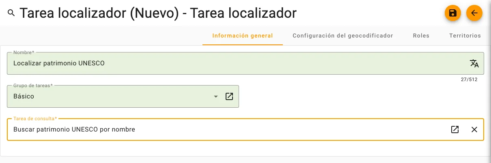
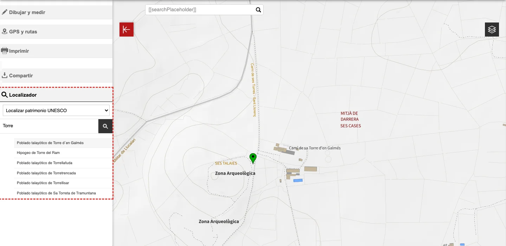

# Tarea de localizador

La tarea de localizador tiene la finalidad de ubicar un elemento en el mapa del visor.

Este tipo de tarea depende de tener una [consulta](consulta.md) enlazada.

Para crear un nuevo localizador, en primer lugar se deben definir los elementos identificadores y de organización interna dentro del administrador, indicando el nombre y el grupo de tareas del que formará parte. Estos datos se encuentran en **Información general**: el nombre puede tener cualquier valor descriptivo, mientras que el grupo de tareas ayuda a agruparlas y localizarlas internamente. El [grupo de tareas](../grupos-de-tareas.md) se debe haber creado con anterioridad.

{ loading=lazy }

La configuración del localizador empieza por vincular la consulta creada antes en el apartado de consultas. Esta consulta debe devolver como mínimo los parámetros de localización X e Y, o longitud y latitud, que servirán para localizar un punto en el mapa. Complementariamente, puede devolver otros parámetros identificativos que los usuarios puedan interpretar más fácilmente.

!!! warning "La consulta debe tener un parámetro `text`"
    El visor envía el texto que escribe el usuario en un parámetro llamado `text`, y una consulta que no lo declare
    responde con un error. En la pestaña **Parámetros** de la consulta se define un parámetro con el nombre `text`
    que se usa en la sentencia SQL. Como los parámetros se enlazan como valores completos, no pueden ir dentro de una cadena
    (`'%${text}%'`); para buscar un texto dentro de un campo se usa una función, por ejemplo:

    ```sql
    SELECT nom_cast AS nombre, etrs89x, etrs89y
    FROM dbo.pa007his_unesco
    WHERE strpos(lower(nom_cast), lower(${text})) > 0
    ```

En la pestaña **Configuración del geocodificador** se detalla cómo se quiere trabajar con estos elementos, indicando:

- **Campo de etiqueta**: campo devuelto por la consulta con un valor identificativo fácil de interpretar por el usuario. Por ejemplo: ID, nombre o referencia catastral.
- **Sistema de referencia**: sistema de referencia con código EPSG. Por ejemplo, EPSG:25831.
- **Campo de latitud** y **Campo de longitud**: coordenadas Y y X de cada resultado. Son opcionales: en su lugar se puede indicar un **Campo de geometría** con una geometría GeoJSON.

En el ejemplo, la consulta «Buscar patrimonio UNESCO por nombre» (la sentencia de arriba) devuelve `nombre` (campo de etiqueta) y las coordenadas `etrs89y` y `etrs89x`, en `EPSG:4326`.

{ loading=lazy }

Si la respuesta JSON de la consulta no es directamente la lista de resultados, **Ruta a los resultados** indica dónde está esa lista (por ejemplo `features` en un GeoJSON). Vacío significa la raíz de la respuesta.

Complementariamente se pueden activar las opciones de:

- Limitar resultados a la extensión del territorio.
- Activar parámetros del servicio.
- Añadir otros parámetros a considerar.

Además, están las pestañas **Roles** y **Territorios**, donde asignar los accesos que se deseen (ver [Roles](../roles.md) y [Territorios](../territorios.md)). El acceso se comprueba con los roles y territorios del localizador; la consulta enlazada no los necesita.

!!! bug "Error conocido de SITMUN 1.3.0: 401 en el proxy con algunos usuarios (sitmun/sitmun#387)"
    Un usuario con fecha de último cambio de contraseña registrada recibe un error 401 en todas las capas y tareas que el visor pide a través de SITMUN Proxy Middleware, como este localizador y su consulta. Es el caso del usuario `admin` cuya contraseña se creó en el primer acceso (o con `SITMUN_BOOTSTRAP_ADMIN_PASSWORD`) y de cualquier usuario que la haya restablecido con la recuperación de contraseña; cambiar la contraseña desde el formulario de usuarios no registra esa fecha.
    No hay solución en la configuración. No se ven afectados el usuario público ni las capas que el visor carga directamente. Más detalles en [la API de Proxy](../../../../que-es-sitmun/plataforma/arquitectura/api.md#problema-token-proxy-1-3-0) y en [sitmun/sitmun#387](https://github.com/sitmun/sitmun/issues/387).

En el visor, el localizador aparece en el panel de herramientas. El usuario elige el localizador, escribe el texto y, al pulsar un resultado, el mapa se centra en él:

{ loading=lazy }
