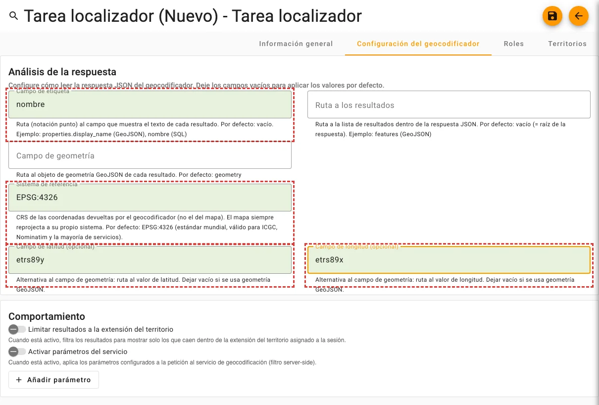

# Tarea de localizador

La tarea de localizador tiene la finalidad de ubicar un elemento en el mapa del visor.

Este tipo de tarea depende de tener una [consulta](consulta.md) enlazada.

Para crear un nuevo localizador, en primer lugar se deben definir los elementos identificadores y de organización interna dentro del administrador, indicando el nombre y el grupo de tareas del que formará parte. Estos datos se encuentran en **Información general**: el nombre puede tener cualquier valor descriptivo, mientras que el grupo de tareas ayuda a agruparlas y localizarlas internamente. El [grupo de tareas](../grupos-de-tareas.md) se debe haber creado con anterioridad.

{ loading=lazy }

La configuración de los elementos del localizador se debe empezar vinculando la consulta previamente creada en el apartado de consultas. Esta consulta debe devolver como mínimo los parámetros de localización X e Y, o longitud y latitud, que servirán para localizar un punto en el mapa. Complementariamente, puede devolver otros parámetros identificativos que los usuarios puedan interpretar más fácilmente.

En la pestaña **Configuración del geocodificador** se detalla cómo se quiere trabajar con estos elementos, indicando:

- **Campo de etiqueta**: campo devuelto por la consulta con un valor identificativo fácil de interpretar por el usuario. Por ejemplo: ID, nombre o referencia catastral.
- **Sistema de referencia**: sistema de referencia con código EPSG. Por ejemplo, EPSG:25831.
- **Campo de latitud**: coordenada de latitud o Y.
- **Campo de longitud**: coordenada de longitud o X.

{ loading=lazy }

Complementariamente se pueden activar las opciones de:

- Limitar resultados a la extensión del territorio.
- Activar parámetros del servicio.
- Añadir otros parámetros a considerar.

Además, están las pestañas **Roles** y **Territorios**, donde asignar los accesos que se deseen (ver [Roles](../roles.md) y [Territorios](../territorios.md)).
