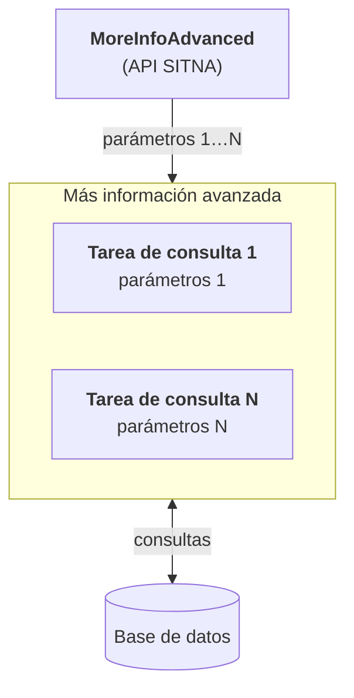
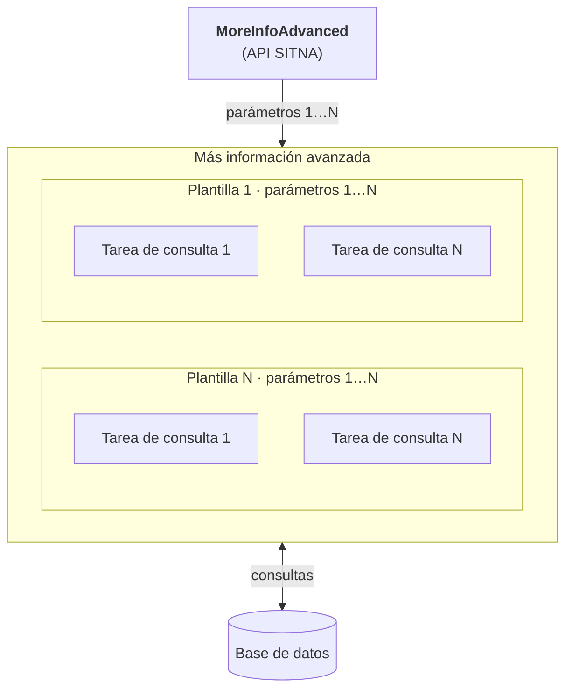
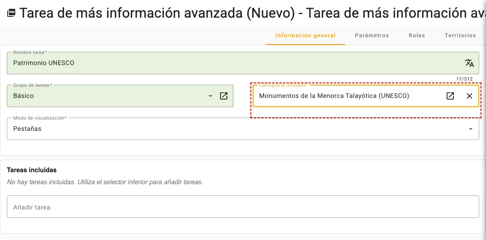
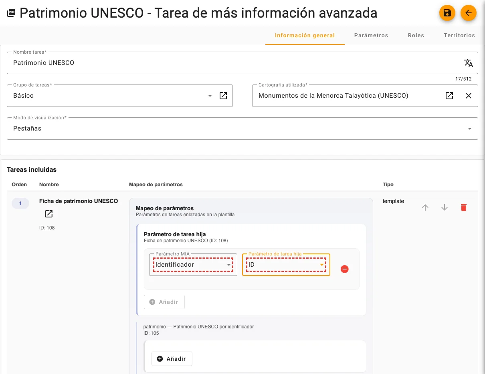

# Tarea de más información avanzada

Este tipo de tarea se basa en la tarea MoreInfoAdvanced de la API SITNA. Por tanto, para poder definir tareas de tipo MIA es necesario tener antes alguna tarea básica con el control de la API SITNA `sitna.moreInfoAdvanced` y que disponga de los roles y territorios correctamente asignados (ver [More Info Advanced](basicas/informacion.md#more-info-advanced)).

A continuación se describen los pasos para configurar correctamente un MIA. A diferencia de las tareas básicas, que esencialmente utilizan un componente de la API SITNA, la tarea MIA requiere varios componentes para ser configurada.

En resumen, la tarea MIA se compone de los siguientes elementos, según dos posibles configuraciones:

*En esta configuración, la tarea MIA es una extensión de la tarea MoreInfoAdvanced (API SITNA). Se compone de N consultas. La tarea MIA puede recibir parámetros y asociarlos con los de las consultas. En este caso no se define ninguna plantilla de visualización y los resultados se muestran con una plantilla básica en formato de tabla.*

Una segunda configuración sería la siguiente:

*En esta configuración, la tarea MIA es una extensión de la tarea MoreInfoAdvanced (API SITNA). Se compone de N plantillas de visualización. A su vez, cada plantilla de visualización se compone de N consultas. La tarea MIA puede recibir parámetros y asociarlos con los de las plantillas, y las plantillas, asociarlos con los de las consultas.*

Las tareas hijas de un MIA solo pueden ser consultas y plantillas. La **exportación documental** no es una tarea hija: es una tarea propia que se asigna, como cualquier otra, a roles y territorios. Si la aplicación la recibe, el visor añade el menú **Exportar** a los resultados de las plantillas en la ventana de los MIA, con una entrada por cada tarea de exportación (con su nombre, por ejemplo «Exportar PDF A4 vertical»), que genera un PDF de la plantilla. Un MIA cuyas tareas hijas son solo consultas no tiene ese menú.

## MIA sin plantillas de visualización

### Paso 1: información general

El primer paso es la configuración general de la tarea MIA. El nombre puede ser cualquier texto, y el grupo de tareas también, según el criterio del administrador para organizar las tareas.

El **Modo de visualización** (obligatorio) decide cómo muestra el visor los resultados de las tareas hijas: **Pestañas** (por defecto), una pestaña por resultado, o **Scroll**, uno debajo de otro.

La tarea MIA irá vinculada a una cartografía (cuadro **Cartografía utilizada**), que será donde se activará cuando el usuario haga clic en algún elemento de esa cartografía. Por tanto, en ese cuadro se añade la capa en la que se quiere que se active el MIA.

Esta capa debe tener activada la función de visualización de información alfanumérica, y el nodo del árbol, la opción **Consultable** de las opciones de visualización. Cómo dar estos dos pasos se explica en la información de la tarea básica [Feature Info](basicas/informacion.md#feature-info).

{ loading=lazy }

*En este ejemplo, el MIA se activará al hacer clic sobre un monumento de la capa «Monumentos de la Menorca Talayótica (UNESCO)», ya que es la cartografía seleccionada.*

Como siempre, será necesario asignar roles y territorios a esta tarea MIA según convenga. Las tareas que incluya el MIA (consultas y plantillas), y las consultas que usen esas plantillas, también deben tener el rol y el territorio de la aplicación. Si le faltan a una tarea incluida en el MIA, el visor muestra «Sin datos» en su lugar; si le faltan a una consulta de una plantilla, la plantilla se muestra sin sus datos.

### Paso 2: preparar las fuentes de información

El siguiente paso es preparar las fuentes de información de lo que se quiere visualizar en el MIA. Por ejemplo, si se quiere visualizar la ficha del monumento en el que se ha hecho clic, se necesita una tarea de consulta que la obtenga de la base de datos.

Para definir estas consultas se utiliza la [tarea de consulta](consulta.md) descrita anteriormente.

En el ejemplo se usa la consulta «Patrimonio UNESCO por identificador» del apartado [Consulta](consulta.md), que tiene como parámetro el identificador del bien (`ID`) y devuelve su nombre, su tipo y su web.

### Paso 3: vincular la fuente de información al MIA

Para vincular esta consulta al MIA se utiliza el campo **Añadir tarea** y se selecciona la consulta preparada:

{ loading=lazy }

Ahora hay que gestionar los parámetros. El objetivo es el siguiente:

1. Obtener el identificador del monumento en el que ha hecho clic el usuario. Esta información la proporciona el control de la API SITNA a través de GFI (GetFeatureInfo). Una forma de saber qué campos del GFI están disponibles es desactivar las tareas de información avanzada y dejar solo la tarea básica Feature Info; así se muestra el siguiente cuadro con los campos que provienen del GFI:

    { loading=lazy }

    En este caso, el campo que identifica el monumento es `gid`, el mismo valor que la consulta espera en `ID`.

2. Una vez que se sabe qué campos del GFI se pueden utilizar, es el momento de crear un parámetro que vincule uno de estos campos con un parámetro del MIA. Esto se hace mediante la pestaña **Parámetros** del menú superior.

    Hay dos campos que rellenar: en **Parámetro de tarea de consulta** se pone un nombre (en el ejemplo, «Identificador») y en **Campo**, el nombre del campo del GFI que se va a utilizar (`gid`).

    { loading=lazy }

3. Antes de seguir, **se guarda la tarea MIA**. En SITMUN 1.3.0 el mapeo solo ofrece los parámetros del MIA ya guardados
    ([sitmun/sitmun#373](https://github.com/sitmun/sitmun/issues/373)).

4. Ahora es necesario asociar el parámetro que se acaba de crear con el de la consulta que lo necesita. Esto se hace con la opción **Mapeo de parámetros** de las tareas incluidas en el MIA. Hay que asociar dos campos: **Parámetro MIA**, que es el nombre dado al parámetro en el paso anterior, y **Parámetro de tarea hija**, que es el parámetro definido en la consulta (aparece con su etiqueta, «Identificador del bien»).

    { loading=lazy }

Una vez configurado todo esto, al hacer clic en el visor sobre un elemento de la capa vinculada al MIA, se ejecutarán las consultas que contiene y se mostrarán los datos.

{ loading=lazy }

Como puede verse en la captura de pantalla, el resultado que se muestra en la ventana **Información avanzada** se visualiza con una tabla básica.

Si se quisiera dar un formato específico a esta tabla y personalizar la información visualizada, se hace con las plantillas, como se explica a continuación.

## MIA con plantillas de visualización

### Paso 1: información general

En este caso, el paso 1 de creación del MIA será igual que en el caso [sin plantillas de visualización](#paso-1-informacion-general).

### Paso 2: preparar las fuentes de información

Este paso también será igual que en el caso anterior: se debe disponer de una consulta que genere los resultados que se quieren visualizar.

### Paso 3: preparar una plantilla de visualización

Para visualizar los resultados de las consultas preparadas en el paso 2 se preparan plantillas de visualización. Cómo crearlas se explica en el apartado [Plantillas](plantillas.md).

### Paso 4: equivalencias de parámetros para utilizar en el MIA

Por último, es necesario establecer la equivalencia entre los parámetros definidos en el MIA y los parámetros definidos en la plantilla (en el ejemplo, «Identificador» → `ID`). Esto se hace con el mapeo de parámetros, tal y como muestra la captura de pantalla:

{ loading=lazy }

Al hacer clic en el visor en un monumento de la capa vinculada a este MIA, se ve el resultado:

{ loading=lazy }

*En la captura se puede ver cómo la visualización ya aplica el diseño definido en la plantilla de visualización.*
