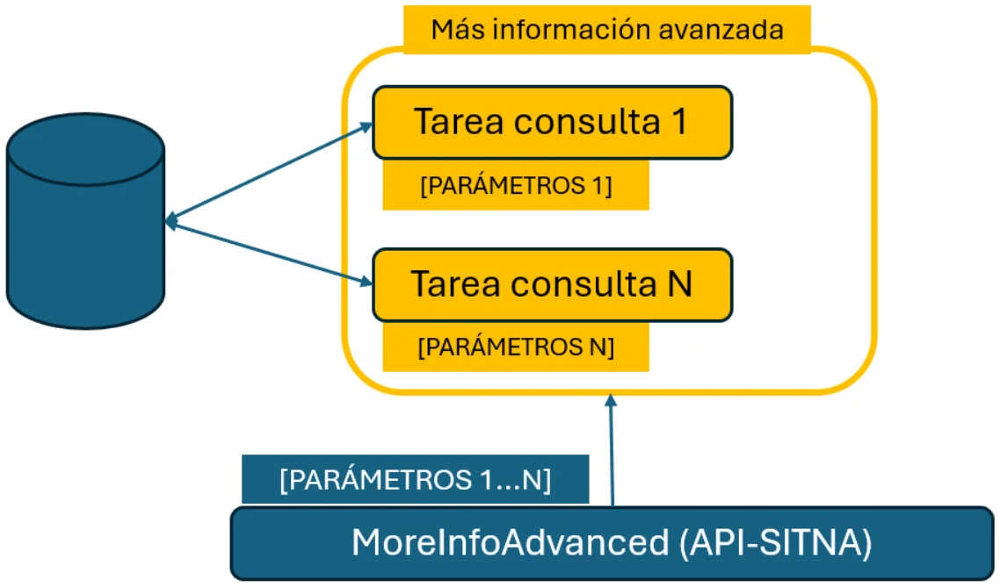
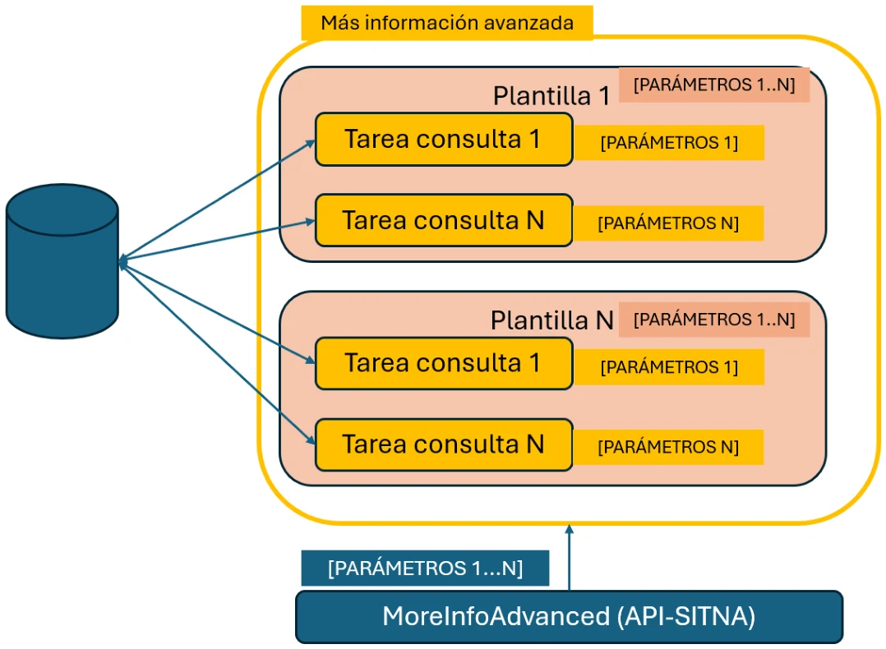
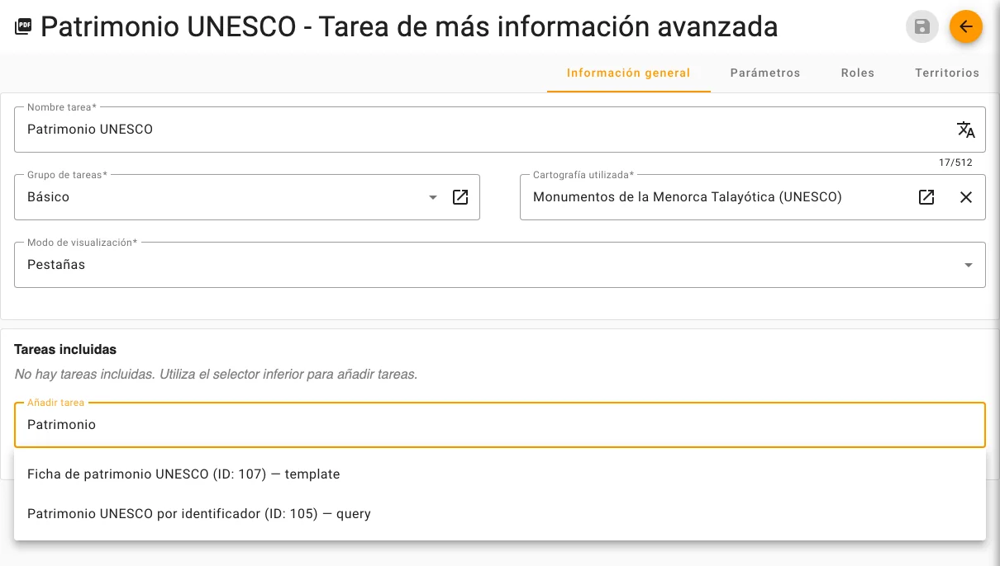
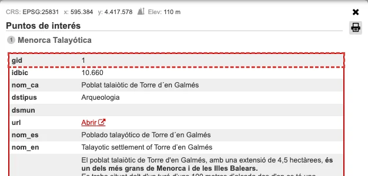
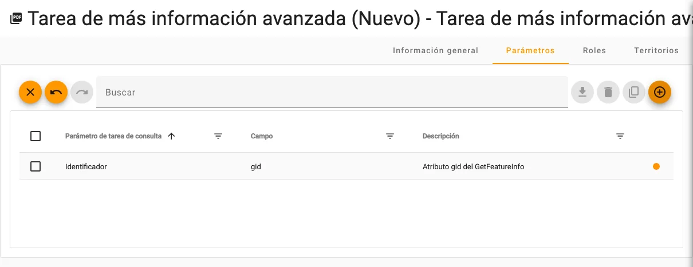
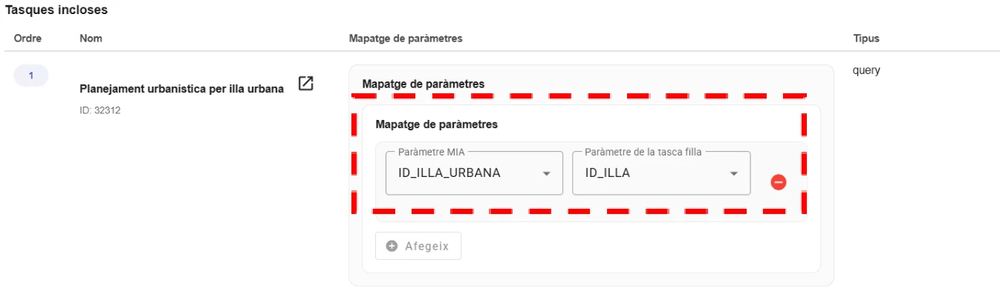
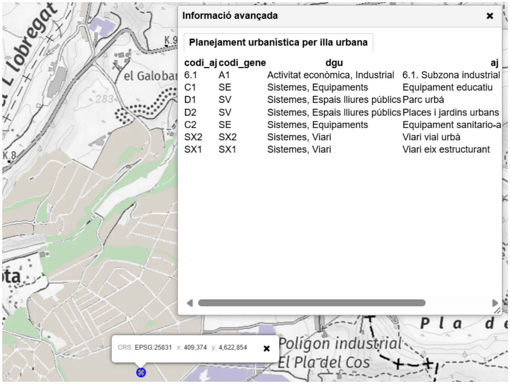
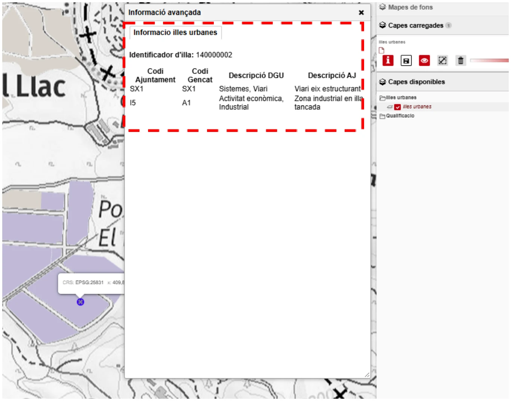

# Tarea de más información avanzada

Este tipo de tarea se basa en la tarea MoreInfoAdvanced de la API SITNA. Por tanto, para poder definir tareas de tipo MIA es necesario tener antes alguna tarea básica con el control de la API SITNA `sitna.moreInfoAdvanced` y que disponga de los roles y territorios correctamente asignados (ver [More Info Advanced](basicas/informacion.md#more-info-advanced)).

A continuación se describen los pasos para configurar correctamente un MIA. A diferencia de las tareas básicas, que esencialmente utilizan un componente de la API SITNA, la tarea MIA requiere varios componentes para ser configurada.

En resumen, la tarea MIA se compone de los siguientes elementos, según dos posibles configuraciones:

{ loading=lazy }

*En esta configuración, la tarea MIA es una extensión de la tarea MoreInfoAdvanced (API SITNA). Se compone de N consultas. La tarea MIA puede recibir parámetros y mapearlos hacia las consultas. En este caso no se define ninguna plantilla de visualización y los resultados se muestran con una plantilla básica en formato de tabla.*

Una segunda configuración sería la siguiente:

{ loading=lazy }

*En esta configuración, la tarea MIA es una extensión de la tarea MoreInfoAdvanced (API SITNA). Se compone de N plantillas de visualización. A su vez, cada plantilla de visualización se compone de N consultas. La tarea MIA puede recibir parámetros y mapearlos hacia las plantillas, y las plantillas, mapearlos hacia las consultas.*

## MIA sin plantillas de visualización

### Paso 1: información general

Lo primero que haremos es la configuración general de la tarea MIA. El nombre puede ser cualquier texto, y el grupo de tareas también, según el criterio del administrador para organizar las tareas.

La tarea MIA irá vinculada a una cartografía (cuadro **Cartografía utilizada**), que será donde se activará cuando el usuario haga clic en algún elemento de esa cartografía. Por tanto, en el apartado de cartografía añadiremos la capa donde queremos que se active el MIA.

Debe tenerse en cuenta que esta capa deberá tener activada la función de visualización de información alfanumérica, y el nodo del árbol deberá tener activada la opción **Consultable** de las opciones de visualización. Podemos ver cómo dar estos dos pasos en la información de la tarea básica [Feature Info](basicas/informacion.md#feature-info).

{ loading=lazy }

*En este ejemplo, el MIA se activará al hacer clic sobre un elemento de la capa CAE1M – Illes urbanes, ya que es la cartografía seleccionada.*

Como siempre, será necesario asignar roles y territorios a esta tarea MIA según convenga.

### Paso 2: preparar las fuentes de información

El siguiente paso es preparar las fuentes de información de lo que queremos visualizar en el MIA. Por ejemplo, si queremos visualizar el planeamiento urbanístico vinculado a la manzana urbana en la que se ha hecho clic, necesitaremos una tarea de consulta que haga esta consulta en la base de datos y devuelva unos resultados.

Para definir estas consultas utilizaremos la [tarea de consulta](consulta.md) descrita anteriormente.

En nuestro ejemplo supondremos que disponemos de una consulta con el nombre «Planeamiento urbanístico por manzana urbana», que tiene como parámetro el ID de la manzana urbana y devuelve el planeamiento urbanístico que la afecta.

### Paso 3: vincular la fuente de información al MIA

Para vincular esta consulta al MIA utilizaremos el campo **Añadir tarea** y seleccionaremos la consulta que hemos preparado:

{ loading=lazy }

Ahora hay que gestionar los parámetros. Nuestro objetivo es el siguiente:

1. Obtener el ID de la manzana urbana en la que ha hecho clic el usuario. Esta información la proporciona el control de la API SITNA a través de GFI (GetFeatureInfo). Una forma de saber qué campos del GFI están disponibles es desactivar las tareas de información avanzada y dejar solo la tarea básica Feature Info; así se muestra el siguiente cuadro con los campos que provienen del GFI:

    { width="339" loading=lazy }

    En este caso, los campos disponibles provenientes del GFI son `MUN_INE`, `TIPUS_ILLA` e `ID`.

2. Una vez que sabemos qué campos del GFI podemos utilizar, es el momento de crear un parámetro que vincule uno de estos campos con un parámetro del MIA. Esto lo haremos mediante la pestaña **Parámetros** del menú superior.

    Hay dos campos que rellenar: en **Parámetro de la tarea consulta** pondremos el nombre que queramos y en **Campo**, el nombre del campo del GFI que queremos utilizar.

    { loading=lazy }

3. Ahora será necesario mapear el parámetro que acabamos de crear hacia la consulta que lo necesita. Esto lo haremos con la opción **Mapeo de parámetros** de las tareas incluidas en el MIA. Hay que mapear dos campos: **Parámetro MIA**, que es el nombre que hemos puesto al parámetro en el paso anterior, y **Parámetro de la tarea hija**, que es el nombre del parámetro que hemos definido en la consulta.

    { loading=lazy }

Una vez configurado todo esto, si accedemos al visor y hacemos clic sobre un elemento de la capa que hemos vinculado al MIA, se ejecutarán las consultas que contiene y se mostrarán los datos.

{ loading=lazy }

Como puede verse en la captura de pantalla, el resultado que se muestra en la ventana **Información avanzada** se visualiza con una tabla básica.

Si se quisiera dar un formato específico a esta tabla y personalizar la información visualizada, lo haremos con las plantillas, como se explica a continuación.

## MIA con plantillas de visualización

### Paso 1: información general

En este caso, el paso 1 de creación del MIA será igual que en el caso [sin plantillas de visualización](#paso-1-informacion-general).

### Paso 2: preparar las fuentes de información

Este paso también será igual que en el caso anterior: deberemos disponer de una consulta que genere los resultados que se quieren visualizar.

### Paso 3: preparar una plantilla de visualización

Para visualizar los resultados de las consultas preparadas en el paso 2, prepararemos plantillas de visualización. Para ver cómo crearlas, consulte el apartado [Plantillas](plantillas.md).

### Paso 4: equivalencias de parámetros para utilizar en el MIA

Por último, es necesario establecer la equivalencia entre los parámetros definidos en el MIA y los parámetros definidos en la plantilla. Esto lo haremos con el mapeo de parámetros, tal y como muestra la captura de pantalla:

{ loading=lazy }

Si vamos al visor y hacemos la consulta del MIA en la capa de manzanas urbanas (que es la cartografía que hemos vinculado a este MIA), podemos ver el resultado:

{ loading=lazy }

*En la captura se puede ver cómo la visualización ya aplica el diseño definido en la plantilla de visualización.*
