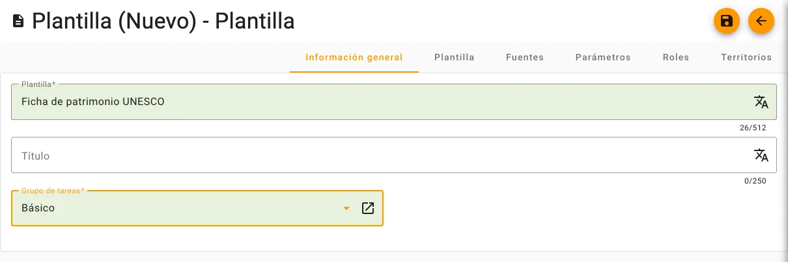
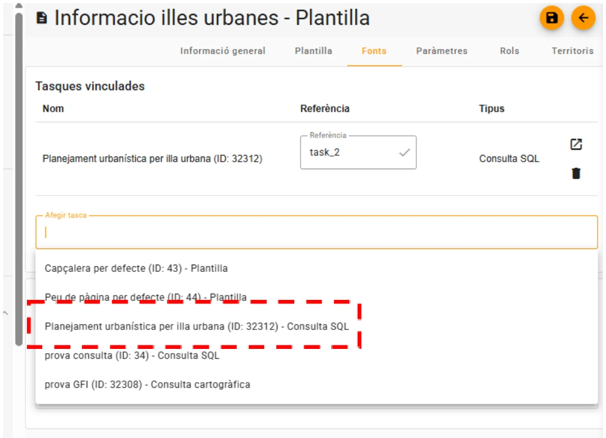
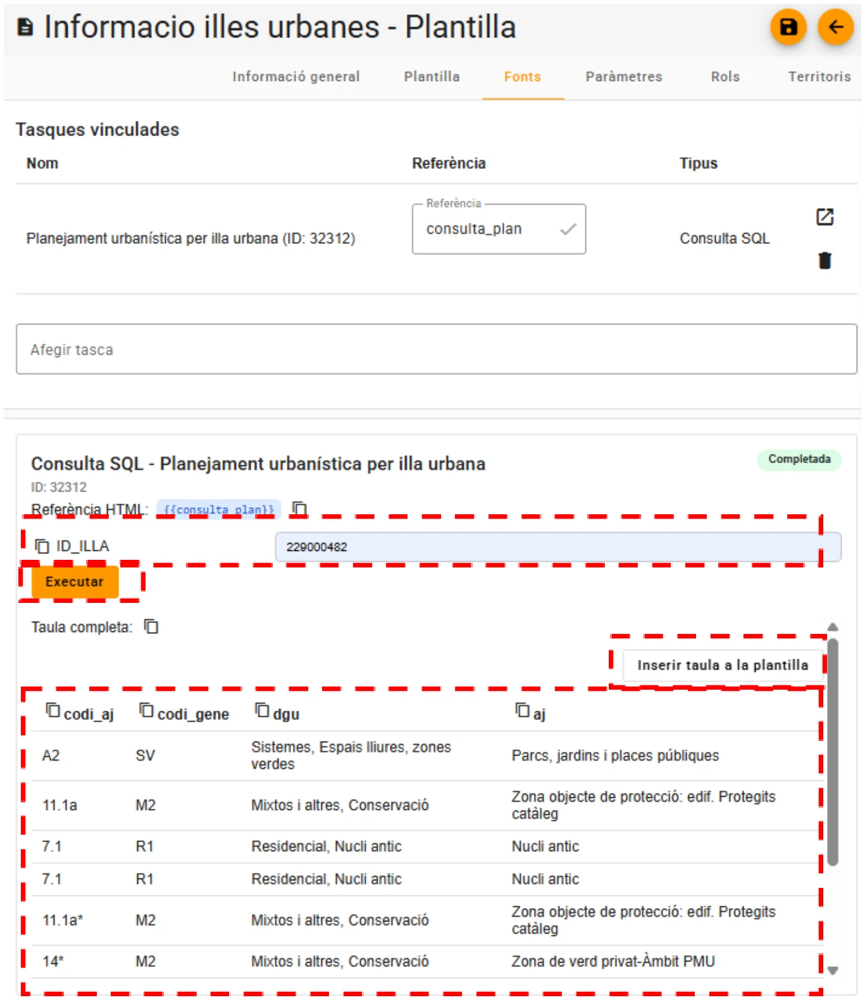

# Plantillas

Las plantillas tienen la finalidad de proporcionar una visualización más amigable de la información obtenida a partir de consultas a bases de datos u otras fuentes de información.

## Información general

En primer lugar se debe definir la **Información general**, indicando el nombre, el **Título** que muestra el visor y el grupo de tareas en el que se almacenará la plantilla. El nombre puede tener cualquier valor descriptivo, mientras que el grupo de tareas puede corresponder, por ejemplo, a un grupo denominado «Plantillas de visualización».

{ loading=lazy }

## Fuentes

A continuación definiremos las **Fuentes** de información de esta plantilla, es decir, los orígenes de los que se obtendrán los datos. Las fuentes de información pueden ser tareas de tipo [consulta](consulta.md) u otras plantillas.

Como ejemplo práctico configuraremos una fuente de tipo tarea de consulta, ya que es uno de los casos más habituales.

Usaremos la consulta SQL del apartado [Consulta](consulta.md), «Patrimonio UNESCO por identificador», que devuelve el nombre, el tipo y la web de un bien del patrimonio mundial a partir de su identificador (parámetro `ID`).

En el apartado **Fuentes** seleccionaremos dicha consulta. Una vez seleccionada, observaremos que es posible modificar la etiqueta que permitirá referenciar el resultado de la consulta; en el ejemplo la cambiamos a `patrimonio`. Además, podremos ejecutarla para verificar que genera el resultado esperado.

{ loading=lazy }

!!! note "Nota"
    En SITMUN 1.3.0 la lista **Añadir tarea** repite cada tarea con varios tipos
    ([sitmun/sitmun#372](https://github.com/sitmun/sitmun/issues/372)).
    Elija la entrada cuyo tipo coincide con el de la tarea, por ejemplo «Consulta SQL».

*1. Seleccionar la consulta.*

{ loading=lazy }

*2. Cambiar el nombre de la referencia de la consulta.*

{ loading=lazy }

*3. Probar la consulta y comprobar que genera resultados.*

Al ejecutar la consulta es posible definir los valores de los parámetros, en caso de que existan, con el objetivo de generar una consulta válida.

Si la consulta devuelve resultados, se recomienda insertar temporalmente la tabla resultante en la plantilla de visualización, con el fin de disponer de una referencia de cómo se mostrará la información una vez generada.

Cuando la fuente de datos funciona correctamente, pueden añadirse más fuentes hasta completar el conjunto de datos que se desea mostrar en la plantilla.

## Plantilla

A continuación se accede a la pestaña **Plantilla**, donde puede elaborarse el código HTML que permitirá visualizar el conjunto de datos. En la plantilla puede definirse el código HTML que mejor se adapte a los requisitos de diseño de la aplicación. No obstante, para poder mostrar los datos generados por las fuentes de información, es necesario respetar una determinada nomenclatura:

- Para recorrer todos los resultados devueltos por una fuente de datos, deberá utilizarse una estructura de tipo tabla de la siguiente forma:

    ```html
    <table data-sitmun-each="patrimonio.rows">
    </table>
    ```

    donde `patrimonio` es el nombre de referencia asignado a la fuente de datos y deberá adaptarse al valor correspondiente en cada caso.

- Para mostrar un campo concreto, se utilizará la siguiente notación:

    ```text
    {{alias_consulta}}
    ```

    donde `alias_consulta` es el alias que se ha asignado a cada campo en la consulta SQL. Esta forma corta solo funciona dentro de una tabla con `data-sitmun-each`; fuera de ella se escribe con la referencia de la fuente, por ejemplo `{{patrimonio.nombre}}`.

El siguiente ejemplo muestra una tabla sencilla con todos los resultados de la fuente `patrimonio`:

```html
<h3>Patrimonio de la Humanidad</h3>
<table data-sitmun-each="patrimonio.rows">
  <tbody>
    <tr>
      <th>Nombre</th>
      <th>Tipo</th>
      <th>Más información</th>
    </tr>
    <tr>
      <td>{{nombre}}</td>
      <td>{{tipo}}</td>
      <td><a href="{{url}}">{{url}}</a></td>
    </tr>
  </tbody>
</table>
```

### Marcadores disponibles

El formulario de la plantilla resume los marcadores que se pueden usar. Cada fuente de información tiene una **Referencia** (por ejemplo `patrimonio`):

| Marcador | Contenido |
| --- | --- |
| `{{referencia.campo}}` | Un campo de la respuesta de la fuente. |
| `{{referencia.$param}}` | Un parámetro enviado a la fuente, con su nombre exacto (por ejemplo `{{patrimonio.$ID}}` para el parámetro `ID`; `{{patrimonio.$id}}` no funciona). |
| `{{referencia.url}}` | La dirección de una fuente de tipo URL o Recurso. |
| `{{referencia.html}}` | El HTML de una plantilla anidada. |
| `{{#APP_NAME}}` | Una [variable de sistema](../variables-sistema.md), escrita con `{{#…}}` en lugar de `#{…}`. |

Dentro de una tabla con `data-sitmun-each`, los campos de cada fila se escriben sin la referencia, como `{{nombre}}` en el ejemplo anterior.

El editor también permite:

- envolver un texto en etiquetas `<t>` para que se traduzca según el idioma del visor (no se pueden anidar);
- marcar un bloque como cabecera o pie de página del PDF, normal o a sangre, para la [exportación documental](mas-informacion-avanzada.md);
- insertar un PDF en la plantilla.

Por seguridad, la plantilla no admite las etiquetas `<script>` ni `<style>` (usa estilos en el atributo `style`), ni atributos JavaScript como `onclick` o direcciones `javascript:`.

Para facilitar el diseño de la plantilla, se dispone tanto de un editor visual como de un editor HTML.

{ loading=lazy }

{ loading=lazy }

## Parámetros

Hasta ahora se han definido la información general, las fuentes de información y la plantilla de visualización. Solo queda definir la gestión de los parámetros, en caso de que la plantilla los requiera.

En el ejemplo se necesita el identificador del bien; por lo tanto, es necesario definir dicho parámetro. Para ello se utiliza la pestaña **Parámetros**.

El parámetro que se defina en la plantilla debe tener el mismo nombre que el parámetro asociado a la fuente de datos. En nuestro caso, la fuente de datos es una consulta que dispone de un parámetro denominado `ID`; por consiguiente, en la plantilla también deberá definirse un parámetro con el nombre `ID` (con un valor de prueba, `1`, que se usa al probar la plantilla).

{ loading=lazy }

*Definición del parámetro de la plantilla con el mismo nombre que el parámetro de la fuente de datos.*

Por último, como en cualquier tarea, asigne **roles y territorios** a la plantilla en sus pestañas. Una vez alcanzado este punto, la plantilla ya estará preparada para ser utilizada por otras tareas como marco de visualización de datos.

Para ver un ejemplo de utilización, puede consultar el apartado [Tarea de más información avanzada: MIA con plantillas de visualización](mas-informacion-avanzada.md#mia-con-plantillas-de-visualizacion).
