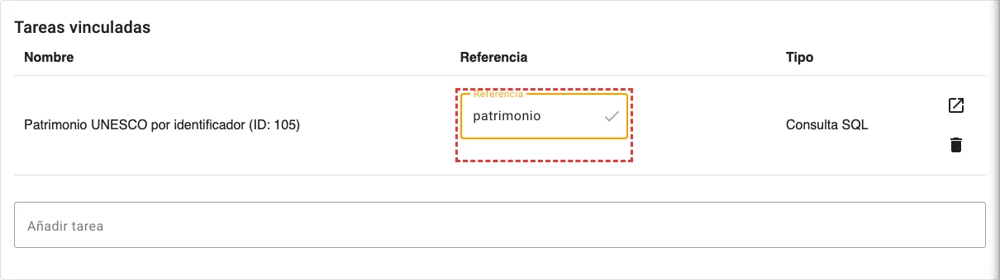
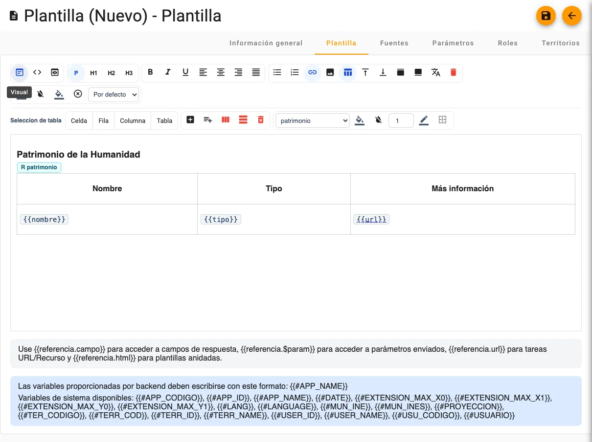
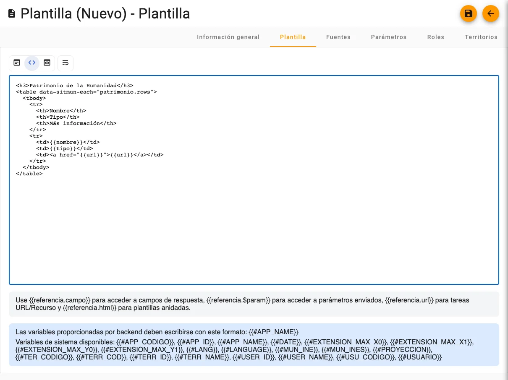
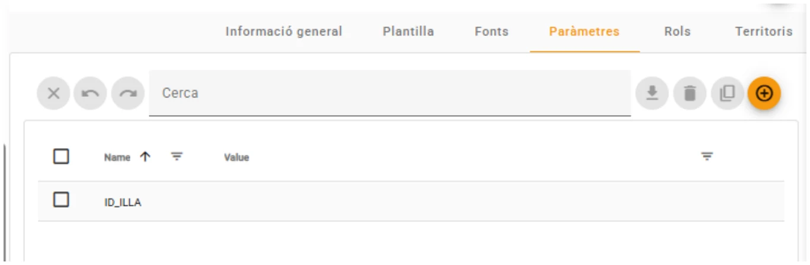

# Plantillas

Las plantillas tienen la finalidad de proporcionar una visualización más amigable de la información obtenida a partir de consultas a bases de datos u otras fuentes de información.

## Información general

En primer lugar se debe definir la **Información general**, indicando el nombre y el grupo de tareas en el que se almacenará la plantilla. El nombre puede tener cualquier valor descriptivo, mientras que el grupo de tareas puede corresponder, por ejemplo, a un grupo denominado «Plantillas de visualización».

{ loading=lazy }

## Fuentes

A continuación definiremos las **Fuentes** de información de esta plantilla, es decir, los orígenes de los que se obtendrán los datos. Las fuentes de información pueden ser tareas de tipo [consulta](consulta.md) u otras plantillas.

Como ejemplo práctico configuraremos una fuente de tipo tarea de consulta, ya que es uno de los casos más habituales.

Supongamos que disponemos de una tarea de tipo consulta SQL que obtiene el planeamiento urbanístico asociado a una manzana urbana concreta (recibida como parámetro). Esta consulta, previamente definida, tiene por nombre «Planeamiento urbanístico por manzana urbana».

En el apartado **Fuentes** seleccionaremos dicha consulta. Una vez seleccionada, observaremos que es posible modificar la etiqueta que permitirá referenciar el resultado de la consulta. Además, podremos ejecutarla para verificar que genera el resultado esperado.

{ width="504" loading=lazy }

*1. Seleccionar la consulta.*

{ width="500" loading=lazy }

*2. Cambiar el nombre de la referencia de la consulta.*

{ loading=lazy }

*3. Probar la consulta y comprobar que genera resultados.*

Al ejecutar la consulta es posible definir los valores de los parámetros, en caso de que existan, con el objetivo de generar una consulta válida.

Si la consulta devuelve resultados, se recomienda insertar temporalmente la tabla resultante en la plantilla de visualización, con el fin de disponer de una referencia de cómo se mostrará la información una vez generada.

Cuando la fuente de datos funciona correctamente, pueden añadirse más fuentes hasta completar el conjunto de datos que se desea mostrar en la plantilla.

## Plantilla

A continuación accedemos a la pestaña **Plantilla**, donde puede elaborarse el código HTML que permitirá visualizar el conjunto de datos. En la plantilla puede definirse el código HTML que mejor se adapte a los requisitos de diseño de la aplicación. No obstante, para poder mostrar los datos generados por las fuentes de información, es necesario respetar una determinada nomenclatura:

- Para recorrer todos los resultados devueltos por una fuente de datos, deberá utilizarse una estructura de tipo tabla de la siguiente forma:

    ```html
    <table data-sitmun-each="consulta_plan.rows">
    </table>
    ```

    donde `consulta_plan` es el nombre de referencia asignado a la fuente de datos y deberá adaptarse al valor correspondiente en cada caso.

- Para mostrar un campo concreto, se utilizará la siguiente notación:

    ```text
    {{alias_consulta}}
    ```

    donde `alias_consulta` es el alias que se ha asignado a cada campo en la consulta SQL.

El siguiente ejemplo muestra cómo sería la visualización de una tabla sencilla con todos los resultados generados por la fuente «Planejament urbanístic per illa»:

```html
<table data-sitmun-each="consulta_plan.rows">
  <tbody>
    <tr>
      <th>Codi Aj.</th>
      <th>Codi Gencat</th>
      <th>Descripció DGU</th>
      <th>Descripció AJ</th>
    </tr>
    <tr>
      <td>{{codi_aj}}</td>
      <td>{{codi_gene}}</td>
      <td>{{dgu}}</td>
      <td>{{aj}}</td>
    </tr>
  </tbody>
</table>
```

Para facilitar el diseño de la plantilla, se dispone tanto de un editor visual como de un editor HTML.

{ loading=lazy }

{ width="400" loading=lazy }

## Parámetros

Hasta ahora hemos definido la información general, las fuentes de información y la plantilla de visualización. Solo queda definir la gestión de los parámetros, en caso de que la plantilla los requiera.

En el ejemplo utilizado necesitamos el identificador de la manzana urbana; por lo tanto, es necesario definir dicho parámetro. Para ello utilizaremos la pestaña **Parámetros**.

El parámetro que se defina en la plantilla debe tener el mismo nombre que el parámetro asociado a la fuente de datos. En nuestro caso, la fuente de datos es una consulta que dispone de un parámetro denominado `ID_ILLA`; por consiguiente, en la plantilla también deberá definirse un parámetro con el nombre `ID_ILLA`.

{ loading=lazy }

*Definición del parámetro de la plantilla con el mismo nombre que el parámetro de la fuente de datos.*

Una vez alcanzado este punto, la plantilla ya estará preparada para ser utilizada por otras tareas como marco de visualización de datos.

Para ver un ejemplo de utilización, puede consultar el apartado [Tarea de más información avanzada: MIA con plantillas de visualización](mas-informacion-avanzada.md#mia-con-plantillas-de-visualizacion).
